# artmind Capability Map

A feature baseline distilled from **artmind as the reference implementation**. Each leaf
feature is stated implementation-agnostically, with the artmind command (or module) that
anchors it. When evaluating another implementation, score every leaf on the scale below —
this doc is both the *input baseline* (what a knowledge system should offer) and the
*test checklist* (what to verify it actually does).

Every feature carries a stable hierarchical id (`4.5`, `6.2.3`) — reference rows by id
when reviewing or scoring.

**Scoring scale** (per leaf feature):

| Level | Meaning |
|---|---|
| **none** | The capability is absent. |
| **partial** | Present in reduced form — e.g. has vector search but no rank fusion, has snapshots but not unified ones. Note the gap. |
| **full** | Matches or exceeds the reference behaviour described in the feature statement. |

**The `✓` column** marks rows whose statement has been verified against the reference
implementation's source. A blank means the row is still first-draft, derived from command
surface rather than code. Each capability's **Grounding notes** carry what that
verification pass surfaced: why the feature exists in the shape it does, and what to
actually test when scoring another implementation.

## Overview

```mermaid
mindmap
  root((artmind<br/>capabilities))
    1 Domain & Ontology Management
      Schema definition
      Domain hierarchy
      Extraction prompts
      Harmonization
      Temporal semantics
      Abstract parent domains
      Authoring assistance
      Chunks-only domains
      Document entity folding
      Dynamic domain guard
      Property alias normalization
    2 Document Ingestion
      Sync & async intake
      Job management
      Dedup & staging
      Structured refresh modes
      Format conversion & image description
      Pending change detection & dry run
      Re-extraction with loss guard
      Document-level context & outline
      Collision-resistant document identity
      In-process DOCX conversion
      Conversion fidelity & page repair
      Temporal retiming
      Staging extraction loss audit
    3 Observations
      LLM extraction
      Anti-drift name resolution
      Observation write
      External KG import
      Portable bundle exchange
      Entity embeddings
      Relationship-type integrity
      Passage discretization & embeddings
      Schema-guided summarization
      Extraction diagnostic isolation
    4 The Projection & Curation
      Deterministic rebuild
      Same-as identity curation
      Two-shape conflict adjudication
      Curation review queue
      Description synthesis
      Document supersession
      Deterministic entity lifecycle
      Projection status & drift
      Supersession reversal
      Affected-key rebuild scoping
    5 Structured Data Store
      Table registry & schema
      Raw SQL guarantee
      Mappings & grain
      Graph bridge & catalogue
      Backup / restore
      Diffable Git text export
      External SQL delegation
      Table metadata lifecycle
    6 Knowledge Retrieval
      Graph introspection
      Progressive corpus orientation
      Domain catalogue
      Knowledge asset discovery
      Templated patterns
      Hybrid semantic search
      Corpus survey
      Targeted survey passage search
      NL query generation
      Evidence & provenance
      Temporal & conflict views
      Document version history
      Cross-store resolution
      Cross-cutting behaviours
      Budgeted result pagination
      Out-of-scope sibling detection
      Query result signposting
      Bounded brief presentation
    7 Document Management
      Registry & lifecycle
    8 Knowledge Updates
      Draft / confirm writes
      Ambiguity resolution
      Retraction
      Conversational provenance
      Identity convergence
      Audit & export
    9 Sessions & State
      Graph snapshots
      Unified snapshots
    10 Platform & Surfaces
      Scaffolding & setup
      Warm query daemon
      Chat UI
      Admin console
      Conversation persistence
      CLI convention enforcement
      Vault-aware daemon proxy
      Curation workbench & editor commands
      Interactive Cytoscape visualization
      Cypher exploration & deep-linking
      Generational catalogue caching
    11 Agent Integration
      Skills contract
      Dual agent backends
      Subagent trace propagation
    12 Vault & Git Transport
      Vault discovery & layout
      Multi-device setup
      Store-level git bookmarks
      Incremental git sync
      Deterministic conflict resolution
      Transport health checks
      Frontmatter decoupling
    13 Saved Views
      View contract & Cypher
      Agent skill pairing
      Entity parameter resolution
      Result presentation & rendering
      Query timeouts & bounding
      Versioned view lifecycle
      Pre-flight testing & explain
    14 Autonomous Graph Insights
      Structural pattern detectors
      Graph health & ontology hygiene
      Cross-period snapshot diffs
      Fingerprint short-circuiting
      Air-gapped LLM narration
      Identity mining to curation queue
      Decoupled snapshot querying
    15 Query Telemetry, Review & Regression Loop
      Turn & span execution telemetry
      Triage signals & path analysis
      Trace-derived miss classification
      Automated answer evaluation & gates
      Structured failure review dossiers
      Graph shape audit & dry-run re-extract
      Corpus leak checks & regression verification
    16 Topic Hierarchies & Topic Pages
      Map-reduce topic synthesis
      Human note preservation
      Citation & figure verification
      Corpus staleness tracking
      Non-recursive graph projection
      Cross-topic web navigation
    17 Dimensional Marts (Unstructured-to-Structured Bridge)
      Declarative schema contracts
      Observation-to-fact assembly
      Deterministic dimension normalization
      Model-assisted taxonomy classification
      Narrative episode synthesis (Wholes)
      Columnar analytics & DuckDB store
      Automated sync & text2sql bridge
```

---

## 1. Domain & Ontology Management

The system's knowledge is organized into user-defined domains, each governed by a schema
(ontology) that drives extraction and querying.

| # | ✓ | Feature | Statement | Reference anchor |
|---|---|---|---|---|
| 1.1 | ✓ | Schema definition | A domain is defined by a single self-contained declarative artifact carrying its identity and routing description, entity-class list, extraction guidance, and temporal semantics; domains are added and removed at runtime by registering/removing the artifact. | `artmind domains add` / `delete` (YAML) |
| 1.2 | ✓ | Domain hierarchy | Domains form parent/child families through dotted naming alone — hierarchy is derived from the names themselves, with no separate registry to maintain; listings render the tree, nesting depth is unbounded, and a parent name used as a query filter rolls up all descendants (see 6.8.4). | `artmind domains list` (e.g. `banking.policy`) |
| 1.3 | ✓ | Structured extraction declarations, assembled at runtime | Entity classes, their properties, and their relations are declared in the schema as structured data (`entity_types`, a map); the three extraction prompts (entities/properties/relationships) are assembled from that declaration plus shared boilerplate at request time, never authored by hand, and are inspectable per domain. | `artmind domains entities-prompt` / `properties-prompt` / `relationships-prompt`, `prompt_builder.py`, `domains/meta.yaml` |
| 1.4 | ✓ | Schema harmonization | Child schemas can be synced against their parent non-destructively: an entity class entirely missing from the child is copied down whole (kind, description, properties, relates_to, guidance); child-specific extras and any class the child already declares are never touched. Supports dry-run. Temporal blocks are instead inherited dynamically at load time (see 1.5). | `artmind domains harmonize --dryRun`, `harmonizer.py` |
| 1.5 | ✓ | Declarative temporal semantics | The schema declares how time is read from content: document-level fields supplying validity/version, a per-property `temporal: valid_from`/`valid_to` tag on the one or two properties that carry an entity's own date, a relative anchor, and defaults. A parent's temporal block deep-merges under the child's when the schema loads, independent of harmonization. | `temporal:` block, per-property `temporal:` key, `temporal.py` (`load_schema`, `_entity_temporal_mapping`) |
| 1.6 | ✓ | Abstract parent domains | A parent domain can exist purely as a hierarchy root — no documents ingested under it — serving as the scope for cross-domain queries (`--domain <parent>`) and as the harmonization source for its children. | `banking_schema.yaml` |
| 1.7 | ✓ | Schema authoring assistance | A new domain schema can be generated by an LLM from a domain name and example documents, producing entity classes (each with a mandatory `kind: recurrent`/`occurrent`), properties, relations, and guidance tuned to the content — validated against the meta-schema contract before it's considered done. | `artmind-create-schema` skill, `artmind domains validate` |
| 1.8 | ✓ | Chunks-only domain declaration | A domain schema can disable entity and relationship extraction entirely via a declarative flag, bypassing all knowledge-graph extraction calls and staging only text chunks and embeddings for pure vector search. | `graph_extraction: false`, `schema_validate.graph_extraction_enabled`, `domain_graph_extraction` |
| 1.9 | ✓ | Document entity folding | A domain schema can designate entity classes that represent the document itself; entity mentions matching the document's title or alphanumeric reference code across chunks are automatically folded into a single canonical document entity. | `document_entity: {classes: [...]}`, `artmind.document_entity`, `schema_validate` |
| 1.10 | ✓ | Dynamic domain guard & typo mitigation | Queries targeting unrecognized or mistyped domain names are detected dynamically across schemas, tables, and graph nodes, emitting structured warnings with close fuzzy suggestions rather than silently returning empty results. | `artmind.domain_guard` (`unknown_domain_warnings`), `_echo_json` (`warnings`) |
| 1.11 | ✓ | Property alias normalization & inheritance | A domain schema can declare property alias mappings that normalize variant property keys emitted across diverse document extractions onto canonical property names without prompt edits; parent schema aliases inherit dynamically at load time under child schemas. | `property_aliases:`, `schema_validate._property_alias_errors`, `temporal.py` (`load_schema`), `retime.py` |

> **Scoring note:** the reference implementation validates only the schema's `name` field at
> registration; malformed content surfaces at extraction time. Validation depth is a
> comparison point when scoring implementations, not part of the baseline statement.

> **Scoring note:** the reference implementation's harmonize step is a whole-class diff, not
> a field-level one: it determines "missing" by comparing `entity_types` dict *keys*, so a
> class present in both parent and child is left entirely alone even if the parent later
> adds a property or relation the child doesn't have. Re-running harmonize is idempotent by
> construction (a present class is never touched), but it also never reaches into an
> existing shared class to sync a later parent edit — that still needs a manual copy or a
> full re-author of the child's declaration. Not part of the baseline statement, but worth
> checking whether another implementation's "non-destructive sync" reaches inside an
> already-shared class or only ever adds whole missing ones.

### Grounding notes

**1.1 Schema definition**
*Why it matters* — one file is the entire contract for a domain: identity and routing
description, the entity-class list, three full prose prompt blocks, and the temporal
block. Nothing about a domain lives in code, so a domain is a portable, reviewable,
diffable artifact. Schemas are read from disk at the point of use, which is what makes
runtime add/remove real — no reload, re-index, or restart step exists to forget.
*Test hint* — register a schema and confirm it is listed and immediately usable for
ingestion with no restart; then confirm removing it takes effect just as immediately.

**1.2 Domain hierarchy**
*Why it matters* — hierarchy costs nothing to maintain because it is inferred from names
rather than declared in a registry, so it cannot drift out of sync with the schemas that
exist. This is the mechanism 1.6 and 6.8.4 are built on: a parent filter expands to
`IN $domains OR STARTS WITH (parent + '.')`, and every retrieval path applies it —
including the LLM-to-Cypher path, so a generated query cannot widen its own scope.
*Test hint* — ingest into `p.child`, query with `--domain p`, and assert the child's
entities come back; then repeat the same assertion through the natural-language query
path to confirm scope enforcement survives LLM generation.

**1.3 Structured extraction declarations, assembled at runtime**
*Why it matters* — a schema author declares content (which classes, what properties, what
relations, and a class's `kind`), never prose; `prompt_builder.py` renders that declaration
into the same shape of prompt text extraction has always consumed, filling in the shared
boilerplate (banners, output format, universal rules) from `domains/meta.yaml`. This closes
a real, previously-live bug class: before this shape existed, three independent
representations of the same content (the prose prompt, `harmonizer.py`'s block-surgery
sync, `schema_reference.py`'s regex parse-back) had to be kept in lockstep by hand, and a
per-domain relationship-prompt formatting bug went undetected in roughly a fifth of
extracted edges because nothing could check the rendered prose against the declared data.
The three `*-prompt` commands remain a read-only window onto exactly what the LLM will
receive, now generated rather than typed.
*Test hint* — change a class's `kind`, a property's `hint`, or a `relates_to` list in the
schema, confirm the relevant `*-prompt` command's output changes accordingly with no other
edit, and confirm `artmind domains validate` fails loudly if the class is missing `kind`
entirely rather than silently extracting with an assumed default.

**1.4 Schema harmonization**
*Why it matters* — harmonization is a dict merge now, not prose surgery: a class entirely
absent from the child is copied whole (its `kind`, `description`, `properties`,
`relates_to`, `guidance` together, as one unit) so the child stays a self-contained
superset of the parent. This is safer than the old regex-block substitution it replaced —
there is no shared prose to keep in lockstep — but narrower in what it reaches, see the
scoring note above.
*Test hint* — remove a class entirely from a child schema, harmonize, and confirm it's
copied back from the parent unchanged; separately, edit a property that exists on a class
*shared* by both parent and child, harmonize, and confirm the child's copy is untouched —
only a wholly missing class is materialized.

**1.5 Declarative temporal semantics**
*Why it matters* — a fact's own date lives right next to the property that carries it
(`effective_date: {hint: ..., temporal: valid_from}`) rather than in a separate
`temporal.entities` block that has to be kept in sync with the properties it references by
name — the redesign folded the two together specifically to remove that indirection.
`temporal` accepts exactly `valid_from`/`valid_to`; there is no separate `event_at` axis any
more, because for a completed (`occurrent`) entity, `valid_from` already **is** the event
date, and tagging a property anything else is silently ignored rather than raising an
error. Load-time inheritance (the schema-level `temporal:` block, not the per-property tag)
is unrelated and still deep-merges from parent to child independent of harmonization (1.4).
*Test hint* — tag a property `temporal: valid_from` on an `occurrent` class and confirm an
observation asserting that property lifts it as the fact's own date; then tag one
`temporal: event_at` by mistake and confirm it is silently absent from the fact's valid-time
window rather than erroring — this is the failure mode to catch in review, since nothing
flags it automatically.

**1.6 Abstract parent domains**
*Why it matters* — a family gets a queryable root without that root holding any content
of its own: cross-family questions get a single scope name, and harmonization gets a
single source of truth to push down. It makes the ontology's shape explicit — the parent
declares what the family shares — rather than leaving commonality implicit across siblings.
*Test hint* — confirm a parent-scoped query returns its children's content while the
parent itself has no documents ingested against it.

**1.7 Schema authoring assistance**
*Why it matters* — the same one-file, structured-declaration contract (1.1/1.3) that makes
a domain portable also makes it agent-authorable: the skill's output is exactly what
`domains add` consumes, so a new domain requires no code and no bespoke schema-writing
knowledge beyond sample documents. Assigning `kind` correctly is the single biggest lever
on extraction quality this skill teaches: a `recurrent` class whose name embeds a
measurement or a date can never be recognised as the same thing again in a later document,
which is what the aggregate key (4.1) depends on. It's scoped to the operator surface only
— the Claude SDK backend enforces this via a hard skill allowlist (`profiles.py`'s
`ADMIN_PROFILE`), not merely a persona's prose.
*Test hint* — confirm the skill's worked examples are real, currently-validating schemas
(not illustrative fakes that can silently drift from what the meta-schema actually
enforces), and that its guidance never tells an author to tag a property `temporal:
event_at` — that value is a documented, silent no-op post-redesign (see 1.5).

**1.8 Chunks-only domain declaration**
*Why it matters* — some document collections (e.g. dense narrative text, uncurated references, or unstructured notes) are ill-suited to graph extraction or too voluminous for multi-step LLM extraction costs. Declaring `graph_extraction: false` makes the domain chunks-only: all LLM extraction steps (vocabularies, summary, entities, properties, relations, canonicalization) are skipped cleanly without errors, staging only text chunks and vector embeddings. The empty-extraction loss guard is bypassed intentionally, allowing an operator to switch a domain to chunks-only and retire old graph entities on sync.
*Test hint* — set `graph_extraction: false` in a domain schema, validate with `artmind domains validate`, ingest a document, and verify chunks and embeddings are staged while observations remain empty with no LLM extraction calls recorded.

**1.9 Document entity folding**
*Why it matters* — multi-chunk documents frequently mention themselves or their parent policy/report under varying surface forms (e.g. "Policy Document", "Ref CN-012", "CN12", full titles) across chunks. When designated in the schema (`document_entity: {classes: [...]}`), the system extracts the document reference and normalizes alphanumeric variants, automatically folding all mentions matching the document's identity into the single canonical document entity variant used by the majority of chunks, preventing fragmented duplicate document nodes in the graph.
*Test hint* — configure `document_entity` for a report class, ingest a document whose chunks refer to it by both title and reference code, and verify that only one folded canonical document entity node is committed to the graph.

**1.10 Dynamic domain guard & typo mitigation**
*Why it matters* — querying with a misspelled domain flag (e.g. `--domain polcy` instead of `--domain policy`) previously resulted in empty result sets with no feedback, making users or calling agents believe no matching data existed. The dynamic domain guard checks user-provided domains against all known schemas, structured tables, and graph node labels; if a domain is unrecognized, it surfaces an explicit warning in the payload and stderr with suggested close matches, while allowing the query to continue gracefully without crashing.
*Test hint* — run a query command with an intentional typo in `--domain` (e.g. `--domain bankng`) and verify that the output payload's `warnings` array contains an `unknown_domain` warning with the suggested valid domain name.

**1.11 Property alias normalization & inheritance**
*Why it matters* — different documents or LLM extraction runs naturally produce minor variations in property names (e.g. `start_date` vs `effective_date`, `tax_id` vs `tin`). Instead of attempting to control every synonym via prompt engineering, schemas can declare `property_aliases: {canonical_prop: [alias1, alias2]}`. Furthermore, child schemas inherit parent property aliases dynamically at load time, and `ingest retime` can retroactively apply newly added alias rules across previously staged documents without re-extracting from scratch.
*Test hint* — declare a property alias in a parent schema, ingest a child document yielding the alias property key, and verify that the observation's property dictionary is normalized to the canonical key.

## 2. Document Ingestion

Intake of files and directories into the system, with lifecycle management of the work.

| # | ✓ | Feature | Statement | Reference anchor |
|---|---|---|---|---|
| 2.1 | ✓ | Synchronous ingestion | A file or directory can be ingested in one blocking call; when a directory is given, one file's failure is isolated and does not abort the rest of the batch. | `artmind ingest sync` |
| 2.2 | ✓ | Asynchronous ingestion | Ingestion can be submitted as a background job that returns a job id immediately, processed by a worker; one file's failure is isolated and does not abort the rest of the job. | `artmind ingest async`, `worker.py`, admin console ingest dashboard |
| 2.3 | ✓ | Job management | Jobs can be listed (in bulk, or filtered to active/completed), filtered by status, inspected per-file, results retrieved, and failed jobs retried. | `artmind ingest jobs` / `jobs-active` / `jobs-completed` / `job-status` / `job-results` / `retry-job` |
| 2.4 | ✓ | Content deduplication | Identical already-registered content is skipped by default, with an explicit force override. | `--force` |
| 2.5 | ✓ | Staged ingestion | Extraction can run without committing to the graph, leaving output staged for a later commit. | `--stageOnly` |
| 2.6 | ✓ | Domain assignment at intake | Every ingested document is assigned to a domain, via flag or interactive prompt; an unrecognized domain is rejected up front, before any ingestion work begins. | `--domain`, `_get_available_domains()` |
| 2.7 | ✓ | Structured refresh modes | Tabular files (csv/xlsx) support replace-on-reingest or full SCD-2 temporal history keyed by business key, with an optional per-row effective-date column; captured history is queryable as of any past date, not just in its current state. | `--refreshMode temporal --businessKey --effectiveDateColumn`, `ingest sync --tableName` (one table across dated exports; an existing temporal table gains a version rather than being rebuilt), `artmind db timeline --asOf` |
| 2.8 | ✓ | Format-agnostic intake | Documents in heterogeneous source formats are normalized to a common text representation before extraction; the original file is preserved alongside the conversion. | `docling`, `ingest_file()` (`ingest.py`) |
| 2.9 | ✓ | Multimodal image description | Images embedded in an ingested document are captioned by a vision-capable model, and the caption is woven into the document's text in place of the image, making image content visible to text-only downstream extraction. | `_describe_image()`, `ARTMIND_IMAGE_MODEL` |
| 2.10 | ✓ | Chunk-level extraction visibility | For a document mid-extraction or failed, per-chunk status can be inspected individually for each extraction step (entities/properties/relationships), not just as an aggregate progress count. | `artmind ingest job-chunks`, `_fetch_chunks()` (`jobs.py`) |
| 2.11 | ✓ | Pending change detection & dry-run planning | An operator can inspect exactly which files an ingestion would process (distinguishing new, modified, or error-state notes, binaries, and tabular files) before running work, or dry-run an ingestion to inspect the planned changes and execution tier without invoking LLM calls. | `artmind ingest pending`, `ingest sync` / `async --pending`, `ingest sync --dryRun`, `artmind.ingest_plan` |
| 2.12 | ✓ | Re-extraction with cache stash & loss guard | Unchanged documents can be re-extracted under an updated schema without bumping version history; chunk caches are safely stashed under `logs/reextract-stash/`, and an extraction loss guard refuses to stage or commit if any chunk step fails or if an unchanged note yields empty observations, automatically restoring the prior cache. | `ingest sync` / `async --reextract`, `_reset_extraction_cache`, `logs/reextract-stash/`, `artmind.ingest` |
| 2.13 | ✓ | Document-level context, outlines, and summary caching | Multi-chunk documents assemble rich document-level context (frontmatter metadata, chunk-relative windowed heading outline, and sampled document summary) injected into chunk extraction prompts, with document summaries cached in a staging sidecar (`document_context.json`) and invalidated only when text, schema, or model parameters change. | `artmind.document_context`, `document_context.json`, `context_settings` |
| 2.14 | ✓ | Collision-resistant document identity | Document staging directories, chunk files, and derived artifacts are indexed by a deterministic document key combining the filename stem and a 12-hex hash of its vault path (`<stem>~<hash>`), preventing naming collisions across directories or distinct vaults. | `artmind.document_identity` (`document_key`), `ingest._resolve_binary_key` |
| 2.15 | ✓ | In-process DOCX conversion with tracked revisions & callout comments | Word documents (`.docx`) are converted in-process via Python API, cleanly incorporating tracked changes and lifting author comments, reply chains, and timestamps into callout annotations (`> [!comment]`) attached to the relevant paragraphs, lists, or tables without splitting chunks mid-table-header. | `artmind.docx_prepare`, `artmind.docx_convert`, `_convert_docx_in_process` |
| 2.16 | ✓ | Document conversion fidelity check & vision-based page repair | Converted documents undergo automated page-by-page fidelity checks against source text shingles; pages flagged for low coverage or formatting spillover can be transcribed and repaired using multimodal vision models with strict coverage and numeral validation. | `artmind.docling_render`, `artmind.page_check`, `artmind.page_repair`, `ARTMIND_PAGE_REPAIR=repair` |
| 2.17 | ✓ | Temporal retiming & property re-extraction | Staged documents can retroactively re-derive valid-time anchors from updated schema definitions without LLM calls, or selectively re-run only the property extraction step for temporal entity classes using document dates as relative time anchors. | `artmind.retime`, `artmind ingest retime`, `--redoProperties`, `temporal.relative_anchor` |
| 2.18 | ✓ | Staging extraction loss audit | Staged extractions can be audited in a read-only pass to detect documents whose extracted observations are completely empty despite having substantive chunk text, automatically skipping intentional chunks-only domains. | `artmind.staging_audit`, `artmind ingest empty-extractions` |

> **Scoring note:** the reference implementation has no job-cancellation mechanism — a
> queued or processing job runs to completion or failure; nothing can abort it mid-flight.
> Not part of the baseline statement, but worth checking when scoring another
> implementation's job management.

### Grounding notes

**2.1 Synchronous ingestion**
*Why it matters* — a single blocking call gives the caller the true end-to-end result
(registered, converted, chunked, extracted, committed) in the same process, with no
polling or job-id bookkeeping — the right shape for a one-off file or a scripted batch
that wants a hard failure signal inline. Per-file isolation is part of the same
contract: a directory batch is a collection of independent units of work, so one
unreadable or oversized file shouldn't cost the rest of the batch. Internal chunk-level
parallelism (a bounded thread pool during extraction) is entirely contained within the
call — the SDK-level concurrency never turns the CLI invocation itself into something
async.
*Test hint* — ingest a directory containing one corrupt/unreadable file alongside valid
ones and confirm the batch completes with a per-file failure count rather than aborting;
separately, ingest a directory containing dotfiles or a dot-directory (`.DS_Store`, a
nested `.git/`) and confirm they're skipped rather than wastefully attempted — every
intake surface (sync, async, and any UI-driven submission) must agree on this, which is
easy to lose if directory discovery isn't centralized in one place.

**2.2 Asynchronous ingestion**
*Why it matters* — the worker is self-terminating rather than a standing daemon: it
drains whatever's queued and exits, so a submission after an idle period always spawns a
process that re-imports current code from disk, sidestepping the stale-code trap a
long-lived server would have (contrast `artmind serve`, 6.8.3/10.3). The queue-and-worker
primitive is shared infrastructure — both the CLI (`ingest async`) and the admin
console's ingest dashboard submit into the same `ingestion_jobs` table and the same
on-demand worker, so job management (2.3) works identically regardless of which surface
queued the job.
*Test hint* — submit a job, kill the worker mid-batch, and confirm a later submission
resumes draining the queue rather than losing the still-queued files; separately, submit
a directory through both the CLI and the dashboard's ingest form and confirm they select
the same files (directory discovery is centralized in `collect_ingest_files()` for
exactly this reason).

**2.3 Job management**
*Why it matters* — retrying a failed file isn't a blunt restart: it deletes the file's
row from the document registry (so the dedup/rename gate that blocks re-ingesting a
known filename doesn't fire) and resets the job/file bookkeeping, but deliberately
leaves per-chunk extraction state untouched. Since a file's content hash is stable, the
next extraction pass reuses whatever chunks already succeeded and only reruns what
failed — retry composes with resumable extraction (3.1) rather than duplicating it.
Every read operation here (list, status, results) works identically whether the job was
queued from the CLI or the admin console's ingest dashboard, because both surfaces call
the same `jobs.py` functions rather than one wrapping the other.
*Test hint* — fail a job partway through extraction (e.g. one chunk's entities step
errors), retry it, and confirm the already-successful chunks/steps are not
re-extracted — only the failed step reruns. Separately, confirm every job-management
read (list/status/results) returns the same data regardless of which surface (CLI or
admin console) is used to query it.

**2.4 Content deduplication**
*Why it matters* — the two ingestion pipelines solve the same problem differently
because they're deduping different things: a document is an immutable artifact (either
this exact file is already registered, or it isn't — a flat, domain-agnostic identity),
while a table is a mutable, versioned resource scoped to where it's used. Forcing a
document duplicate creates an independent extraction identity (randomized doc/chunk
identity, renamed original) so it never collides with the original in the graph; forcing
a table re-ingest instead versions the same row in place — the same flag name, two
intentionally different mechanics.
*Test hint* — ingest the same file into two different domains without `--force`: for a
KG document, confirm the second ingestion is skipped as a duplicate (global scope); for a
structured file producing a same-named table, confirm both domains keep independent rows
(domain-scoped) — this asymmetry is deliberate and tested
(`test_ingest_structured_file_same_table_name_two_domains_no_overwrite`), not a bug to
expect fixed.

**2.5 Staged ingestion**
*Why it matters* — what's deferred is the full commit — fact-level date lifting, the
observation write, and the projection rebuild, all inside one transaction (3.3) — not just
a raw write. The observation write is the single convergence point every ingestion source
(this one, external KG import (3.4), bundle import (3.8)) and every surface (CLI, admin
console) reach at commit time, so a staged document gets identical treatment whenever it's
eventually committed, regardless of how it got staged. This is the same underlying
mechanism as 3.3's KG-JSON artifact — 2.5 is the opt-in at ingest time, 3.3 is what the
resulting artifact is and how it's later consumed.
*Test hint* — stage a document, confirm nothing appears in the graph yet but
`KG_DIR/<domain>/<doc>/document.json` exists, then commit it later and confirm the graph
now reflects it with its projection already rebuilt (not just bare observation nodes with
no Entity to show for them). Separately — a real gap to probe in any implementation —
ingest a directory mixing documents and tabular files with staging requested, and check
whether the tabular files were staged too or silently committed anyway (the reference
implementation commits them immediately regardless of the flag).

**2.6 Domain assignment at intake**
*Why it matters* — validation is uniform across both file types (KG documents and
structured tables), and deliberately so: a domain's structured-table metadata isn't just
a scoping label, it's what the structured↔graph bridge (5.4/5.6/6.7.1) matches against.
Column-to-entity-class mapping proposals work by fetching that domain's *actual graph
entities* and fuzzy-matching structured column values against them — a domain with no
schema can never have graph entities (extraction requires the schema to run at all), so
a structured table silently registered under a schema-less domain would be permanently
unable to receive mapping proposals with no error ever surfacing. Rejecting the domain
up front, before any file is even read, avoids paying for a document's costly conversion
step only to fail deep inside extraction, and avoids a structured table being registered
under a typo that quietly breaks bridging forever.
*Test hint* — ingest with a nonexistent domain via the non-interactive path (flag or
API) for both a KG document and a structured file, and confirm both are rejected
immediately with a message naming the bad domain — not accepted, and not failed later
with a generic, hard-to-diagnose error.

**2.7 Structured refresh modes**
*Why it matters* — the two modes solve genuinely different problems: replace is a
cheap, disposable snapshot (old data simply doesn't matter once refreshed), while
temporal treats history as data worth keeping correct — it closes rows whose business
key vanished from a batch rather than ignoring the deletion, and never rewrites a row
whose content is unchanged, so a no-op refresh is a true no-op at the storage level, not
just skipped at the file level. Captured history is only as valuable as it is queryable:
`db timeline`'s point-in-time read mirrors the graph store's own `--asOf` convention
(used across every `query graph` command), so a temporal table's history and an entity's
valid-time history are queried the same way — one mental model for "what did this look
like on date X," whether the answer lives in the graph or the structured store.
*Test hint* — refresh a temporal table three times: once with a changed row, once with
a row removed, once with nothing changed — confirm the middle refresh closes exactly the
removed key's row rather than silently dropping it, and the last refresh writes zero new
rows. Then query the table `--asOf` a date preceding the second refresh and confirm it
returns the pre-refresh state, not the current one.

**2.8 Format-agnostic intake**
*Why it matters* — extraction downstream only ever reasons over normalized text, so
supporting a new source format is a conversion-layer concern, not an extraction-layer
one; the pipeline's quality is decoupled from the format the source document happened to
arrive in. This applies uniformly to both intake paths (sync and async both call the
same `ingest_file()`), not just one of them.
*Test hint* — ingest documents in at least two structurally different formats (e.g. a
PDF and a plain markdown file) into the same domain and confirm both extract with
comparable fidelity, and that the original file is retrievable independently of its
converted form.

**2.9 Multimodal image description**
*Why it matters* — the KG extraction LLM only ever sees text, so without this step any
information conveyed purely through an embedded image (a diagram, a photo, a chart)
would be invisible to extraction; captioning turns that visual content into text the
same schema-guided prompts can reason over, before extraction ever runs.
*Test hint* — ingest a document with an embedded image carrying information not
restated in the surrounding prose, then confirm an entity or property derived from the
image's content appears in the extracted graph.

**2.10 Chunk-level extraction visibility**
*Why it matters* — `job-status`'s `chunk_progress` only ever gives a count ("4 of 6
chunks done"), which can't distinguish a job that's genuinely still working through
chunks from one that's silently stuck on a specific chunk's specific step; per-chunk
visibility turns "extraction seems stuck" into "chunk 3's relationships step is the one
still pending," which is what you'd actually act on.
*Test hint* — while a job is mid-extraction, inspect its chunk grid and confirm it shows
independent entities/properties/relationships status per chunk rather than one combined
per-chunk status.

**2.11 Pending change detection & dry-run planning**
*Why it matters* — kicking off batch ingestion blindly on a large vault risks burning LLM tokens or running unwanted changes. `artmind ingest pending` provides a read-only, non-LLM pre-flight audit that mirrors the exact traversal logic of `ingest async` (ignoring dot-directories and `_Inbox`), reporting every note, binary, and table classified as `new` or `changed`, as well as configuration or path errors that would fail ingestion. Pairing this with `ingest sync --dryRun` outputs the exact step-by-step execution plan and re-ingest classification tier without mutating storage or calling models.
*Test hint* — edit one note and add a new binary in a vault, run `artmind ingest pending`, and verify that the note and binary are listed with their expected reasons (`changed` and `new`) while untouched files are excluded.

**2.12 Re-extraction with cache stash & loss guard**
*Why it matters* — when a domain schema evolves (e.g. new entity classes, altered property hints), unchanged documents need re-extraction under the new ontology without incrementing document versions in the registry. `--reextract` forces the content tier for unchanged notes, resetting the extraction chunk cache and tracking rows. To protect against silent data loss if an LLM extraction fails or returns zero observations on a previously populated document, the prior cache is preserved in `logs/reextract-stash/`; if extraction yields no facts, the loss guard halts the commit and restores the prior cache, keeping the existing graph intact.
*Test hint* — run `ingest sync --reextract` on an existing document and confirm the chunk cache is stashed; simulate an empty extraction result and verify that the loss guard aborts staging, restores the stash, and leaves prior observations unharmed.

**2.13 Document-level context, outlines, and summary caching**
*Why it matters* — chunks extracted in isolation lose high-level context, leading to misinterpretations or dropped entities. Document-level context synthesizes document metadata, a windowed heading outline showing where each chunk sits in the overall document structure, and a sampled document summary injected directly into every chunk's prompt. To prevent redundant LLM overhead, the document summary is computed once and cached in `document_context.json` alongside a deterministic key (content hash, schema bytes, model, and prompt version), reusing the cached summary across chunks and re-extractions unless the text or schema changes.
*Test hint* — ingest a multi-chunk document and inspect its staged `document_context.json`; verify that subsequent chunk extraction calls reuse the stored summary without re-prompting the summary model.

**2.14 Collision-resistant document identity**
*Why it matters* — naming staging folders and derived artifacts solely by filename stem creates silent collisions when distinct documents share identical names across different subdirectories or separate vaults (e.g. multiple `Overview.md` or `README.md` files). Deriving deterministic document keys as `<stem>~<12-hex-vault-path-hash>` ensures that each physical document maintains an isolated, reproducible staging namespace and chunk directory without overwriting sibling artifacts.
*Test hint* — ingest two different files named `policy.md` located in different vault subdirectories, and confirm their staging folders receive distinct hashed document keys rather than colliding into a single directory.

**2.15 In-process DOCX conversion with tracked revisions & callout comments**
*Why it matters* — converting Word documents via external CLI subprocesses loses rich editorial history like tracked changes and threaded review comments. In-process conversion accepts tracked insertions and deletions cleanly, converts author comments, reply chains, timestamps, and highlighted passages into markdown callout blocks (`> [!comment]`), and places them directly adjacent to their referenced paragraphs, list items, or tables. Furthermore, chunk boundary logic guarantees that chunks never break across bare table headers.
*Test hint* — convert a `.docx` document containing tracked edits and comment replies, and verify that the resulting markdown contains accepted changes, inline `> [!comment]` annotations, and intact table headers.

**2.16 Document conversion fidelity check & vision-based page repair**
*Why it matters* — complex PDFs and presentations often suffer text loss or mangled table layouts during automated docling conversion. The conversion pipeline checks rendered markdown against source page text using shingle coverage metrics. Flagged pages with low coverage or structural anomalies are logged; when page repair is enabled (`ARTMIND_PAGE_REPAIR=repair`), flagged PDF page images are dispatched to a multimodal vision model for transcription, verified against numeric tokens, and cached locally in `page_repair_cache/`, preventing silent text dropping.
*Test hint* — ingest a PDF with a complex layout under `ARTMIND_PAGE_REPAIR=repair`, verify that flagged pages trigger vision transcription, and confirm that the repaired content is cached and incorporated into the final markdown body.

**2.17 Temporal retiming & property re-extraction**
*Why it matters* — when temporal extraction rules or property aliases change, re-extracting entire multi-page documents from scratch is computationally expensive. `ingest retime` re-derives document-level valid time across previously staged documents using current schema rules with zero LLM calls. With `--redoProperties`, it selectively re-executes only the property extraction step for temporal entity classes, using the document's date as a relative anchor while preserving canonical entity names and relationships.
*Test hint* — modify a domain schema's temporal document patterns, run `artmind ingest retime --domain <domain>`, and verify that staged document dates update without invoking full entity extraction.

**2.18 Staging extraction loss audit**
*Why it matters* — during bulk ingestion or schema migration, extraction errors or overly restrictive prompts can cause notes to yield zero observations without raising fatal errors. `artmind ingest empty-extractions` provides a lightweight, read-only audit scanning all staged notes to identify documents whose staged `observations.json` contains no entities despite having substantive chunk text. It automatically respects schema configuration, skipping domains configured with `graph_extraction: false`.
*Test hint* — create a staged document with non-empty text but empty observations, execute `artmind ingest empty-extractions`, and verify that the document is reported with its character and chunk counts.

## 3. Observations — Turning Documents into Immutable Facts

What extraction actually writes: not a graph of entities directly, but the immutable,
per-chunk record everything else is computed from. See
[projection-pipeline.md](./projection-pipeline.md) for the mechanism this section
summarizes as capabilities.

| # | ✓ | Feature | Statement | Reference anchor |
|---|---|---|---|---|
| 3.1 | ✓ | LLM extraction | Entities, properties, and relationships are extracted from document chunks by an LLM guided by the domain schema; extraction is resumable at the step level, skipping already-successful entities/properties/relationships steps within each chunk rather than re-running whole chunks. | `artmind ingest extract-kg`, `ingest.py:extract_kg`, `extraction.py` (prompt builders) |
| 3.2 | ✓ | Anti-drift name resolution | Before extraction, chunks are shown a retrieved sample of names already in use for recurrent classes (an ANN over entity embeddings) so a new document reuses an existing name rather than coining a fresh one. After every chunk extracts — once per document, never per chunk, since chunks run in parallel and cannot see each other — a single reconciliation pass maps every extracted name onto one canonical spelling. | `artmind.canonicalize` (`retrieve_vocabulary`, per-document canonicalization pass) |
| 3.3 | ✓ | Observation write | Extraction output is persisted as an intermediate artifact (KG JSON) that can be written to the graph independently of extraction — re-runnable after store failures — converging on one commit function for every ingestion source. The write is an immutable per-(chunk, entity-identity) `:Observation`, never a merge into an existing node: a document's own fact-level dates are lifted before the write, and the projection rebuild (§4) runs inside the same transaction, not as a follow-up hook. | `artmind ingest write-to-graph`, `_commit_document_tx()` (`ingest.py`) |
| 3.4 | ✓ | External KG import | Pre-extracted KG artifacts can be pulled from an external repository into local staging, conflict-checked against existing local documents, and committed via the same graph-write step as any other staged extraction. | `artmind ingest pull-kg`, `kg_pull.py:pull_kg` |
| 3.5 | ✓ | Entity embeddings | Entities get vector embeddings to enable semantic entity search; an embedding is never nulled, only marked stale, so a service outage cannot make an entity invisible to search. | `artmind ingest embed-entities`, the embed sweep (`ingest.py`) |
| 3.6 | ✓ | Provenance links | Every observation stays linked to the chunk it came from; relationships have a raw, chunk-scoped provenance record of their own — a real change from the pre-redesign model, where only entities carried a source link. | `(:Observation)-[:EXTRACTED_FROM]->(:DocChunk)`, `(:Observation)-[:ASSERTS_RELATION]->(:Observation)` |
| 3.7 | ✓ | Reserved relationship-type enforcement | System-managed relationship types (supersession, extraction-provenance, and the projection's own aggregation edges) cannot be created by LLM-driven extraction — an extracted relationship that would collide with a reserved type is rejected at write time, not merely by prompt convention. | `RESERVED_REL_TYPES` (`ingest.py`) |
| 3.8 | ✓ | Portable bundle exchange | A staged extraction artifact for one document can be exported as a single portable file and re-imported elsewhere, entering the graph through the same commit path as any other staged extraction — a third route to that convergence point alongside direct extraction and external repository pull (3.4), needing no git/ssh transport at all. | admin console `/api/artifacts/{domain}/{doc}/bundle`, `/api/artifacts/import` |
| 3.9 | ✓ | Passage discretization & dense embeddings | Ingested document chunks are discretized into uniform text passages (~1200 characters) carrying dense vector embeddings for passage-level semantic retrieval; embeddings are cached locally in SQLite and reconciled incrementally during commits or dedicated sweeps. | `artmind ingest embed-passages`, `artmind.passages`, `artmind.passage_store`, `embedding_cache.sqlite` |
| 3.10 | ✓ | Schema-guided document & chunk summarization | Multi-chunk staged documents generate hierarchical summaries (a sampled whole-document summary and per-chunk summaries) evaluated by an LLM against domain schemas, cached deterministically in staging artifacts and committed to orient chunk extraction and downstream contextual retrieval. | `artmind ingest summarise`, `summarise_staged`, `document_context.json` |
| 3.11 | ✓ | Extraction diagnostic isolation | Raw LLM output from failed, timed-out, or cut-off extraction steps is quarantined in a dedicated diagnostic log directory (`logs/extraction-debug/`), preventing malformed JSON or partial outputs from polluting staging sidecars or downstream graph writes. | `logs/extraction-debug/`, `artmind.ingest.extract_kg`, `artmind.extraction.is_cut_off` |

> **Scoring note:** there is no accretive property merge at write time any more — writing
> the same entity again (from a later chunk, or a different document) never touches an
> existing node. Reconciling what multiple observations assert about one real-world thing
> is entirely §4's job, not this section's. Compare another implementation's write path on
> this exact question: does it merge/overwrite at extraction time, or defer reconciliation
> to a separate, rebuildable layer?

### Grounding notes

**3.1 LLM extraction**
*Why it matters* — resumability is granular at the step level, not the chunk level: each
chunk persists independent entities/properties/relationships status, so a resume after a
partial failure re-runs only the step that failed, not the whole chunk's three LLM calls.
This is also not a separate pipeline from ingestion (section 2) — `ingest sync`/`async`
call this exact function inline via `ingest_to_kg()`; the standalone `extract-kg` command
is a re-entry point into the same code for resume/retry, not an alternate implementation.
Relationships can additionally be marked bidirectional by the LLM, in which case the write
layer creates edges in both directions.
*Test hint* — extract a document, force one chunk's relationships step to fail, re-run
extraction, and confirm only that chunk's relationships step re-executes — its
already-`ok` entities/properties steps and every other chunk are left untouched.

**3.2 Anti-drift name resolution**
*Why it matters* — the two steps attack different problems and neither alone is enough.
Retrieved vocabulary stops a *new document* inventing a fresh name for something already
in the graph — it only ever shows names from `kind: recurrent` classes (an occurrent
class's name is expected to be unique per occurrence, so there is nothing to reuse). The
per-document canonicalization pass stops *one document* producing several names for one
thing — chunks extract in parallel and share no state, so nine chunks of one long document
can independently name the same policy nine slightly different ways; only a pass that sees
the whole document's output afterward can catch that. Neither step overwrites what a chunk
actually said: the verbatim extracted name always survives as the observation's `name` and
folds into the eventual entity's `aliases` — canonicalization only decides what feeds the
aggregate key (§4.1).
*Test hint* — ingest a document whose Tier 2 rate is named three different ways across its
own chunks, and confirm they collapse to one entity only when canonicalization runs — with
the key function alone (no canonicalization), confirm they'd stay separate. Separately,
ingest a second document naming the same recurrent entity yet another way and confirm the
retrieved-vocabulary step steers the extractor back to the name already in use.

**3.3 Observation write**
*Why it matters* — the write is the single convergence point for every ingestion source
(direct extraction, external pull, bundle import), and it does more than persist rows: a
document's own fact-level `valid_from`/`valid_to` are lifted from its schema-declared date
properties *before* any observation is built (this is a hard dependency of the commit, not
a best-effort afterthought — the pre-redesign version ran this as an after-the-fact hook
that silently swallowed its own failures), and the projection rebuild for every key the
commit touches runs inside the *same* transaction, so a rebuild failure fails the whole
commit rather than leaving observations written with no projection to show for them.
*Test hint* — commit a staged document and confirm, in the one call: observations written,
each carrying `_valid_from` lifted from its own properties where declared, and the
projection already reflecting them with no separate rebuild step. Then force the rebuild
step to raise and confirm the whole transaction rolls back — no partial observation write
survives a projection failure.

**3.4 External KG import**
*Why it matters* — pulling is a staging operation, not a commit: `pull_kg()` sparse-clones
only the requested sub-path (validated against traversal and restricted to
`https`/`ssh`/`git` transports), aborts entirely if any incoming document folder name
collides with one already on disk, and then only copies files into local KG storage.
Nothing reaches Neo4j until a separate graph-write step runs — pulled documents are staged
exactly like a `--stageOnly` extraction (2.5), reusing the same observation-write
convergence point (3.3) rather than having their own write logic.
*Test hint* — pull from a repo into a domain and confirm nothing appears in the graph yet;
then run the write step and confirm it now does. Separately, pull the same document name
twice and confirm the second pull aborts on conflict rather than overwriting the first.

**3.5 Entity embeddings**
*Why it matters* — the standalone command's real job is catching up entities that missed
embedding — e.g. a service that was down at write time — because the sweep already runs
automatically, scoped to whatever keys a commit, retire, restore, or same-as approval just
touched, matching `embedding IS NULL OR embedding_stale`. The never-null invariant is
load-bearing: a rebuild cannot call the embed service (it runs inside a Neo4j transaction),
so it leaves the old embedding in place and sets `embedding_stale = true` rather than
clearing it — a stale embedding still finds the entity in semantic search, a null one makes
it invisible. Only `projection synthesize` (4.5) computes a genuinely new embedding, and it
does so *before* writing, so there is no window where an entity has none.
*Test hint* — write an entity, confirm it has an embedding with no explicit backfill call;
then force a rebuild that changes its description and confirm the entity keeps its *old*
embedding with `embedding_stale: true` set, rather than a null — and confirm a subsequent
sweep clears the flag and installs a fresh embedding.

**3.6 Provenance links**
*Why it matters* — this inverts the pre-redesign asymmetry, where only entities carried a
source link and a relationship's evidence had to be inferred from its endpoints. Now the
raw layer records exactly which chunk asserted which relationship
(`(:Observation)-[:ASSERTS_RELATION {rel_type, doc_id, chunk_id}]->(:Observation)`), and the
aggregate `RELATES_TO` edge the query layer reads carries `chunk_ids`/`doc_ids` rolled up
from every contributing observation — a relationship's evidence is a first-class, directly
queryable fact now, not something to reconstruct.
*Test hint* — extract a document, inspect the graph, and confirm every observation has an
`EXTRACTED_FROM` edge to a `DocChunk`, and every extracted relationship has a matching
`ASSERTS_RELATION` edge naming the same chunk — not just the aggregate `RELATES_TO` edge on
the projected entities.

**3.7 Reserved relationship-type enforcement**
*Why it matters* — the reserved set grew with the redesign: `RELATES_TO`, `ASSERTS_RELATION`,
and `AGGREGATES` joined `SUPERSEDES`/`EXTRACTED_FROM`/`PRIOR_STATE` because they are now the
system's own aggregation machinery, and an extractor claiming one as its own `rel_type`
would be indistinguishable from a real one. The guard is enforced at the point relationships
are written — after type names are normalized (uppercased, non-alphanumeric replaced) — so
it's a hard backstop, not just a prompt instruction. `PART_OF` stays deliberately
unreserved: several shipped domain schemas legitimately extract `part_of` between entities
(e.g. branch/region), and the one structural `PART_OF` edge (`DocChunk→Document`) is a
different code path entirely.
*Test hint* — get an LLM extraction to emit a relationship typed `RELATES_TO` or
`ASSERTS_RELATION` (or something that normalizes to one), write it to the graph, and confirm
it's rejected with a logged warning; separately confirm a legitimate `part_of` relationship
between two entities is *not* blocked.

**3.8 Portable bundle exchange**
*Why it matters* — this complements 3.4 with a transport that needs nothing beyond a file:
no git remote, no `https`/`ssh`/`git` restriction to enforce, just a zip. It still converges
on the same observation-write path as every other ingestion source. Import validates every
zip member resolves to a path under the destination directory before extracting anything —
a zip-slip guard, the same family of containment check as 3.4's transport restriction.
*Test hint* — export a staged document's bundle, import it into a different domain/doc slot,
and confirm it stages then commits identically to a CLI `write-to-graph` call; separately,
craft a zip containing a `../`-traversal entry and confirm import rejects it with no file
written, rather than extracting outside the destination directory.

**3.9 Passage discretization & dense embeddings**
*Why it matters* — document chunks (typically 2,000–4,000 chars) are often too coarse for high-precision semantic retrieval and dilute cosine similarity scores. Discretizing chunks into uniform passages (~1200 chars) gives retrieval a granular semantic unit while retaining parent chunk context. The passage sweep (`embed-passages` / `embed_sweep.reconcile_passages`) guarantees that all passages carry dense vectors. To avoid redundant embedder API costs across restarts, rebuilds, or sweeps, embeddings are persisted in `<data>/embedding_cache.sqlite` keyed by model and content hash.
*Test hint* — ingest a multi-page document, run `artmind ingest embed-passages`, and verify in Neo4j that `DocChunk` nodes possess child `Passage` nodes with populated `embedding` vectors; re-run the sweep and confirm zero new embeddings are computed.

**3.10 Schema-guided document & chunk summarization**
*Why it matters* — large documents require context-setting both for accurate LLM extraction and for broad corpus queries. `artmind ingest summarise` computes two tiers of summaries: a whole-document summary sampled from up to 12,000 characters, and per-chunk summaries. These summaries are cached in `document_context.json` and committed alongside chunks, providing contextual orientation during chunk extraction and powering fast multi-document survey queries (`query survey`) without re-reading thousands of raw chunk tokens.
*Test hint* — run `artmind ingest summarise --dryRun` on staged documents and confirm it reports the required LLM calls; run without `--dryRun` and verify that `document_context.json` is updated and committed with the document.

**3.11 Extraction diagnostic isolation**
*Why it matters* — when an LLM chunk extraction step fails, times out, or produces cut-off JSON (exceeding token budgets), saving the raw response into the staging directory or KG-JSON artifacts risks corrupting subsequent processing passes or poisoning the graph write transaction. Quarantining raw responses and error stack traces into `logs/extraction-debug/` keeps staging folders pristine and deterministic while providing full diagnostic traces for operators investigating extraction failures.
*Test hint* — simulate a truncated or malformed LLM response during extraction, confirm that the extraction step reports failure, and verify that the raw response appears under `logs/extraction-debug/` while the staging folder contains no corrupt partial JSON.

## 4. The Projection & Curation

The projection is the one layer ordinary queries touch: a deterministic, rebuildable view
computed from every observation, plus the human judgment (same-as identity, conflict
adjudication, description synthesis) that can't be computed and is reviewed rather than
applied blind. See [projection-pipeline.md](./projection-pipeline.md) §2–3 for the
mechanism.

| # | ✓ | Feature | Statement | Reference anchor |
|---|---|---|---|---|
| 4.1 | ✓ | Deterministic rebuild | Entities are recomputed from observations, never authored directly: one `:Entity` per aggregate key (a normalized name, its class, and its domain), with scalar properties resolved by the observation with the latest document date, list properties unioned, and a same-instant disagreement raised as a `:Conflict` rather than silently picked. Dropping the whole projection and rebuilding it from observations reproduces byte-identical entity ids. | `artmind projection rebuild`, `projection.py` (`rebuild_key`, `merge_observations`) |
| 4.2 | ✓ | Same-as identity curation | A human can declare a curated group of aggregate keys as one real-world thing, naming one member canonical; keys sharing a class and domain merge into one Entity, keys spanning a class or domain boundary link via a `SAME_AS` edge instead. The group is a plain file, and removing it and rebuilding un-merges just as cleanly as adding it merged — there is no destructive graph surgery. | `same_as.yaml`, `projection.py` (`_plan_groups`) |
| 4.3 | ✓ | Two-shape conflict adjudication | Disagreement is detected two ways feeding two different shapes of the same `:Conflict` label: the rebuild itself raises one when one entity's own property is disputed within a single instant (automatic, never orphaned, no detection pass to run); a separate cross-entity adjudicator raises the other when two candidate-matching entities across a domain or class boundary turn out to be making incompatible claims rather than describing one thing. Either shape can be explicitly closed as resolved or dismissed; closure is never automatic. | `:Conflict {_source}` (`projection.py`, `conflicts.py`), `artmind query graph conflicts`, `artmind ingest resolve-conflict` |
| 4.4 | ✓ | Curation review queue | Same-as candidates from two independent proposers — a cross-domain embedding adjudicator and an intra-class name-similarity clusterer — land in one review queue with one shape (a canonical plus its members), listable and filterable by status, approved or rejected explicitly. Nothing in either proposer touches the graph; only approval does. | `artmind sameas propose` / `list` / `approve` / `reject`, `artmind ingest refine-graph` |
| 4.5 | ✓ | Description synthesis | An entity's description can be rewritten as one coherent passage drawn from every one of its observations, rather than showing one observation's wording — the only step in the pipeline that spends language-model budget without being asked to, so it is always an explicit, separate call, never automatic and never per-document. The new embedding is computed before anything is written, so there is no window where the entity has none. | `artmind projection synthesize`, `synthesize.py` |
| 4.6 | ✓ | Document supersession | A human can assert one document supersedes another (or it can be detected from the document's own declared notice), retiring the older document — moving everything it asserted out of the index — and recording the lineage as a typed edge. All three routes (manual, automatic, conflict-adjudicated) converge on one primitive. | `artmind ingest supersede` / `detect-supersession`, `conflicts.py` (verdict `"superseded"`) |
| 4.7 | ✓ | Deterministic entity lifecycle | An entity's identity is never assigned or destroyed by a separate lifecycle operation: a key with at least one current observation projects an Entity; a key with none is removed by the next rebuild, arithmetically, not by a heuristic guess. Nothing needs a separate "retirement" step, and nothing needs a separate history snapshot — every value any document ever asserted stays on its own immutable observation regardless of what a later document says. | `projection.py` (affected-key GC), `artmind query entity-history` |
| 4.8 | ✓ | Projection status & drift detection | The projection reports whether it has caught up with the two things that can change out from under it with no natural commit to trigger a rebuild — a hand-edited same-as file and a changed schema set — by comparing recorded content hashes against current ones. It only ever reports; queries run read-only and cannot self-heal, so closing drift is always an explicit rebuild. | `artmind projection status`, `:ProjectionState` |
| 4.9 | ✓ | Supersession reversal & unretirement | Human-asserted or detected document supersessions can be cleanly reversed, deleting the supersession graph edge and curation record, re-evaluating remaining lineage constraints, and restoring the older document's facts and projection entities back to active status. | `artmind ingest unsupersede`, `temporal.unapply_supersession`, `unsupersede_effect` |
| 4.10 | ✓ | Affected-key projection rebuild scoping | Graph projection rebuilds calculate the exact set of aggregate keys affected by committed or curated mutations, rebuilding only touched entities and their local graph neighborhoods in batched transactions rather than requiring a full-graph recomputation. | `artmind.projection` (`affected_keys`, `rebuild_keys`), `_commit_document_tx` |

> **Scoring note:** description synthesis (4.5) and same-as approval (4.4) leave a
> deliberate gap: approving a group runs a rebuild scoped to only the domain families it
> touches, not a global one, so `projection status` (4.8) keeps reporting drift against the
> curation file's hash until a separate, unscoped `projection rebuild` runs. This is a
> two-step workflow by design (a partial rebuild can't honestly clear a global signal), not
> an oversight — worth checking whether another implementation's equivalent curation step
> makes the same distinction or conflates "rebuilt what I touched" with "caught up."

> **Scoring note:** the reference implementation's precondition for cross-domain conflict
> detection (a prior same-as review on each target domain) is enforced only as a logged
> warning, not a hard block — a caller can skip it and pairing will simply operate on
> unmerged aliases. Not part of the baseline statement, but worth checking when scoring
> another implementation's "candidate pairing operates on clean entities" claim.

### Grounding notes

**4.1 Deterministic rebuild**
*Why it matters* — "varies over time" and "conflicts" are independent facts about the same
property, decided on different axes: a `kind: recurrent` class's property lands in
`_temporal_props` when its winning value differs across *instants*, and raises a `:Conflict`
when more than one value is asserted *within* one instant — a property can be both at once
(three observations across three months, one of which is itself internally disputed), and
treating the two as mutually exclusive is precisely the bug this design avoids: one bad
extraction inside one document would otherwise erase a property's entire recorded history.
An `occurrent` class's disagreement is always the latter — a completed event's attributes
don't drift, so any two differing observations are a conflict, never a variation.
*Test hint* — feed a recurrent entity three observations at three different dates, two of
which additionally disagree with each other at the *same* date, and confirm the rebuild
reports the property under `_temporal_props` **and** raises a `:Conflict` — not one or the
other. Then delete the whole projection and rebuild from the same observations, and confirm
every entity id is byte-identical to before.

**4.2 Same-as identity curation**
*Why it matters* — this is the inversion the redesign is most consequential for: the old
merge mechanism deleted alias nodes via `apoc.refactor.mergeNodes` with no built-in undo, so
every review had to be conservative about approving. Now a group is a bounded, declarative
file edit — approving costs one edit and one rebuild, and so does reversing it, so the right
default is to review generously rather than defensively. Splitting by member relative to the
group's own canonical (never member-to-member) is what keeps a "mixed" group — some members
sharing the canonical's class and domain, one crossing a boundary — resolvable without
chasing transitive closure, which is exactly the mechanism pairwise merge rules avalanche
through when two unrelated things share one category.
*Test hint* — approve a group merging two same-class, same-domain keys and confirm one
Entity results, keyed on the canonical; remove the group from the file, rebuild, and confirm
the original two entities return under their original deterministic ids. Separately, approve
a group whose members span two domains and confirm a `SAME_AS` edge appears rather than a
merge.

**4.3 Two-shape conflict adjudication**
*Why it matters* — the two shapes solve genuinely different problems and neither can stand
in for the other. The rebuild's own shape needs no detection pass and cannot go stale — it's
recomputed from scratch every time, so it can never point at evidence that's since been
deleted. The adjudicator's shape is the only one that can compare two entities nobody has
already merged, which is what makes it the source that also feeds same-as identity (4.2) —
a "same entity" verdict and a "conflicting claims" verdict are two outcomes of one
judgment, not two separate passes.
*Test hint* — construct one entity whose own property is disputed within a single document
and confirm a `:Conflict` appears with no detection command ever run, tagged
`_source: 'projection'`; separately, run cross-domain adjudication over two entities making
incompatible claims and confirm a `:Conflict` tagged `_source: 'adjudicator'` appears
instead, with a `CONFLICTS_WITH` edge between them that the first shape never gets.

**4.4 Curation review queue**
*Why it matters* — one queue for two proposers means a reviewer never has to remember which
mechanism found which candidate; `sameas list` renders it directly, with no intermediate
report file that could drift from the command's own shape. The clustering proposer groups a
whole cluster of aliases into one canonical-plus-members proposal rather than N separate
pairs, matching the same-as group shape a human would want to review — reviewing "these five
names are one thing" once, not five pairwise merge decisions that happen to agree.
*Test hint* — run both proposers against the same domain and confirm their outputs land in
one queue, distinguishable by `source`; approve one and reject the other, and confirm
`sameas list --status open` reflects exactly the remaining, undecided ones.

**4.5 Description synthesis**
*Why it matters* — the naming (`rebuild` vs `synthesize`) is deliberate: one is
deterministic and automatic, the other spends a language-model call and is always asked
for. A synthesis lives in a sibling store keyed by the entity's own deterministic id, so a
rebuild's `MERGE`+`SET` never touches it — dropping every synthesis degrades the system to
winner-descriptions with nothing broken, which is what makes it safe to treat as optional
rather than load-bearing. It is skipped for an entity with an open *projection* conflict
(synthesizing prose over a disputed property would force the model to silently pick a side)
and for one whose observation set hasn't changed since the last synthesis, unless forced.
*Test hint* — synthesize an entity, confirm its description and embedding update together in
one write, then run a plain `projection rebuild` and confirm the synthesized description
survives — proving the synthesis store is a real input, not a side effect the next rebuild
would discard. Separately, mark the entity with an open conflict and confirm a synthesis run
skips it.

**4.6 Document supersession**
*Why it matters* — this is the convergence point all three supersession routes share, and
what changed is what happens once a document is superseded: the older document is retired
(its observations relabelled out of the index, see 4.7), not walked node-by-node stamping
`valid_to`. A document that declares its own supersession in a `## Supersession Notice`
section gets identical treatment to one a human asserts by hand or one an adjudicator infers
from two entities being the same authority at different versions.
*Test hint* — supersede two documents and confirm the older one's observations move to
history in the same call (`entity-history` on an entity solely sourced from it now shows
only history-status facts); separately, ingest a document with a genuine Supersession Notice
and confirm the edge and the retirement both apply automatically with no separate command.

**4.7 Deterministic entity lifecycle**
*Why it matters* — this replaces three separate pre-redesign mechanisms (an orphan-entity
sweep, a `size(docIds)=1` heuristic, and a scoped entity GC) with one rule: any key in the
affected set with zero `latest` observations has its Entity deleted, full stop. Nothing
needs deciding case by case, and nothing needs a superseded-value snapshot, because a value
a document asserted is never overwritten in the first place — it stays on its own
observation, reachable by `entity-history` (6.6.3), whether or not the entity that
aggregates it is still current.
*Test hint* — retire the only document behind an entity and confirm the entity disappears
from the projection on the next rebuild; restore the document and confirm the entity returns
under the identical deterministic id. Then call `entity-history` on it while retired and
confirm its facts are still readable, spanning the now-history observations.

**4.8 Projection status & drift detection**
*Why it matters* — same-as approval (4.2) and a bare document commit both rebuild, but only
a scoped subset — neither can honestly claim the *whole* projection has caught up with a
*global* file like `same_as.yaml` or the schema set. `record_rebuild()` is therefore called
only from a domain-unscoped full rebuild, and `projection status`'s own queries stay
read-access, matching the system's stance that a query must never silently repair state on
someone's behalf.
*Test hint* — hand-edit `same_as.yaml` and confirm `projection status` reports
`same_as_drift: true` immediately, with no rebuild having run yet; run a domain-scoped
`sameas approve` and confirm the flag is still set afterward; then run a bare
`projection rebuild` with no domain and confirm it clears.

**4.9 Supersession reversal & unretirement**
*Why it matters* — operators or adjudicators can make mistakes when establishing document supersession (e.g. asserting lineage the wrong way round). Previously, reversing a supersession required manual database surgery. `artmind ingest unsupersede` is the exact inverse of `ingest supersede`: it deletes the `SUPERSEDES` graph edge, removes the curation record file in `.artmind/data/curation/supersessions/`, recomputes the older document's `valid_to` and `superseded_by` attributes based on any remaining lineages, and restores its observations from history to current when no other supersession targets it.
*Test hint* — assert document A supersedes document B, verify B's observations move to history, then run `artmind ingest unsupersede` for the pair and verify that the `SUPERSEDES` edge is removed and B's observations and projected entities are restored to current.

**4.10 Affected-key projection rebuild scoping**
*Why it matters* — in a corpus with tens of thousands of entities, rebuilding the entire graph projection on every single document commit or same-as approval would cause unbearable write latency and lock contention. Instead, the projection pipeline computes `affected_keys`: only the aggregate keys directly mentioned or modified by the incoming commit, retirement, or curation group are queued for recomputation. The rebuild processes these affected keys in bounded transactions, preserving transactional integrity without full-graph rebuild overhead.
*Test hint* — ingest a document affecting a small number of entities in a large graph, and verify via query logs that the transactional projection rebuild executes only across the touched aggregate keys rather than re-evaluating all domain entities.

## 5. Structured Data Store

A parallel SQL store for tabular data, joined to the graph rather than flattened into it.

### The three table classifications

Every registered table carries three independent semantic judgments (5.4/5.5/5.6), each
proposed then confirmed on its own. Two of them describe *columns* and are easily
conflated, so the distinction is worth stating plainly: **`bridge` asks whether a document
would discuss a column's values; `mapping` asks what class those values are instances of.**
Those are orthogonal questions — a column can be either, both, or neither.

| | `grain` | `bridge` column | column `mapping` |
|---|---|---|---|
| **Unit** | the whole table | one column | one (column, entity_class) pair |
| **Cardinality** | exactly one per table | at most one role per column | many per column — a column may denote several classes |
| **Question** | what do these rows denote? | would a document discuss these values? | what class are these values instances of? |
| **Answer** | `instance` / `lookup` / `normative` | yes (`term`) | `CUSTOMER`, `PRODUCT`, … — drawn from the domain schema |
| **Evidence used** | table metadata + column profiles | the column's sampled values | sampled values + the schema's class descriptions |
| **What consumes it** | answer synthesis: only `normative` changes behaviour, quarantining the table against the documents that also assert its content | fusion: feed the cell's value to `query vector-text` / `entity-resolve` to pull related graph content | routing: "which tables are about `CUSTOMER`?" (`db bridge --entityClass`) |
| **Confirm with** | `db grain --set` | `db bridge confirm` | `db mappings … confirm` |

Worked example — four columns of one `complaints` table, showing all four combinations:

| column | sampled values | bridge | mapping | why |
|---|---|---|---|---|
| `customer_id` | `CUST-0003`, `CUST-0016` | — | `CUSTOMER` | opaque keys mean nothing to a document, yet they plainly denote customers |
| `status` | `Resolved`, `Upheld` | ✓ | — | complaint-handling vocabulary a policy discusses, but not a thing the graph models as an entity |
| `category` | `Fee Dispute`, `Fraud/Unauthorized Transaction` | ✓ | `PROCESS_STEP` | both: a searchable term *and* a typed thing |
| `compensation_gbp` | (numeric) | — | — | a measure: neither searchable vocabulary nor an entity |

`customer_id` is the case that most clearly separates the two: no string search of the
documents will ever surface `CUST-0003`, so it is useless as a bridge, while it is exactly
the column that tells the router this table is about `CUSTOMER`.

| # | ✓ | Feature | Statement | Reference anchor |
|---|---|---|---|---|
| 5.1 | ✓ | Table registry | Ingested tables are registered and listable, domain-scoped — resolution is symmetric across the domain hierarchy: a query at a child domain also reaches tables registered at an ancestor, and a query at a parent reaches every descendant's tables. | `artmind db list` |
| 5.2 | ✓ | LLM-ready schema | Table schemas (columns, types, value profiles, mappings) are exposed in the form an LLM needs to write SQL. | `artmind db schema`, `text2sql.py` (`_schema_summary_sql`) |
| 5.3 | ✓ | Independent-query guarantee | Raw read-only SQL runs against the store with no LLM in the loop. | `artmind db sql`, `text2sql.validate_read_only_sql` |
| 5.4 | ✓ | Semantic mappings | Columns are mapped to graph entity classes via a propose → confirm lifecycle (set / confirm / clear). Candidates are LLM-proposed against the domain **schema's** class descriptions, so a table is classifiable the moment it lands — with no dependency on the domain having any ingested documents or extracted entities. A successful re-proposal also prunes unconfirmed mappings to classes the schema no longer declares (a renamed class); confirmed ones are kept and reported. | `artmind db mappings`, `db propose` (`semantics.py:propose_mapping`) |
| 5.5 | ✓ | Table grain semantics | What a table's rows denote — instance, lookup, or normative — is proposed and confirmable. | `artmind db grain`, `db propose` (`semantics.py:propose_semantics`) |
| 5.6 | ✓ | Structured↔graph bridge | The join model between store and graph (class scope, bridge columns, grain) is explicit, inspectable, and reviewable: every proposed part of it carries a confirm → reject lifecycle, and one command lists whatever is still unadjudicated. | `artmind db bridge` (+ `bridge confirm`/`clear`), `artmind db review` |
| 5.7 | ✓ | Graph catalogue | The store's structure is mirrored as a catalogue subgraph (Table / TableColumn / EntityClass) inside the graph itself. | `artmind db catalogue` |
| 5.8 | ✓ | Source refresh | A table can be re-ingested from its recorded source file. | `artmind db refresh` |
| 5.9 | ✓ | External adapters | A surface is reserved for connecting external SQL engines beyond the embedded one. | `artmind db connect` (stub, DuckDB-only v1) |
| 5.10 | ✓ | Store backup/restore | The structured store snapshots to a single archive and restores from it (wipe + restore). | `artmind db backup` / `restore` |
| 5.11 | ✓ | Bulk classification | Every table in a domain can be (re-)classified in one call, skipping tables whose classification already succeeded unless a full redo is requested, with progress reported as the run proceeds. | admin console structured tab (`POST /api/structured/propose-all`) |
| 5.12 | ✓ | Table → graph projection | A table's rows become graph entities and relationships under the domain schema, with no LLM: a declarative table mapping (`domains/table_mappings/*.yaml`) names each row's classes, a name template that is also the entity's identity, column→property transforms and value maps, cross-row lookups (e.g. a manager column resolved to the manager's own row, stubbed or skipped when unmatched), and relationships. It commits through the same document transaction — the table as a Document, each contributing row a DocChunk — so provenance, re-run replacement and projection behave as for a document (the rebuild alone runs afterwards in batched transactions, since a table's key count overruns Neo4j's per-transaction memory); SCD-2 tables project every row version, each entity keeping its latest by default. A dry run validates the mapping against the table and schema and reports every skip. | `artmind ingest table2graph` (`table2graph.py`) |
| 5.13 | ✓ | Diffable Git text export & cache rebuild | Structured tables export to canonical, row-ordered CSV files with `.meta.json` schema sidecars in the vault (`.artmind/structured_text/`), allowing DuckDB catalogs and Parquet caches to be reconstituted after repository clones without committing binary database files. | `artmind db export-text` / `restore-text`, `export_structured_text` |
| 5.14 | ✓ | External SQL engine delegation | Natural-language SQL compilation can delegate to external specialized engines (`sql-browser`) with isolated DuckDB workspaces and metadata merging, automatically falling back to built-in generation on failure. | `artmind.sql_browser`, `ARTMIND_TEXT2SQL_ENGINE` |
| 5.15 | ✓ | Table metadata sidecar lifecycle | Structured store tables maintain companion YAML metadata definitions that can be initialized, validated, and regenerated via dedicated CLI actions. | `artmind db metadata (init / validate / regenerate)` |

> **Scoring note:** the reference implementation's cross-store fusion runs on raw value
> strings only — there is no persisted `RESOLVES_AGAINST` anchor linking a table's rows to
> specific graph entities, and no persisted "which classes govern this table" relation.
> Unscoped value-driven semantic search (`query vector-text`) stands in for both, per
> measurement in `docs/superpowers/specs/2026-07-25-cross-store-join-model-design.md`. Not
> part of the baseline statement, but worth checking whether another implementation's
> "bridge" claim is backed by a real stored join or the same string-fusion approach.

> **Scoring note:** `db sql` (5.3) is deliberately exempt from the scoping and quarantine
> conventions that apply elsewhere in the system — it is domain-unscoped (one connection
> sees every domain's tables at once) and blind to the `grain=normative` quarantine rule
> (5.5/5.6), unlike `text2sql`, which honors both. This is a documented, intentional
> asymmetry — an operator-facing raw-SQL escape hatch, not an agent-facing retrieval path —
> not a gap to expect closed in another implementation.

### Grounding notes

**5.1 Table registry**
*Why it matters* — hierarchical domain matching is symmetric by design, not an oversight:
documents carry a genre-scoped domain (`banking.cases`, `banking.policy`) because that's
the level an extraction schema lives at, but tables carry the corpus root because a table
has no genre. Without the ancestor half, the documented routing workflow (take the domains
from `domains-overview`, ask `db list --domain <d>` per one) returns empty for every one of
them while populated tables sit at the parent — the exact defect
`docs/superpowers/specs/2026-07-25-cross-store-join-model-design.md` measured and fixed.
*Test hint* — register a table under a bare parent domain (e.g. `banking`), then list it via
a child scope (`db list --domain banking.cases`) and confirm it's returned; separately
confirm a table registered at a child is still returned by a parent-scoped list (the
pre-existing descendant direction).

**5.2 LLM-ready schema**
*Why it matters* — `db schema`'s CLI output (columns, dtypes, profiles, confirmed mappings)
is the operator-facing view; the fuller form actually handed to the text2sql LLM
additionally carries `[bridge]` annotations and a grain-based quarantine note
(`text2sql._schema_summary_sql`). The two are close but not identical — an operator
debugging a bad generated query by eyeballing `db schema` won't see everything the LLM saw.
*Test hint* — confirm a table with a confirmed bridge column shows `[bridge]` in the
text2sql prompt (inspect via `text2sql --dryRun`) even though `db schema`'s own JSON output
has no equivalent field.

**5.3 Independent-query guarantee**
*Why it matters* — the read-only check is one shared function (`validate_read_only_sql`)
reused verbatim by `db sql`, the admin-UI's SQL route, and text2sql's own generated
queries, so the write-verb blocklist can't drift between surfaces. Unlike every other query
path in the system, `db sql` carries no domain filter and no grain-quarantine awareness —
it's a deliberate operator escape hatch, not a scoped retrieval path (see scoring note
above).
*Test hint* — confirm a write-verb keyword embedded past a semicolon or inside a CTE is
still rejected; separately, ingest tables under two different domains and confirm a single
`db sql` call can query both in one statement (no scoping error).

**5.4 Semantic mappings**
*Why it matters* — the question "does this column denote instances of this class" is
semantic, not lexical, and the distinction is load-bearing. An earlier implementation matched
sampled column values against the domain's *already-extracted* graph entity names (exact,
then `difflib` fuzzy). That can only ever recognise a class whose members have already been
written to the graph verbatim, which produced two failures worth naming: a `customer_id`
column full of opaque keys like `CUST-0019` matches no entity name and stayed unmapped even
though it plainly denotes `CUSTOMER`; and a domain with tables but no ingested documents got
zero proposals forever, since there were no names to match against — a chicken-and-egg
dependency that grain and bridge (which read only the table) never had. Reading the domain
schema's class descriptions instead (`schema_reference.parse_entities`, the same parser the
admin-ui's Schemas tab uses) removes the graph from the loop entirely. Note the cost: the
schema is now load-bearing for mapping, so a domain whose schema is missing or unharmonized
fails this step with a clear error rather than silently proposing nothing — deliberately
distinguished in code from "schema exists but declares no classes", which is a legitimate
empty result.
*Test hint* — the decisive check is a domain that has a schema and tables but **zero**
extracted entities (`query graph entity-listing --domain <d>` returns nothing): `db propose
<table> --domain <d>` must still persist mappings. The retired matcher short-circuited to
`[]` in exactly that case, so a non-empty result cannot be produced by string matching.
Separately, confirm a proposal for an opaque-identifier column whose values appear nowhere in
the graph, and confirm a `(column, entity_class)` pair already marked `confirmed` survives
`db propose <table> --step mapping --redo` untouched.

**5.5 Table grain semantics**
*Why it matters* — grain and bridge-column proposal share a single LLM call
(`semantics.propose_semantics`), because there is no way to ask the model just one of the two
questions; the orchestrator therefore gates whether grain is *persisted* on whether that step
was actually requested. Grain is proposed at first registration and never re-proposed by a
refresh, because what a table means does not change when rows arrive. Confirming `normative`
requires `refresh_mode=temporal` — enforced in `registry.set_grain` itself, not just the CLI —
because a fact that gets superseded needs history to stay reconstructable via `--asOf`.
All three steps (grain, bridge, mapping) carry their own run status on the table row
(`grain_status`/`bridge_status`/`mapping_status`, each `pending|ok|failed`), mirroring
`kg_chunk_status`'s per-chunk entities/properties/relationships model: a step that fails is
recorded and logged rather than raised, so `db propose` resumes exactly what is broken and
leaves succeeded steps alone. Failures store no error text, matching the codebase's
best-effort-hook convention — diagnosis is via the ingestion log.
*Test hint* — confirm a fresh table's grain is proposed automatically on first ingest with
no separate command; then attempt `db grain <table> --set normative` on a `replace`-mode
table and confirm it's rejected before any write. For the step model: set one step to
`failed`, run `db propose <table>` with no flags, and confirm only that step re-runs (an
already-`ok` step must cost no LLM call) — and that `--redo` is the only way to re-run one.

**5.6 Structured↔graph bridge**
*Why it matters* — `entity_class`, not `domain`, is the actual routing key: it's
many-to-many with tables in a way a single dotted domain string never could be (one
`complaints` table can map to `CUSTOMER`, `EMPLOYEE`, and `PRODUCT` at once). `db bridge`'s
output composes the same `list_tables` domain resolution as 5.1, so it inherits the same
ancestor/descendant symmetry.
The review loop closes over all three parts of the join model, not just mappings: grain
(`db grain --set`), mappings (`db mappings ... confirm`) and bridge columns (`db bridge
confirm`) are each confirmable, and `db review` is the cross-table inbox — it lists only
tables with something still unconfirmed, so a table disappears from it once fully
adjudicated and an empty result means the domain is done. Note what confirming does and
does not do: unconfirmed proposals already route (they reach the catalogue carrying
`confirmed: false`, deliberately, so a fresh table isn't invisible until reviewed), and
nothing reads `column_roles.confirmed` at all today — confirming raises trust and stops a
column being re-litigated, rather than switching anything on.
*Test hint* — confirm `db bridge --entityClass CUSTOMER` returns only tables whose
confirmed-or-proposed mappings include that class, from across every table regardless of
which domain in the hierarchy it's registered at. For the review loop: take a table with
one unconfirmed bridge column and an unconfirmed grain, confirm both, and assert it drops
out of `db review` (`pending_count` decrements) — then assert `db bridge confirm` on a
column with no bridge role fails loudly rather than silently no-opping.

**5.7 Graph catalogue**
*Why it matters* — this subgraph is the *only* routing surface on a query-only host (no
`$ARTMIND_DATA_DIR`, so no registry DB), which is why unconfirmed mappings are projected too
(carrying `confirmed: false` on the edge) rather than dropped — dropping them would leave a
freshly ingested table invisible to routing until a human reviewed it. The wipe-then-rebuild
scope is deliberately descendant-only (`include_ancestors=False`), unlike 5.1/5.6's symmetric
read path, so a rebuild never orphans an ancestor-registered table it doesn't also re-write.
*Test hint* — confirm an unconfirmed mapping still appears in the catalogue subgraph with
`confirmed: false`; separately, rebuild the catalogue for a child domain and confirm a table
registered at the parent is untouched (neither wiped nor re-projected) by that call.

**5.8 Source refresh**
*Why it matters* — `register_table`'s update path deliberately leaves `grain` untouched on
every re-ingest (only `set_grain` changes it), so an operator's confirmed grain survives a
refresh the same way confirmed mappings do. The catalogue is re-projected after every
refresh, which is how a mapping confirmed after the fact (`db mappings ... confirm`) reaches
Neo4j without a re-ingest.
*Test hint* — confirm a table with a manually confirmed `normative` grain keeps that grain
after `db refresh`; separately, confirm the Neo4j catalogue reflects a refresh's new row
count without a separate `db catalogue` call.

**5.9 External adapters**
*Why it matters* — this is a reserved surface, not a partial implementation: `db connect`
raises unconditionally regardless of the DSN given, so there's no half-working adapter path
to accidentally rely on. The surface already has a shape, though: `connector.py`'s
`Datasource` Protocol (`introspect_schema`/`profile_columns`/`run_sql`/`load_table`) is what
`DuckDBDatasource` structurally satisfies today, and what a future non-DuckDB adapter would
need to implement — nothing enforces it via `isinstance` or a declared base class yet, it's a
documented contract, not wiring.
*Test hint* — confirm `db connect` fails identically for both a plausible and an obviously
malformed DSN — the rejection is unconditional, not DSN-shape validation.

**5.10 Store backup/restore**
*Why it matters* — `registry.restore_all` reinserts every row with its original primary key,
which is what keeps `columns.table_id` / `column_mappings.table_id` / `column_roles.table_id`
valid after a wipe-and-restore — a naive re-insert (letting SQLite reassign ids) would
silently orphan every dependent row.
*Test hint* — back up, mutate a table's mappings, restore, and confirm the mappings are back
to the backed-up state with the same `table_id` linkage (not just the same data floating
with new ids).

**5.11 Bulk classification**
*Why it matters* — the admin console's "classify all" action is not a separate
implementation: it iterates a domain's tables through the exact same
`propose_table_semantics` orchestrator `db propose` calls per-table (5.4/5.5/5.6), so a
bulk run inherits the same skip-if-`ok`, `--redo`, and never-overwrite-confirmed guarantees
without re-implementing them. Progress is deliberately non-persisted — an in-memory counter
keyed by domain — because a restart mid-run loses only the counter; each table's actual
classification state is already durable in the registry the moment its own call finishes.
*Test hint* — start a bulk run on a domain where some tables already have `grain_status` /
`bridge_status` / `mapping_status` all `ok`, and confirm those tables are skipped (no LLM
call) unless the run is started with redo; separately, poll the progress endpoint mid-run
and confirm `done`/`total` advance and the entry disappears once the run finishes.

**5.12 Table → graph projection**
*Why it matters* — the mapping's rendered `name` becomes the aggregate key through
`build_observation(..., identity=...)`, which normalizes case and whitespace only. The
extraction path's `normalize_name` would strip a digit-bearing trailing parenthetical, folding
"Pooja Jain (002PZE744)" and "Pooja Jain (003SZR744)" onto one entity. For the same reason
`update confirm`'s link path now records against the chosen Entity's *stored* `key` instead
of recomputing one from its display name. Relationship endpoints are passed as explicit
observation ids (`source_observation_id`/`target_observation_id`), not resolved by name,
because two rows can render the same name. Unlike a document, the rebuild is *not* in the
observation transaction: it runs afterwards in batches of `REBUILD_BATCH` keys, never
splitting a same-as group (`_plan_groups` only folds a group whose members are all in scope).
A failed batch leaves the projection partly stale until the idempotent re-run. For the full
mapping-file rule set (transform names, field-spec resolution order, condition types, lookup
policies, version modes) see `artmind/skills/artmind-create-schema/references/table_mapping.md`
— this row states the capability, not the syntax.
*Test hint* — map a table with two rows sharing a display name but not a natural key, and
confirm two entities with distinct keys; re-run and confirm the prior observations are
demoted (`retracted.observations_demoted`), not duplicated; for an SCD-2 table, confirm last
year's occurrent entity survives a refresh that no longer carries it on the current row.

**5.13 Diffable Git text export & cache rebuild**
*Why it matters* — Parquet files and DuckDB catalogs are binary artifacts ill-suited to Git tracking, yet teams collaborating over shared vaults need structured table data to version cleanly alongside notes. `artmind db export-text` exports tables as canonical, row-ordered CSV files with `.meta.json` schema sidecars into `.artmind/structured_text/`. When cloned to a new machine or branch, `artmind db restore-text` reconstitutes the local Parquet files, DuckDB catalog, and registry tables deterministically without requiring binary database commits.
*Test hint* — run `artmind db export-text`, modify a row in a table, re-run, and verify that `git diff` produces a clean single-line diff in the CSV; wipe the local structured store and run `artmind db restore-text --confirm` to verify that all tables and schema mappings are recovered.

**5.14 External SQL engine delegation**
*Why it matters* — writing robust SQL queries across complex schemas benefits from purpose-built text-to-SQL tooling. `sql_browser.py` enables delegating natural-language queries to the external `sql-browser` CLI (`ARTMIND_TEXT2SQL_ENGINE=auto/sql-browser/builtin`). Each invocation builds a temporary, scoped DuckDB instance under `logs/sql/` containing only the relevant `<domain>__<table>` views, merges schema metadata files, and sets up OpenAI-compatible LLM credentials securely via environment variables. When configured in `auto` mode, any engine error automatically falls back to artmind's built-in generator with an explicit warning, ensuring high reliability.
*Test hint* — configure `ARTMIND_TEXT2SQL_ENGINE=sql-browser` (with `sql-browser` installed), run `artmind query text2sql "<question>" --domain <domain>`, and verify that the response payload indicates delegation to the external engine; simulate a failure and confirm the built-in generator executes as a fallback.

**5.15 Table metadata sidecar lifecycle**
*Why it matters* — effective text-to-SQL generation requires rich column descriptions, value ranges, and relationship context that standard database schemas omit. `artmind db metadata` manages YAML metadata sidecars (`domains/metadata/<domain>.meta.yaml` and `<domain>.mart.meta.yaml`). Subcommands `init`, `validate`, and `regenerate` ensure that tables keep documented, syntactically valid descriptions that feed directly into prompt synthesis and external SQL browsers.
*Test hint* — run `artmind db metadata validate --domain <domain>` to check existing table sidecars for structural errors; run `init` or `regenerate` and confirm that updated table schemas and column profiles are captured.

## 6. Knowledge Retrieval

Answering questions over the accumulated knowledge — the consuming face of the system.

### 6.1 Graph introspection

| # | ✓ | Feature | Statement | Reference anchor |
|---|---|---|---|---|
| 6.1.1 | ✓ | Schema metadata | The graph describes its own labels, properties, and relationship types. | `artmind query graph metadata` |
| 6.1.2 | ✓ | Structural census | Focused counts and relationships for the core node types — Document, DocChunk, UserChat, Observation, and the Entity projection — with its Document `names` list capped (`--maxNames`, `names_total` alongside) for corpora with hundreds of documents. | `artmind query graph structural-metadata` |
| 6.1.3 | ✓ | Entity inventory | Entity names grouped by label/class, each group's name list capped (`--maxNames`, `names_total` alongside) for a class with many entities. | `artmind query graph entity-listing` |
| 6.1.4 | ✓ | Domain overview | Per-domain routing summary: document names/counts, entity counts, top classes. | `artmind query domains-overview` |
| 6.1.5 | ✓ | Progressive corpus orientation | The corpus structure and domain organization can be progressively discovered across two disclosure tiers: high-level cards summarizing each domain's purpose, voice, stores, and knowledge units without domain arguments, and deep domain inspection revealing entity classes, measured types, relation shapes, structured tables, and precomputed assets without requiring a query. | `artmind query orient`, `orient.py` |
| 6.1.6 | ✓ | Domain catalogue introspection | Deep structural and operational catalogue inspection exposing classes, relations, shapes, types, documents, versions, names index, stores, time boundaries, and graph generation health. | `artmind query catalogue`, `artmind.catalogue` |
| 6.1.7 | ✓ | Knowledge asset discovery | Precomputed knowledge assets across domains (saved views, topic pages, graph insights, summary sets) can be inventoried and semantically ranked against query text, identifying answers already computed before querying raw graph or vector layers. | `artmind query assets`, `artmind.assets` |

### 6.2 Templated graph retrieval (deterministic, no LLM)

| # | ✓ | Feature | Statement | Reference anchor |
|---|---|---|---|---|
| 6.2.1 | ✓ | Class listing | List entities of a class. | `pattern1` |
| 6.2.2 | ✓ | Entity detail | Info on one or more named entities, with each entity's `doc_sources`/`source_documents` capped (`--maxDocSources`/`--maxSourceDocuments`, `*_total` alongside) for one mentioned across many documents. | `pattern2` |
| 6.2.3 | ✓ | Relationship summary | Entity plus a lightweight relationship summary, with `doc_sources`/`source_documents`/`connections` all capped (`--maxDocSources`/`--maxSourceDocuments`/`--maxConnections`, `*_total` alongside) for a hub entity. | `pattern3` |
| 6.2.4 | ✓ | Neighborhood expansion | Entity plus its full neighborhood, with the same doc/connection caps as pattern3 plus each neighbour's own list properties capped (`--maxListItems`, `truncated_properties` alongside). | `pattern4` |
| 6.2.5 | ✓ | Pathfinding | Paths between two entities — shortest, or all within bounded depth. | `pattern5` |
| 6.2.6 | ✓ | Direct relationships | Direct relationships between two named entities. | `pattern6` |
| 6.2.7 | ✓ | Fragment search | Search entities by name or description fragment. | `pattern7` |
| 6.2.8 | ✓ | Anchored class filter | Entities of class X connected to entity Y, rows capped (`--limit`, default 50) with `rows_total`/`truncated`, paginated with `--offset`. | `pattern8` |
| 6.2.9 | ✓ | Centrality ranking | Top-N entities of a class by connection count. | `pattern9` |
| 6.2.10 | ✓ | Document chunks | All text chunks of a named document, capped (`--limit`, default 300) with `rows_total`/`truncated`, paginated with `--offset` (ordered by chunk id, so offsets are stable). | `pattern10` |

### 6.3 Hybrid semantic search

| # | ✓ | Feature | Statement | Reference anchor |
|---|---|---|---|---|
| 6.3.1 | ✓ | Fused text search | Source text searched by vector embeddings and keyword match, fused via Reciprocal Rank Fusion. | `artmind query vector-text` |
| 6.3.2 | ✓ | Entity resolution | A name fragment or description resolves to canonical graph entities (fulltext + vector, RRF). | `artmind query entity-resolve` |
| 6.3.3 | ✓ | Multi-document corpus survey | Broad thematic questions can be answered across large document collections through a synthesized survey that fuses MaxP passage ranking with concise document gists, optional chronological grouping (by year or month), and explicit temporal date bounds. | `artmind query survey`, `retrieval_rank.py`, `survey_leg_weights` |
| 6.3.4 | ✓ | Targeted survey passage search | A follow-up query can search for specific sub-phrases or parts across every passage of documents returned by a previous survey via its result handle without re-querying the graph or vector index. | `artmind query find <handle> <part>` |

### 6.4 Natural-language query generation

| # | ✓ | Feature | Statement | Reference anchor |
|---|---|---|---|---|
| 6.4.1 | ✓ | NL → graph query | A natural-language question is compiled to a graph query (Cypher), executed, and results returned, with rows capped post-fetch (`--maxRows`, default 200, `rows_total`/`truncated` alongside) since the generated Cypher carries no LIMIT of its own. | `artmind query graph text2cypher` |
| 6.4.2 | ✓ | NL → SQL | A natural-language question is compiled to read-only SQL against the structured store and executed. | `artmind query text2sql` |

### 6.5 Evidence & provenance retrieval

| # | ✓ | Feature | Statement | Reference anchor |
|---|---|---|---|---|
| 6.5.1 | ✓ | Evidence fetch | Chunk text is retrievable by the exact evidence ids other queries return. | `artmind query chunks` |
| 6.5.2 | ✓ | Entity dossier | One call returns an entity's properties, one-hop relationships, and source chunk text — bounded for hub entities and rankable toward a question (`--query`). | `artmind query entity-context` |

### 6.6 Temporal & conflict views

| # | ✓ | Feature | Statement | Reference anchor |
|---|---|---|---|---|
| 6.6.1 | ✓ | Domain timeline | Every entity of a completed-event class in a domain, ordered by when it happened — a "what happened here, in order" view, not one entity's own history. | `artmind query graph timeline` |
| 6.6.2 | ✓ | Conflict listing | Materialized, cross-entity conflicts, scoped to given domains — one of two conflict shapes; see 4.3. | `artmind query graph conflicts` |
| 6.6.3 | ✓ | Entity fact history | Every fact ever asserted about one entity is retrievable in fact-level time order, spanning both current and retired sources, since nothing is ever overwritten in place — as the full chain, or narrowed to one property's value at each point. | `artmind query entity-history` |
| 6.6.4 | ✓ | Document historical revision tracking | The historical evolution of facts asserted across successive ingested versions of a document can be inspected, explicitly reporting dropped entity keys, versioned facts, and current versus history-status observations across document revisions. | `artmind query document-history`, `graph_query.document_history` |

### 6.7 Cross-store resolution

| # | ✓ | Feature | Statement | Reference anchor |
|---|---|---|---|---|
| 6.7.1 | ✓ | Key resolution | A free-text value resolves to a canonical column value and/or a graph entity — the join point between stores. | `artmind query resolve-key` |

### 6.8 Cross-cutting retrieval behaviours

| # | ✓ | Feature | Statement | Reference anchor |
|---|---|---|---|---|
| 6.8.1 | ✓ | Domain scoping | Every query accepts repeatable, comma-splittable domain filters. | `--domain` on all query commands |
| 6.8.2 | ✓ | Machine-readable output | Every query emits JSON, with a compact mode. | `--compact` |
| 6.8.3 | ✓ | Warm serving | Queries are served by a long-lived daemon; the CLI transparently proxies to it for low latency. | `artmind serve`, `_entry.py` |
| 6.8.4 | ✓ | Hierarchical domain rollup | A parent-domain filter transparently includes every descendant domain at any depth. Templated graph queries, hybrid search, and the structured store enforce this server-side — the caller cannot influence the predicate or the set of tables/views exposed. LLM-generated Cypher is instead guarded at generation time: a query that never references the domain parameter is rejected before execution, though nothing verifies the predicate was actually applied to every matched node. | `domain_predicate` (`graph_query.py`), `structured/registry.py::list_tables`, `text2sql.py::execute_text2sql`, `text2cypher.py::validate_domain_scoped` |
| 6.8.5 | ✓ | Budgeted result store pagination | Large query results exceeding agent output token budgets (`ARTMIND_OUTPUT_BUDGET`) are truncated gracefully and preserved in an ephemeral result store under a temporary handle, allowing callers to paginate through subsequent slices without re-executing expensive graph or vector searches. | `artmind query page`, `result_store.py`, `LOGS_DIR/results/` |
| 6.8.6 | ✓ | Cross-domain out-of-scope sibling detection | When scoped to a narrow child domain, searches evaluate sibling domains under the same root, surfacing higher-scoring passages in an out-of-scope block with suggested widening commands. | `artmind.scope_check`, `outside_scope` |
| 6.8.7 | ✓ | Deterministic query result signposting | Query responses returning empty, thin, or truncated results include runnable, shell-quoted follow-up commands in a structured signpost attribute to guide next retrieval steps. | `artmind.hints:join_next` |
| 6.8.8 | ✓ | Bounded brief retrieval presentation | Search commands support an extractive brief format returning query-matched gist sentences and passage allocations within strict token budgets. | `artmind.brief`, `--shape brief / full` |

> **Scoring note:** `domains-overview` (6.1.4) is the one query command with no `--domain`
> option at all — it is the cross-domain discovery entry point that domain filtering would
> be circular for (it exists precisely so a caller can learn what domains are available
> before scoping to one). 6.8.1's "every query accepts a domain filter" should be read with
> that one documented exception, the same way section 5 exempts `db sql`. Not part of the
> baseline statement, but worth checking whether another implementation's routing-discovery
> entry point has the same, necessary exception.

> **Scoring note:** the reference implementation's two NL-to-query paths (6.4.1/6.4.2)
> enforce domain scope by different means and to different strength, and the gap was real
> until this pass: `text2sql` builds its execution connection from only the tables
> `structured_registry.list_tables(domains)` returns, so an out-of-scope table cannot be
> queried regardless of what SQL the LLM writes — a structural guarantee independent of the
> LLM's compliance. `text2cypher` has no equivalent structural guarantee available (there is
> one shared graph, not one connection per domain); it now relies on a generation-time check
> (`validate_domain_scoped`) that the returned Cypher references the domain parameter at
> all, added specifically because the prior implementation had no check whatsoever — a
> generated query that omitted domain scoping entirely executed unscoped against the full
> graph. Even with the check, a query that mentions `$domains` without applying it to every
> matched node still passes; only the "forgot scoping entirely" failure mode is closed. Worth
> checking whether another implementation's NL-to-graph-query path has an equivalent guard,
> and whether it is structural (like the SQL path) or a heuristic backstop (like this one).

### Grounding notes

**6.1.1 Schema metadata**
*Why it matters* — `graph_metadata` is not a fixed schema description read from a config
file; it introspects live labels, relationship types, and property keys from whatever is
actually in the graph, domain-scoped like every other retrieval path. This is also the raw
input `text2cypher` compresses into its prompt's schema section (6.4.1) — the two share one
source of truth for "what does this domain's graph look like."
*Test hint* — ingest a document that introduces a new entity class or relationship type,
call `metadata` immediately after, and confirm the new label/type appears with no schema
re-registration step.

**6.1.2 Structural census**
*Why it matters* — this exists as a cheaper, fixed-shape sibling to 6.1.1: rather than the
full label/property enumeration, it returns counts and named lists for exactly the five
structural node types (Document, DocChunk, UserChat, Observation, Entity) plus the fixed
relationships between them — `PART_OF`, `EXTRACTED_FROM`, `AGGREGATES`, `RELATES_TO` — compact
enough for an agent or `text2cypher` to sanity-check corpus size without parsing the larger
metadata payload. Counting `Observation` separately from `Entity` is deliberate: the two
populations can have very different counts (many observations aggregating into few
entities), and conflating them would hide exactly the ratio that signals how much a domain's
extraction is fragmenting one real-world thing into many names. The `Document` row's `names`
is fetched in full and then sorted/capped in Python (`--maxNames`, default 50, `names_total`
alongside) rather than sliced in Cypher — a corpus of 1000+ documents would otherwise return
a list too large for an agent harness to show before truncating it mid-array. There is no
`--offset` here: raising `--maxNames` is cheap (names are short strings), and the better fix
for "I need one specific document" is `pattern10 --documentName`, not paging through the
full list.
*Test hint* — confirm the returned `Document` row's `names` list matches what `pattern10`/
`domains-overview` independently report for the same domain; separately, confirm
`Observation` and `Entity` counts are reported as two distinct rows, not folded together.
Confirm `names_total` reflects the full count even when `names` itself is capped below it.

**6.1.3 Entity inventory**
*Why it matters* — grouping is by label (the entity class), not by domain, and every group
carries the raw name list an LLM can pattern-match against — this is the exact payload
`text2cypher` compresses into its prompt's entity-listing section, so the two must stay
literally the same function call, not two independent implementations that could drift. Each
group's `names` is capped the same way as structural-metadata's (`--maxNames`, default 50,
`names_total` alongside, Python-side sort+cap after a full fetch) — a class with hundreds of
entities (protagonists, recurring characters, every clause of a policy) would otherwise
dominate the payload. `--nameFilter` is the intended narrowing path when the full list
matters, not a larger `--maxNames`.
*Test hint* — confirm `entity-listing --nameFilter <fragment>` and `text2cypher`'s prompt
(via `--dryRun`) agree on which entities exist for a fragment that matches only one class.
Confirm each `typeGroups[].names_total` reflects that group's full count independent of the
shared `--maxNames` cap.

**6.1.4 Domain overview**
*Why it matters* — this is the one query command with no `--domain` filter (see the scoring
note above) precisely because it *is* the domain discovery step every other command's
`--domain` depends on. It aggregates Document/Entity counts from the graph and unions in
structured-store domains from the registry in a separate, independently-failing step —
wrapped in a bare `except`, so a query-only host with no registry DB still gets the graph
half of the overview rather than erroring the whole call.
*Test hint* — on a corpus where tables are registered at a coarser domain root than
documents (e.g. documents at `banking.cases`/`banking.policy`, tables at bare `banking`),
confirm `domains-overview` surfaces all three domains, not just the two holding documents.

**6.1.5 Progressive corpus orientation**
*Why it matters* — an agent entering an unfamiliar knowledge base needs factual orientation without hallucinating domains or burning tokens on full-text scans. `query orient` provides two-stage progressive disclosure without looking at a question: without `--domain` (peel 1), it outputs one orientation card per domain describing purpose, unit of knowledge, voice, dating conventions, available data stores, and asset counts; with `--domain` (peel 2), it reveals classes with definitions, relation shapes (`CLASS -REL-> CLASS`), structured tables, saved views, and superseded documents.
*Test hint* — run `artmind query orient` without arguments and confirm it returns overview cards for each domain; then run with `--domain <domain>` and confirm it unpacks detailed relation shapes and class definitions for that domain.

**6.1.6 Domain catalogue introspection**
*Why it matters* — querying complex knowledge graphs requires inspecting exact ontological components and live graph state. `artmind query catalogue` provides granular inspection across individual parts (classes, relations, shapes, types, documents, versions, names index, stores, time, health). Each part reports its data source (memory, disk, live, absent) and the graph generation hash it was built from, allowing agents and operators to diagnose synchronization and ontological coverage.
*Test hint* — run `artmind query catalogue --domain <domain> --part classes --part relations` and verify that the output reports classes and relations alongside their build generation metadata.

**6.1.7 Knowledge asset discovery**
*Why it matters* — naive query agents frequently attempt expensive multi-hop Cypher or vector searches to answer questions that have already been precomputed into structured artifacts. `artmind query assets` inventories all available saved views, topic pages, autonomous insight findings, and summary sets across domains. With `--like "<question>"`, it embeds the query and ranks matching assets by semantic similarity, allowing agents to find and run an existing curated answer in a single step.
*Test hint* — create a saved view or topic page, run `artmind query assets --domain <domain> --like "<text>"`, and verify that the precomputed asset appears with a high relevance score.

**6.2.1–6.2.10 Templated patterns**
*Why it matters* — every pattern shares the same entity-selection convention: an exact
`--entityId`/`--entityIdList` always wins over fuzzy `--entityName`/`--entityNameList`
CONTAINS matching when both are given, which is what makes the documented Resolve-then-
Retrieve workflow (resolve a name once, reuse the id everywhere) actually safe from
name-collision fan-out. `--asOf` inverted here: it used to be a mandatory-by-convention
currency filter on every pattern, with an `asOf_ignored` escape hatch on the two that
couldn't honor it; now none of patterns 1–4 or 6–9 accept it at all, because the projection
they read is current by construction — there is nothing stale left to filter out, and the
option (and `asOf_ignored`) were removed rather than kept as dead weight. Pattern5 never
had a single filterable node to apply it to in the first place (paths traverse unbound
intermediate entities). Pattern10 is the one exception that *kept* `--asOf`, with a changed
meaning: chunks carry no date of their own, so passing it is a presence flag that
additionally reaches into `:DocumentHistory`/`:DocChunkHistory` for that document, not a
point-in-time filter. pattern9's "connection count" is actually three selectable degree
modes (`relations`, `mentions`, `all`), and pattern7's fragment search runs against an index
built over both entity name *and* description, matching the stated "name or description
fragment."
*Test hint* — confirm none of patterns 1–4/6–9 accept `--asOf` at all (and that none return
an `asOf_ignored` key, which no longer exists); confirm pattern10 without `--asOf` returns
only current chunks, and with it (any value) also surfaces a retired document's chunks.

**6.2.2–6.2.4, 6.2.8, 6.2.10 Bounding and pagination**
*Why it matters* — patterns 2/3/4 can return as unbounded output as `entity-context` could
before it was capped (6.5.2): a hub entity's `doc_sources`/`source_documents`/`connections`
each grow with how much it has aggregated. Capped the same way — a stable sort (by name/id,
not relevance) over the full fetch, first N, `*_total` alongside — but without
`entity-context`'s ranking, since these three patterns are explicitly the "just the
structure, no evidence ranking" alternative to it. That asymmetry is deliberate, not a gap:
raising `--maxConnections`/`--maxDocSources`/`--maxSourceDocuments` is the right move for "a
few more are fine," but for a genuine hub, the correct escalation is to `entity-context
--relType <type> --query "<question>"` instead of a bigger page, since only it can put the
edge that answers the question on top. Each connection's relationship-property map also no
longer echoes the edge's raw `chunk_ids`/`doc_ids` (unbounded per edge) — only
`observation_count` and a derived `doc_count` survive. Patterns 8 and 10 took the opposite
fix: neither has an equally-ranked alternative command ("entities of class X connected to Y"
and "chunk N of a specific document" have no relevance signal to sort by), so instead of a
"narrow or re-rank" escape hatch they got real pagination — `--offset`/`--limit`, `SKIP
$offset` pushed into the Cypher itself (pattern10 slices a server-side `collect()` instead,
since each chunk carries its own `.text` and pulling the whole document across the wire just
to slice it in Python would defeat the point), with `rows_total`/`truncated` surfaced from a
`_rowsTotal` computed in the same query pass (a `count()` subquery for pattern8, `size()` of
the collected pairs for pattern10) rather than a second full-count query. pattern10 orders by
`c.id` before collecting, so repeated `--offset` calls return a stable, non-overlapping walk.
*Test hint* — on an entity with more `doc_sources`/`connections` than the default cap, assert
on the actual Cypher/parameters sent (never on a mocked session's summary counts — see the
`update confirm` lesson elsewhere in this repo) that `*_total` reflects the full count while
the returned list is capped; for pattern4, confirm a neighbour with more than
`--maxListItems` properties reports `truncated_properties`. For pattern8/pattern10, confirm
`rows_total > len(rows)` sets `truncated: true`, and that re-running with `--offset
<limit>` returns the next, non-overlapping slice (pattern10: ordered by chunk id).

**6.3.1 Fused text search / 6.3.2 Entity resolution**
*Why it matters* — both commands run two independently-ranked queries (Lucene fulltext and
cosine-similarity vector search) and combine them with the same `_rrf_combine` function
(`score = Σ 1/(k+rank)` per ranking list, `k=60`), so the fusion math can't drift between
the two call sites. `vector-text` additionally searches `UserChat` nodes alongside
`DocChunk` text (broader than "source text" alone suggests), and both commands degrade
gracefully — a missing vector index (e.g. an ungrounded pre-embedding corpus) is caught and
treated as an empty vector leg rather than failing the whole call.
*Test hint* — for a question whose answer is a name fragment (fulltext wins) and one that's
purely descriptive with no shared words (vector wins), confirm both surface the right
result through the same command; separately, null out the vector index and confirm the
command still returns fulltext-only results rather than erroring.

**6.3.3 Multi-document corpus survey**
*Why it matters* — when users or agents ask broad thematic questions across tens or hundreds of documents (e.g. "how have capital adequacy policies changed over time?"), single-chunk vector retrieval returns fragmented details from a few top documents. `artmind query survey` performs fused multi-document discovery: it samples top-scoring documents via MaxP passage ranking and provides a structured gist for each document. It supports chronological bucketing (`--by year` or `--by month`), returning representative documents per period alongside keyword hit counts and explicit temporal date bounds (`--from`, `--to`).
*Test hint* — query a multi-document domain with `artmind query survey "<topic>" --by year`, and verify that the result contains documents grouped into chronological period buckets with gist summaries and passage references.

**6.3.4 Targeted survey passage search**
*Why it matters* — when a broad survey identifies a set of relevant documents, an agent frequently needs to zero in on specific provisions, keywords, or sub-topics within those exact documents. Rather than formulating a new global vector or keyword query that might pull in unrelated documents, `artmind query find` searches passages of the documents pinned by a previous survey handle, allowing targeted drill-down with zero index overhead.
*Test hint* — run a survey query to obtain a result handle, execute `artmind query find <handle> "<part>"`, and verify that passages returned are strictly constrained to documents present in the survey handle.

**6.4.1 NL → graph query**
*Why it matters* — domain enforcement here is **not** structural the way the templated
patterns are (see the scoring note above): the prompt instructs the LLM to add a
`$domains`-based `WHERE` clause to every unbound node, but prior to this pass nothing
checked that it actually did. `validate_domain_scoped` now rejects any generated Cypher
that never references `$domains` at all, alongside the pre-existing `validate_read_only`
write-keyword blocklist — both are regex/substring heuristics in the same style, not a
Cypher parser, so a query that references `$domains` without applying it to every matched
node still passes.
*Test hint* — force the LLM mock to return a query with no domain reference and confirm
`generate_cypher` raises before `_run_read_query` is ever called; separately, confirm a
normal domain-scoped query still executes and returns rows.

Rows are capped the same way as every other unbounded output here (`--maxRows`, default
200, `rows_total`/`truncated` alongside), but unlike the templated patterns the full result
is still fetched before truncating — there is no generic way to push a `LIMIT` into
arbitrary LLM-generated Cypher without risking a semantically wrong answer (a `LIMIT` placed
before an aggregation changes what gets aggregated). There is also no `--offset`: the
generated query is a fresh LLM call every time, so "get the next page" has no stable meaning
across calls the way pattern10's chunk-id ordering does. The prompt instead nudges the LLM to
add a deterministic `ORDER BY` whenever its own match isn't highly selective, so which rows
survive a given truncation is stable across identical questions rather than arbitrary.
*Test hint* — force a mock query to return more than `--maxRows` rows and confirm
`rows_total`/`truncated` reflect the full count while `rows` is capped; confirm `--maxRows 0`
is accepted (empty `rows`, `truncated: true` whenever any row exists) and a negative value
raises before any query runs.

**6.4.2 NL → SQL**
*Why it matters* — unlike 6.4.1, this path's domain scope is enforced by construction, not
convention: `execute_text2sql` builds a fresh in-memory DuckDB connection and registers
views only for `structured_registry.list_tables(domains)` — not the shared persistent
catalog, which carries a permanent view for every table ever ingested across every domain.
An out-of-scope table is not merely filtered out of the prompt; it does not exist as a
queryable object in that connection, so no SQL the LLM could write can reach it.
*Test hint* — register tables in two different domains, generate SQL scoped to one, and
confirm a query that names the other domain's table by name fails with an unknown-table
error rather than returning data — the LLM cannot get around the view boundary by knowing
the table name.

**6.5.1 Evidence fetch**
*Why it matters* — this is the deterministic grounding step every chunk-id-returning
surface converges on (patterns 2/3/4's `doc_sources`, conflicts' `evidence`) — callers
never re-search for text they already have an id for. `--expand N` computes a same-document
neighbor window from the zero-padded `{doc_id}_{seq:03d}` chunk-id encoding, not from a
chunk's `name` field (which reads like "Chunk 16/38" and does not sort correctly).
*Test hint* — fetch a chunk with `--expand 1` and confirm the returned neighbors are the
lexically-adjacent chunk ids of the same document, not adjacent by `name` string.

**6.5.2 Entity dossier**
*Why it matters* — this collapses the pattern4-plus-chunk-fetch sequence into one call, and
orders returned chunks current-first (`valid_to IS NULL DESC`) before truncating to
`--includeChunks` — so the chunks with full text are preferentially the ones still valid,
and the overflow `more_chunks` (ids only) is exactly what `query chunks` expects next. It
takes no `--asOf`: the entity and its projected source chunks are current by construction,
the same reasoning behind every entity command's `--asOf` removal (6.2's grounding note).
It is bounded for hub entities (hundreds of observations): `connection_summary` counts
every edge by `rel_type`/direction while `connections` lists only `--maxConnections`
(filterable with `--relType`), list properties keep their newest `--maxListItems`
(`truncated_properties` reports full lengths), and `more_chunks`/`source_documents` are
capped with `*_total` counts. `--query "<question>"` ranks connections (question words
against target name and rel_type, then embedding similarity) and chunks (vector + BM25,
RRF) toward the question, so the evidence that answers it is what survives the cut.
*Test hint* — set `--includeChunks 1` on an entity with more than one source chunk and
confirm the first is full text while the rest appear only in `more_chunks` as fetchable ids;
on a hub entity, compare `connections` with and without `--query` for a question whose
answer is one specific edge.

**6.6.1 Entity timeline**
*Why it matters* — this is domain-scoped, not entity-scoped — a real re-specification, not
a rename: it lists every entity of a `kind: occurrent` class in a domain, ordered by
`valid_from`, for "what happened here, in order." There is no `--entityId` any more. The
old per-entity relationship-history shape is gone along with the `event_at` axis it read
(6.6.3 now covers one entity's own fact history, on the correct axis).
*Test hint* — call `timeline` on a domain with several occurrent-class entities spanning a
date range and confirm it returns one ordered list across classes, not per-entity; confirm
it rejects (or ignores) an `--entityId` — none is defined for this command any more.

**6.6.2 Conflict listing**
*Why it matters* — this matches the `CONFLICTS_WITH` edge directly and reaches only one of
`:Conflict`'s two shapes (see 4.3) — the cross-entity, adjudicator-produced kind. It cannot
see the other shape (one entity's own property disputed within an instant, raised
automatically by the rebuild) at all, because that shape has no `CONFLICTS_WITH` edge to
match — a real gap, not yet closed by a dedicated command; the current way to notice one is
reading `entity-history` (6.6.3) for two facts sharing a date with different values.
`status='all'` is required to see resolved/dismissed conflicts (4.3); the default only
returns `open`.
*Test hint* — resolve an adjudicator-shape conflict, confirm the default `--status open`
call no longer returns it and `--status all` does; separately, construct a projection-shape
conflict (one entity, one disputed property, same instant) and confirm this command returns
nothing for it regardless of `--status`.

**6.6.3 Entity fact history**
*Why it matters* — this replaced `entity-versions` and its snapshot-on-supersede mechanism,
which belonged to the pre-redesign model where a document commit overwrote a property in
place and had to snapshot the old value first. Under the observation model nothing is ever
overwritten, so there is nothing to snapshot: every value a document ever asserted stays on
its own immutable observation, reachable here whether or not a later document disagreed or
the source document is now retired. It orders by the **fact-level** valid-time axis
(`_valid_from`/`_valid_to` on the observation itself), not the document's own date — the two
can differ when a fact carries its own dated property (see 4.1). Without `--asOf` it returns
the
full chain oldest-first, spanning both current and retired sources; with `--asOf` and
`--property` it narrows to that one property's value at each point in time. This is also
the signal for whether an entity's own current value is even the whole story:
`_temporal_props` on the entity (4.1) names which properties genuinely vary, and this
command is where to look when one of them does. Known limitation: an entity with zero
remaining observations anywhere (fully retired everywhere) has no `:Entity` node left to
resolve `--entityId` through, so this answers "what was true about a still-projecting
entity" rather than "what did we ever know about something now entirely gone."
*Test hint* — retire the document behind one of two observations feeding a recurring
property, call this command with `--property` on that entity, and confirm both the current
and the now-history observation's values both return, ordered by their own fact-level date
— not just the winner the entity itself currently shows.

**6.6.4 Document historical revision tracking**
*Why it matters* — when documents are updated and re-ingested over time, facts stated in an older revision may be dropped, revised, or reaffirmed in the newer revision. `artmind query document-history` compares all ingested versions of a document, contrasting current active observations against demoted history observations. It explicitly enumerates `dropped_keys` (entities that were asserted in a prior version but omitted in the latest revision), giving auditors and domain specialists clear visibility into fact attrition across revisions without manual document diffing.
*Test hint* — re-ingest a document with one section removed, run `artmind query document-history --domain <domain> --documentName <doc>`, and verify that the removed section's entities are reported under `dropped_keys` and linked to their prior version.

**6.7.1 Key resolution**
*Why it matters* — this is deterministic string matching (exact case-fold, then `difflib`
fuzzy), not an LLM or embedding call — a deliberate choice: resolving a phrase the caller
actually typed against values that actually exist is a lexical question, unlike mapping
proposal (5.4) which is semantic. It always checks the graph (`entity_listing`); the column
leg only runs when `--column` is given, since without a target column there is nothing on
the structured side to match against.
*Test hint* — resolve a phrase that matches both a graph entity name and a column's
profiled value under the same string and confirm `source: "both"` with the higher of the
two scores; resolve one with no `--column` and confirm only the graph side was consulted.

**6.8.1 Domain scoping**
*Why it matters* — every `query`/`query graph` command declares `--domain` as
`required=True, multiple=True`, so scoping isn't opt-in — a caller cannot forget it, only
choose which domains. `domains-overview` (6.1.4) is the sole, necessary exception; see the
scoring note above.
*Test hint* — confirm every command in `just dev-cli-help`'s `query`/`query graph` subtree
has a `--domain` option except `domains-overview`.

**6.8.2 Machine-readable output**
*Why it matters* — one shared `_echo_json` helper backs every query command's output, with
`default=str` so non-JSON-native values (DuckDB `DATE`/`DECIMAL` from `text2sql`) render
instead of crashing the CLI's only output path. `--compact` only changes separators/
indentation, never the payload shape, so scripts can switch modes without a schema change.
*Test hint* — run the same query with and without `--compact` and confirm the parsed JSON
is identical, differing only in whitespace.

**6.8.3 Warm serving**
*Why it matters* — the daemon executes the real Click commands in-process via `CliRunner`
(byte-identical output to a direct CLI run — a transport layer, not a reimplementation),
and only proxies `query ...` calls; every other command falls through to a full process.
Requests are serialized behind one lock (`CliRunner` redirects process-wide stdout), so the
latency win is avoiding ~2s of import overhead per call, not request concurrency.
*Test hint* — compare `artmind query --help` against `ARTMIND_NO_PROXY=1 artmind query
--help` after a code change while the daemon is still running from before the change — a
mismatch confirms the daemon is serving stale code (see CLAUDE.md's testing traps).

**6.8.4 Hierarchical domain rollup**
*Why it matters* — the templated/hybrid/structured paths share one enforcement point each
(`domain_predicate` server-side for the graph, `list_tables`-scoped views for SQL) that the
caller cannot see or influence, which is what makes those three paths' rollup a genuine
guarantee. Every label carries the same domain property name, `_domain` — this used to
differ (`:Entity._domain` vs. every other label's plain `domain`), and that split bit twice
in practice before it was unified: `expand_domain_family`'s own docstring records a rollup
that "silently did nothing" under it, and a whole archived Cypher pattern library
(docs/DOC_INVENTORY.md) was unusable for the same reason. A query using the wrong property
name for the label it matched doesn't error — it silently scopes nothing — which is exactly
why a second name was worth removing rather than just documenting more carefully. The
LLM-to-Cypher path is qualitatively different: there is one shared graph, not one connection
per domain, so there's no equivalent structural boundary available — the generation-time
`validate_domain_scoped` guard closes the "forgot scoping entirely" failure mode but is not
the same class of guarantee, and the scoring note above spells out exactly where it stops
short. Unification closes most of that gap too, though: the prompt now only has to teach the
model one property name, not two plus which label gets which — `validate_domain_scoped`
still can't verify the model applied it to every matched node, but a wrong-property mismatch
is no longer a way to fail silently even when `$domains` is present.
*Test hint* — for the templated/hybrid/SQL paths, request a parent scope and confirm
descendant content returns with no way to widen it further; for text2cypher specifically,
confirm a generated query with no `$domains` reference is rejected before execution, and
separately confirm (this is the gap) that a query which references `$domains` in a
non-restrictive way (e.g. in an unrelated `RETURN` expression) is *not* caught.

**6.8.5 Budgeted result store pagination**
*Why it matters* — queries returning hundreds or thousands of rows or passages can quickly blow past LLM agent context and token limits (`ARTMIND_OUTPUT_BUDGET`), truncating outputs mid-JSON and wasting context. Instead of forcing agents to devise complex pagination queries or failing the call, artmind slices the result within budget, attaches a continuation handle (`handle`), and caches the full payload in `<run folder>/logs/results/` for 24 hours. The agent or user can then call `artmind query page <handle> --from <N> --rows <count>` to inspect subsequent slices cleanly without re-executing the query against Neo4j or DuckDB.
*Test hint* — run a query on a large corpus with `ARTMIND_OUTPUT_BUDGET` set low, verify that the result is truncated with `truncated: true` and includes a `handle` and suggested `next` command, then call `artmind query page <handle>` and verify the next slice of rows is returned.

**6.8.6 Cross-domain out-of-scope sibling detection**
*Why it matters* — users or agent planners often over-constrain queries to a specific leaf domain (e.g. `hr.benefits`) when the relevant evidence sits in a sibling domain (e.g. `hr.payroll`). `scope_check` runs a light probe across sibling domains under the same root domain during vector retrieval; if significantly higher-scoring passages exist outside the requested scope, they are reported under `outside_scope` alongside runnable widening commands (e.g. scoping to the common root).
*Test hint* — execute a vector search constrained to a sub-domain on a topic present only in a sibling sub-domain; verify that `outside_scope` contains passages from the sibling domain and provides a suggested wider query.

**6.8.7 Deterministic query result signposting**
*Why it matters* — autonomous agents and interactive users need immediate, deterministic guidance when a query returns zero results, ambiguous entities, or truncated pages. artmind's `hints.py` inspects retrieval outcomes and generates shell-quoted next-step commands in a structured `hints` payload attribute (such as recommending entity resolution commands or pagination handles), eliminating LLM hallucination of query flags.
*Test hint* — run a query with an ambiguous entity name or a query that matches no rows; verify that the output envelope includes a `hints` attribute containing valid, copy-pasteable follow-up CLI invocations.

**6.8.8 Bounded brief retrieval presentation**
*Why it matters* — consuming full passages across multiple documents quickly exhausts agent context windows. The `--shape brief` option activates an extractive summarization pipeline (`brief.py`) that extracts salient sentence-level evidence and allocates compact gist tokens according to relevance scores, returning high-density answers within tight character budgets.
*Test hint* — execute `artmind query vector-text "<query>" --shape brief` and confirm the returned passages contain sentence-budgeted gists rather than unbounded full text blocks.

## 7. Document & Corpus Management

Identity, lifecycle, and removal for documents — see
[document-identity.md](./document-identity.md) for the full resolution table this section
summarizes.

| # | ✓ | Feature | Statement | Reference anchor |
|---|---|---|---|---|
| 7.1 | ✓ | Assigned, durable identity | A vault-native document's identity is assigned once (a time-ordered id, written into its own frontmatter on first ingest) and never re-derived from path or content — a rename, a move, or a re-home to a different domain leaves it the same document. A local path↔id cache lets the system tell a move from a duplicate, but is never itself authoritative. | `_artmind_id`, `document_identity.py` (`resolve_identity`), `document_registry.db` |
| 7.2 | ✓ | Retire / restore | A document and everything it asserted can be moved out of every index — vector, fulltext, chunk lookup, doc listings — while staying in storage and reachable by asking for it directly; the exact inverse restores it. An assertion-time act with no date semantics: a retired document's facts keep the valid-time window they always had. | `artmind docs retire` / `restore`, `lifecycle.py` |
| 7.3 | ✓ | Archive / restore-from-archive | The one actual deletion in the system: a document is bundled (staged extraction, vault content, original binary if any) into a portable, self-contained file, then removed from both the graph and the vault. Restoring replays the bundle and lands the document back as retired, never as current, since re-appearing silently would defeat the point of a deliberate removal. Deleting the bundle itself is a filesystem act outside any command — the only irreversible step, and never implicit. | `artmind docs archive` / `restore-from-archive` / `archived`, `archive.py` |
| 7.4 | ✓ | Registry reindex | The path↔id cache can be rebuilt from scratch by scanning vault frontmatter, safe to run at any time since the registry is never authoritative — after a wipe, a restored snapshot, or plain doubt about staleness. | `artmind docs reindex`, `reindex.py` |
| 7.5 | ✓ | Structured table deletion | A registered structured table (and its underlying data) can be permanently removed on its own, independent of a full store wipe. | `artmind/structured/registry.py:delete_table` (defined, unreferenced — no CLI or API surface calls it) |

> **Scoring note:** binary sources (pdf/pptx/docx) and tabular sources (csv/xlsx) don't get
> the full identity treatment 7.1 describes. A binary's *derived* markdown carries the
> assigned id once converted; the original binary itself is path-keyed. A tabular source is
> path-keyed only, full stop — an accepted limitation, since a csv has no derived artifact
> to promote and 7.4's reindex cannot rebuild what was never assigned. Worth checking
> whether another implementation's identity model draws the same line by source type or
> tries to unify all three.

### Grounding notes

**7.1 Assigned, durable identity**
*Why it matters* — every attribute you could derive an identity from is mutable (path
changes on `git mv`, content changes on every edit, domain changes on re-homing), which is
why a hash of any of them fails the moment a vault is reorganised. The resolution table this
anchors is a six-row decision — re-ingest, move, refuse, adopt, heal, new — keyed on whether
the frontmatter carries an id and whether the registry's recorded path for that id still
exists on disk; getting *heal* (frontmatter lost the id, path is still registered) and
*adopt* (id is valid but the registry has never seen it — the common case after a wipe)
backwards is the easiest way to get this wrong. Refusing a genuine two-claimant collision
rather than guessing is deliberate: "I copied it to make a new version" and "I used it as a
template" are indistinguishable intents, and only a human can say which.
*Test hint* — edit a vault file's body and re-ingest: confirm the version bumps and the id
is unchanged. `git mv` it and re-ingest: confirm the id survives with no version bump and no
re-extraction. Strip its frontmatter entirely (simulating an editor mangling it) while
leaving the file at its registered path, re-ingest, and confirm the id is healed back from
the registry rather than a new one minted.

**7.2 Retire / restore**
*Why it matters* — this is an assertion-time act, not a date one: a retired document's facts
keep whatever `valid_from`/`valid_to` they always had, and retiring is reversible precisely
because nothing is deleted, only relabelled out of the indexes that make content "current."
Entities left with zero remaining current observations anywhere are then removed by the next
projection rebuild (4.7) — an arithmetic consequence of what nothing asserts any more, not a
separate heuristic this command has to get right on its own.
*Test hint* — retire a document, confirm its chunks vanish from fulltext/vector search and
`docs list` while `entity-history` still surfaces its facts; confirm an entity solely
sourced from it is gone from the projection; then restore it and confirm both come back
under their original ids with no re-extraction.

**7.3 Archive / restore-from-archive**
*Why it matters* — retiring (7.2) is reversible by design and archiving is the one operation
that isn't, so the two are kept structurally distinct rather than points on one scale —
archiving never relabels, it removes, and there is deliberately no `:DocumentArchived` label
that could be confused with the retire mechanism's history labels. The bundle is
self-contained specifically so it needs nothing from the data dir or vault to restore
somewhere else. Landing a restored document back as history rather than live is what keeps
un-archiving from silently changing every current query's answer the moment it runs.
*Test hint* — archive a document, confirm it's gone from both the graph and the vault's
working tree (the deletion is left for the vault's own git workflow — Obsidian Git or a
manual commit — to commit; artmind never commits it itself) with a bundle now present
under the archive root; restore it and confirm it lands as history, requiring an explicit
`docs restore` afterward to promote it to current.

**7.4 Registry reindex**
*Why it matters* — "never authoritative" is the property that makes this safe: every row the
registry could produce is re-derivable from the vault's own frontmatter, so rebuilding it
from scratch can't lose information the vault doesn't already hold. The one accepted
exception is tabular sources, whose identity was never assigned in the first place (7.1's
scoring note) — there is nothing in a csv's own bytes to rebuild an id *from*.
*Test hint* — wipe the registry entirely, reindex, and confirm every vault-native document's
path↔id mapping is recovered exactly; separately, confirm a csv/xlsx table's registry row is
**not** recovered by reindex and must be re-ingested directly instead.

**7.5 Structured table deletion**
*Why it matters* — the deletion primitive already exists at the storage layer but nothing
above it — no `db` subcommand, no admin-console route — ever calls it, so a registered
structured table can currently only go away via a full structured-store wipe (`db
restore` from an earlier backup) or a full domain teardown, never on its own. This is the
one place in the system where no operator-facing path exists at all for an operation KG
documents already have (7.2/7.3); the propose→confirm lifecycle in section 5 covers
*classification* of a table, never its existence.
*Test hint* — attempt to remove a single registered table without touching any other table
in the same domain; confirm no CLI command or API route accomplishes it, and that
`registry.delete_table` has no caller anywhere in the codebase.

## 8. Knowledge Updates

Direct, conversational writes to the graph — knowledge that arrives as statements, not documents.

| # | ✓ | Feature | Statement | Reference anchor |
|---|---|---|---|---|
| 8.1 | ✓ | Two-phase NL writes | Facts stated in natural language are extracted and matched against existing graph candidates in a draft phase that writes nothing and is persisted for a later explicit confirm; the confirm applies the caller's per-entity resolution (create / link to a chosen existing node / skip) and reports only what actually landed. | `artmind update draft` / `confirm`, `write_user_chat` (`update.py`) |
| 8.2 | ✓ | Ambiguity resolution | The draft phase surfaces ranked candidate entities per extracted reference, exact matches first, so ambiguous references are resolved before anything is written; a resolution names the specific node chosen and the write lands on **that** node, not on the surface form the extractor produced. | `find_candidates`, `_resolve_target_identity` (`update.py`) |
| 8.3 | ✓ | Retraction | A resolution can declare a specific existing observation — or, for a relationship fact, a specific `ASSERTS_RELATION` edge — no longer true; the rebuild demotes the named observation to history (or deletes the edge), never mutating it. Observation-level, not node-level (there is no node-level mechanism any more — entities are recomputed from observations on every rebuild, so nothing at the node level can be "marked" and have it stick). Reachable both as a standalone correction and inline within a confirmed natural-language update, with the draft phase proactively detecting the likely relationship-replacement cases. | `resolutions[].retracts`, `_detect_supersession_candidates`/`find_supersession_candidates` (`update.py`); applied via `projection.apply_retractions` |
| 8.4 | ✓ | Update audit | Recent update sessions are listable and filterable by author or by domain (rolling up descendants): who wrote, when, in which domain, and the input text — session metadata rather than a structured record of the resulting graph writes. | `artmind update history`, `_list_update_sessions` (`db.py`) |
| 8.5 | ✓ | Knowledge export | User-contributed knowledge is exportable to plain files as the original natural-language inputs plus the entities each one touched, ordered by session or regrouped by entity. | `artmind update export`, `export_chats` (`update.py`) |
| 8.6 | ✓ | Conversational provenance | Every confirmed natural-language write is itself persisted as a first-class node, embedded, with its observations linked to each entity it touched exactly like a document's — so a fact's conversational origin stays recoverable and reachable by the same semantic search that serves document text. | `UserChat` node, `(:Observation)-[:EXTRACTED_FROM]->(:UserChat)`, `write_user_chat` (`update.py`), searched by `artmind query vector-text` |
| 8.7 | ✓ | Write-path identity convergence | A conversational write resolves onto the same aggregate key that document extraction produces (a normalized name, its class, its domain), so a fact contributed by conversation and a fact extracted from a document project onto one entity instead of silently forking into parallel ones. | `observations.aggregate_key` — the one key function both `write_user_chat` (`update.py`) and document commit (`ingest.py`) feed |

> **Scoring note:** conversational writes apply property values by overwrite (an authority
> statement — "no, it's X" — not another source's contribution), while document extraction's
> observations accumulate additively and let the projection's winner rule pick the most
> recent one. Worth checking which semantics another implementation picks for the
> conversational path, and whether it picked deliberately.

> **Scoring note:** the counts a confirm returns (nodes created/updated/retracted,
> relationships written) go to the caller and are never persisted, so 8.4's audit trail
> cannot be asked what a past session actually changed — only what was said and by whom.
> Reconstructing the effect means reading the observations the session wrote directly (they
> carry `doc_id`/`chunk_id` pointing back at the `UserChat`), since the projected entity
> itself carries no per-write timestamp of its own. Not part of the baseline statement, but
> a real depth difference to probe in another implementation's "writes are traceable" claim.

### Grounding notes

**8.1 Two-phase NL writes**
*Why it matters* — the draft phase is genuinely inert: extraction and candidate search
persist to a relational session/draft pair, and nothing touches the graph until confirm,
so an abandoned conversation leaves the graph untouched by construction rather than by
cleanup. Extraction reuses the *same* three schema-driven prompt builders document
ingestion uses, so a fact stated in chat is read through exactly the domain ontology that
governs documents — not a second, looser path. The write is equally bound by the system's
invariants: reserved relationship types (3.6) are rejected here too, so a conversational
turn cannot mint an unaudited supersession or provenance edge.
*Test hint* — draft a fact and confirm the graph is unchanged, then confirm the session
and check the same fact lands. Separately, the reporting is what makes this trustworthy:
force a resolution that cannot land (a `link` naming a deleted node) and confirm the
returned counts *exclude* it rather than reporting a write that never happened — an empty
graph match raises nothing, so a naive implementation over-reports here.

**8.2 Ambiguity resolution**
*Why it matters* — candidate ranking puts exact name matches first via an explicit flag
rather than a remapped score, because the underlying fulltext scores are unbounded and a
fuzzy hit would otherwise outrank an exact one. The decisive property is what the write
then does with the caller's choice: `_resolve_target_identity` resolves the chosen node by
identifier — accepting either the internal node id or the app-managed one — so the write
lands on the canonical node even when its name differs from the extracted surface form.
Matching on the extracted name instead makes the entire disambiguation step decorative,
and fails silently in exactly the case it exists for.
*Test hint* — the decisive check is a resolution whose chosen candidate is named
*differently* from the extracted mention (extracted "Alice", candidate "Alice Smith").
Confirm the update, the provenance edge, and any relationship all land on the candidate
node, and that the counts reflect it — a name-keyed implementation no-ops here while
still reporting success. Then confirm a candidate from outside the queried domain can
still be linked, since candidate search falls back to a global scope.

**8.3 Retraction**
*Why it matters* — this closed a real capability regression the redesign otherwise left
open: the pre-redesign entity-level supersession mechanism (retire a node, stamp an end
date and a pointer to its replacement) had no equivalent once entities became fully
recomputed from observations — there is nothing at the node level left to mark and have it
stick, since the next rebuild would silently discard the mark. Retraction is the deliberate
replacement, at the correct granularity: it targets the specific fact (an observation, or
the `ASSERTS_RELATION` edge behind a relationship), never the entity. Detection is a
suggestion, never automatic: it fires only when the new fact's source already has a
same-`rel_type` edge to a different target — a fuzzy match means there's no established
prior fact to replace, so proposing one would be a guess. A retracted observation is never
deleted; it's relabelled to `:ObservationHistory` and drops out of the projection on the
next rebuild, which already runs as part of the same `confirm` call.
*Test hint* — state a fact that replaces an existing relationship target (a role holder
changing) and confirm the draft *offers* the retraction rather than applying it; confirm
it, then call `entity-history` on the old target and confirm the retracted fact is still
readable there, just no longer contributing to the entity's current projection.

**8.6 Conversational provenance**
*Why it matters* — the conversation node is not a log line, it is graph-resident and
embedded, and its observations reach the entities it touched through the exact same
`EXTRACTED_FROM`/`AGGREGATES` path a document's chunks do — a conversational fact and a
document-extracted fact are structurally indistinguishable once written, which is what
lets semantic search return a user-contributed fact alongside document-sourced text for the
same question. The link is keyed on the resolved node, so a conversation about "Alice" that
resolved to "Alice Smith" is retrievable from that entity, and the by-entity export (8.5)
reads this same path in the other direction (entity → its chats).
*Test hint* — contribute a fact conversationally, then ask a semantic text search a
question whose answer appears only in that contribution and confirm the conversation node
comes back. Separately, confirm the entity the resolution actually landed on aggregates an
observation pointing back at the `UserChat` — not an entity merely named after the
extracted surface form.

**8.7 Write-path identity convergence**
*Why it matters* — the aggregate key (a normalized name, its class, its domain) is what
every write path — document commit and conversational write alike — computes independently
and lands on identically, so there is exactly one place ("what decides sameness") to get
right rather than two write paths that each have to remember to match the other's
convention. Nothing needs a special case for "this fact came from a conversation": the key
function has no idea which source produced an observation, which is precisely what keeps
the two accumulating on one entity instead of silently forking into parallel ones.
*Test hint* — ingest a document mentioning an entity, then conversationally contribute a
fact about the same entity choosing "create" rather than linking, and confirm one Entity
results (same deterministic id) rather than two. Then check the general case: rebuild the
projection from scratch and confirm entity ids are byte-identical to before — proof the key
function, not a lucky write order, is what converges them.

## 9. Sessions & State

| # | ✓ | Feature | Statement | Reference anchor |
|---|---|---|---|---|
| 9.1 | ✓ | Graph snapshots | The graph's **sources** — documents, chunks, observations, conversations, and synthesized descriptions — export to a compressed snapshot and restore from one (wipe + restore). The projection is deliberately not part of the snapshot at all: it is rebuilt from the restored sources instead, then swept for embeddings, as the unconditional final phase of a restore. | `artmind session close` / `initiate`, `graph_snapshot.py` |
| 9.2 | ✓ | Unified snapshots | All system state snapshots and restores together by default — the graph's sources, the structured store, KG staging artifacts, and preserved originals — or as an explicit subset with a divergence warning when a partial restore could leave components out of sync. A `curation` component (same-as groups plus domain schemas) is available but not default, named explicitly rather than a glob of the run folder, so credentials sitting beside it are never swept in. | `artmind snapshot create` / `restore` |

### Grounding notes

**9.1 Graph snapshots**
*Why it matters* — this inverted from exporting the whole graph (projection included) to
exporting only what the projection is computed from, matching the wider redesign's premise
that the projection should never be authored, only rebuilt. Restoring is therefore a
two-phase act, both unconditional: reindex the registry from vault frontmatter (best-effort
— its failure must not lose the far more important step that follows), then a full,
domain-unscoped projection rebuild plus an embed sweep grouped by domain family so every
restored family actually gets swept, not just the one domain a scoped rebuild would touch.
Relationships among the exported sources are re-matched on business keys (ids, not Neo4j's
internal node ids), so a snapshot is portable to a different database instance, not just a
restore point for the same one.
*Test hint* — export, wipe, restore into a *different* empty database, and confirm the
projection is fully rebuilt from the restored sources with the identical deterministic
entity ids it had before wiping — not merely that the sources themselves reattached
correctly. Separately, confirm the restore's reported `embedding_stale_remaining` count
reaches zero, not just that the rebuild ran.

**9.2 Unified snapshots**
*Why it matters* — each component is exported/restored through the exact same function its
own single-purpose command uses (`graph_snapshot`, `structured_snapshot`) rather than a
parallel implementation, so the unified path can't drift from the component-level one.
`registry` is deliberately **not** a component any more — it's a pure path↔id cache,
rebuildable from vault frontmatter in seconds (7.4), so backing it up was solving a problem
that no longer exists once losing it costs nothing. `originals` is in the default set
specifically because it wasn't before the redesign and its absence meant a data-dir wipe
permanently lost every ingested binary — a real gap, closed, not a restored default.
Selective restore exists because components can legitimately be restored independently, but
that flexibility is exactly what can desynchronize them — hence the staleness warning
rather than a silent partial restore.
*Test hint* — create a snapshot with default components and confirm `registry` is absent
from it and `originals` is present; restore only `structured` from a snapshot where
graph/structured were captured together, confirm the staleness warning fires, and confirm
the Neo4j structured-catalogue subgraph is rebuilt afterward even though the graph snapshot
itself never carried it. Separately, request the `curation` component explicitly and
confirm the resulting archive contains `same_as.yaml` and the domain schemas but never
`.env`, checked inside every component file, not just at the archive's own top level.

## 10. Platform & Surfaces

| # | ✓ | Feature | Statement | Reference anchor |
|---|---|---|---|---|
| 10.1 | ✓ | Run-folder scaffolding | One command scaffolds the runtime home (config, skills, schemas, logs), overwriting package assets while preserving user data; runtime home and data dir are relocatable via env. | `artmind init`, `paths.py` |
| 10.2 | ✓ | Idempotent store setup | Database tables, constraints, and indexes are created idempotently. | `artmind setup` |
| 10.3 | ✓ | Warm query daemon | A long-lived server keeps the query layer hot; CLI calls proxy to it transparently, with an explicit escape hatch. | `artmind serve`, `ARTMIND_NO_PROXY` |
| 10.4 | ✓ | Chat UI | An end-user conversational web UI over the knowledge system. | `artmind chat-ui` |
| 10.5 | ✓ | Admin console | An operator web UI: agent console, ingest dashboard, structured-data tab, CLI guide, and live schema reference. | `artmind admin-ui` |
| 10.6 | ✓ | Structured classification UI | The structured-data tab surfaces per-table classification state (grain / bridge / mapping run status) and drives it: a per-table classify action with per-step and redo control, plus a bulk "classify every unclassified table in this domain" run with a live progress readout. Calls the same function the CLI does — a caller, not a reimplementation. | `admin-ui` Structured data tab, `POST /api/structured/tables/{t}/propose`, `POST /api/structured/propose-all` |
| 10.7 | ✓ | Multi-turn conversation persistence & replay | Conversational exchanges in chat and admin web interfaces are persisted in a local relational database and selectively replayed into fresh agent sessions within token budgets, with conversations addressable via URL state and sidebar navigation. | `artmind.conversations`, `ConversationRecorder`, `conversations/replay.py`, `static/conversations.js` |
| 10.8 | ✓ | CLI convention enforcement & structured effect envelopes | CLI commands conform to uniform stdlib and Click conventions, surfacing structured effect envelopes for write operations and enforced by automated tests walking the Click command tree. | `artmind.cli_conventions`, `test_cli_conventions.py`, `WRITE_COMMANDS`, `Effect` |
| 10.9 | ✓ | Vault-aware daemon proxying | The CLI entrypoint inspects daemon health and active vault paths, routing query invocations to the background daemon only when running against an identical vault and falling back to in-process execution automatically when vaults differ. | `artmind._entry`, `artmind.serve`, `vault.py` |
| 10.10 | ✓ | Dedicated curation workspace & editor note commands | The administrative console provides a unified Curate workbench for same-as identity, conflicts, and mart review, complemented by native editor commands operating directly on active notes. | `admin-ui Curate tab`, `curate_routes.py`, `src/noteCommands.ts` |
| 10.11 | ✓ | Interactive Cytoscape graph visualization | Graph query results and subgraphs render as interactive visual network diagrams inside chat and console views via client-side graph rendering libraries. | `webui artmind-graph`, `cytoscape`, `POST /api/graph/run` |
| 10.12 | ✓ | Natural-language Cypher exploration & browser deep-linking | Natural language questions can compile to parameterized Cypher with self-contained deep links that open editable queries directly in external graph browser interfaces. | `POST /api/explore/cypher`, `explore_routes.py` |
| 10.13 | ✓ | Generational catalogue caching & background health | Knowledge catalogues maintain fingerprint-validated disk caches with background sweeps ensuring health metrics remain current without blocking query execution. | `artmind.catalogue.cache`, `artmind catalogue refresh` |

### Grounding notes

**10.1 Run-folder scaffolding**
*Why it matters* — package assets (skills, opencode persona, schemas) are overwritten
wholesale on every run because the package is their source of truth; user data (`.env`)
is seeded once and never touched again. That split is what makes editing
`artmind/skills/` reach the chat UI reliably (`just dev-refresh-skills`/`init`) without
ever clobbering a hand-edited `.env` or a user-added domain schema, which the package
doesn't ship and `_seed_tree` therefore never prunes.
*Test hint* — edit a package skill, run `init`, confirm the run-folder copy changes;
separately, hand-edit the run-folder `.env` and re-run `init`, confirm it's untouched; add
a domain schema directly to the run folder and re-run `init`, confirm it survives even
though the package never shipped it.

**10.2 Idempotent store setup**
*Why it matters* — `setup` re-runs the same scaffold step `init` does (so it's safe to run
standalone on a fresh checkout), and every Neo4j statement is `IF NOT EXISTS` or wrapped
to degrade gracefully — e.g. the `Entity.id` uniqueness constraint falls back to a plain
index if duplicate ids already exist, rather than failing setup outright.
*Test hint* — run `setup` twice in a row and confirm identical output/no errors; then seed
a graph with duplicate `Entity.id` values before running `setup` and confirm it reports
the fallback-index path instead of crashing.

**10.3 Warm query daemon**
*Why it matters* — the daemon executes the real Click command in-process via `CliRunner`
rather than reimplementing query logic over HTTP, so a proxied response is byte-identical
to a direct CLI run; and the proxy gate is scoped to `query` calls specifically (non-query
commands and `ARTMIND_NO_PROXY=1` always run in-process), which is what makes the daemon a
pure performance optimization rather than a second code path to keep in sync.
*Test hint* — compare `artmind query --help` against `ARTMIND_NO_PROXY=1 artmind query
--help` with a stale daemon running after a code change — they should disagree, proving
the daemon path is real and separately cached from disk.

**10.4 Chat UI**
*Why it matters* — the end-user surface isn't sandboxed by prose alone: it runs under
`QA_PROFILE`, which hard-scopes the agent to the `artmind-query`/`artmind-update` skills
only, so it cannot reach schema-authoring or ingestion tooling even if asked to.
*Test hint* — from the chat UI, ask the agent to create a new domain schema or trigger
ingestion and confirm it has no skill available to do so, versus the same request
succeeding from the admin console.

**10.5 Admin console**
*Why it matters* — "admin console" is one `admin-ui` process serving two lanes off the
same app factory: the agent chat (running under `ADMIN_PROFILE`'s wider skill set) and a
separate dashboard surface whose CLI guide and schema reference are generated live from
the running process's own imports/disk state on every request — never a checked-in copy
that can drift.
*Test hint* — edit a domain schema on disk and reload the Schemas tab without restarting
admin-ui; confirm it reflects the change immediately (no restart, no cache).

**10.6 Structured classification UI**
*Why it matters* — `propose_table_semantics` is the single re-entry point for
classification everywhere it can happen (CLI, ingest's auto-run on first
registration/new columns, and both admin-ui routes), so the UI is provably a caller and
not a parallel implementation that could drift from CLI behavior. The bulk-progress
counter is deliberately in-memory and non-persisted — a mid-run restart loses only the
live readout, never the actual per-table status already durable in the registry.
*Test hint* — trigger a bulk classify run, restart admin-ui mid-run, and confirm the
progress readout resets to zero/unknown while the tables that did finish still carry
their correct status rather than reverting.

**10.7 Multi-turn conversation persistence & replay**
*Why it matters* — conversational web interfaces previously lost context across page reloads or agent restarts. The conversation recorder intercepts UI event streams and commits structured turn records to SQLite (`conversations` and `conversation_turns`). When an agent session initializes, `replay.build_context` injects prior user turns and final assistant responses within a configurable character budget (`ARTMIND_REPLAY_BUDGET_CHARS`), allowing multi-turn conversations to resume seamlessly without exceeding LLM context windows. Conversations are directly addressable via URL parameters (`/?c=<id>`) and the sidebar navigation.
*Test hint* — conduct a multi-turn chat conversation in the web UI, reload the page via its conversation URL parameter, and verify that the full conversation history is rendered and subsequent queries maintain conversational continuity.

**10.8 CLI convention enforcement & structured effect envelopes**
*Why it matters* — a complex CLI with dozens of commands easily succumbs to inconsistent option naming, divergent JSON output envelopes, or uncoordinated dry-run behaviors. `artmind.cli_conventions` codifies standard CLI primitives (`envelope`, `compact_option`, `dry_run_option`, `aliased_option`, `Effect`, `Change`, `WRITE_COMMANDS`). Every mutating command reports a uniform `effect` block detailing touched entities, topics, or files. An automated Click tree traversal test (`test/test_cli_conventions.py`) enforces that all write commands provide dry-run flags and envelope conventions.
*Test hint* — run `pytest test/test_cli_conventions.py` to confirm that every registered Click command adheres to standardized parameter names, dry-run flags, and output formats.

**10.9 Vault-aware daemon proxying**
*Why it matters* — when multiple vaults or testing environments exist on the same host, proxying CLI commands blindly to a background daemon (`artmind serve`) risks executing queries against the wrong database or vault. The `_entry.py` entrypoint queries the running daemon's `/health` endpoint to verify that its active vault path matches the caller's vault. If the vaults match, low-latency in-process proxying is used; if they differ, the CLI falls back to direct in-process execution with a note on stderr, eliminating cross-vault contamination.
*Test hint* — start a daemon against vault A, invoke a query pointing at vault B, and verify on stderr that `_entry.py` notes the vault mismatch and executes in-process against vault B rather than proxying to vault A.

**10.10 Dedicated curation workspace & editor note commands**
*Why it matters* — curation operations (resolving entity identity via `same_as`, adjudicating observation conflicts, and reviewing mart classifications) require a focused workflow rather than dispersed CLI flags. The admin console unifies these into a dedicated Curate tab (`curate_routes.py`). Furthermore, for vault editors, native command palette actions (`noteCommands.ts`) enable operators to mark notes for superseding, retirement, or restoration directly from their writing environment.
*Test hint* — navigate to the Curate tab in `admin-ui`, verify that pending entity pairs, conflicts, and mart items can be inspected and approved; trigger a note supersede action from the editor and confirm the underlying markdown frontmatter is updated.

**10.11 Interactive Cytoscape graph visualization**
*Why it matters* — tabular or textual entity-relationship outputs make high-order network connectivity difficult to understand. artmind embeds Cytoscape and the fcose layout engine (`webui/src/components/CytoscapeGraph.vue`, `POST /api/graph/run`) to render graph subgraphs interactively inside chat and operator views, allowing users to expand nodes, inspect relationship properties, and pan/zoom the topology directly in their browser.
*Test hint* — run a graph query in chat or admin console that returns node subgraphs; verify that an interactive Cytoscape canvas renders with draggable nodes, edge labels, and layout physics.

**10.12 Natural-language Cypher exploration & browser deep-linking**
*Why it matters* — operators and data analysts investigating graph patterns need an easy bridge between natural language asking and direct Cypher query tuning. The explore endpoint (`POST /api/explore/cypher`) compiles questions to Cypher and generates pre-filled deep links to the Neo4j Browser interface, permitting immediate manual inspection, profiling, and query refinement.
*Test hint* — call `POST /api/explore/cypher` with a graph exploration question; verify that the response returns the compiled Cypher query alongside a pre-encoded URL that opens the query directly in the Neo4j Browser.

**10.13 Generational catalogue caching & background health**
*Why it matters* — building full graph and domain catalogues across large enterprise knowledge graphs is expensive and can introduce multi-second latencies if calculated on every request. `artmind.catalogue.cache` maintains generational disk caches keyed by graph fingerprints, paired with non-blocking background refresh sweeps (`artmind catalogue refresh`) that keep health and connectivity metrics warm without degrading query response times.
*Test hint* — request a domain catalogue twice in succession; verify that the second request returns instantaneously from the disk cache, and modifying a graph node triggers a cache invalidation and background rebuild.

## 11. Agent Integration

How AI agents consume the system — the NL interface contract.

| # | ✓ | Feature | Statement | Reference anchor |
|---|---|---|---|---|
| 11.1 | ✓ | Skills contract | Packaged agent skills define the NL workflows (query, ingest guidance, curation, updates, schema authoring) and ship with the system as the source of truth. | `artmind/skills/` |
| 11.2 | ✓ | Dual agent backends | The web UIs run on either a first-party agent SDK or any ACP-speaking agent, selectable at runtime. | `webui/agent.py`, `--acpCmd` |
| 11.3 | ✓ | Skill seeding | Skills are seeded into the runtime home so the agent's working directory always has the current contract. | `artmind init` (`_seed_tree()`) |
| 11.4 | ✓ | Agent persona packaging | A ready-made persona/config for an external agent runtime ships with the system. | `artmind/opencode/` |
| 11.5 | ✓ | Subagent trace context propagation | Background subagent invocations and spawned tool calls automatically inherit caller session and trace context, binding trace identifiers across process boundaries so multi-agent workflows remain fully auditable in query telemetry. | `webui/subagent_trace.py`, `TracedGroup`, `ARTMIND_TRACE_ID` |

> **Scoring note:** the reference implementation maintains two independent persona texts
> for the same two personas — inline prose in `profiles.py` for the SDK backend, and
> separate markdown files in `artmind/opencode/agent/` for the ACP backend — kept in sync
> by hand rather than generated from one source. Not part of the baseline statement, but
> worth checking whether another implementation's dual-backend persona texts can drift
> from each other silently.

### Grounding notes

**11.1 Skills contract**
*Why it matters* — each skill is a self-contained `SKILL.md` (with supporting
scripts/assets where needed) rather than logic embedded in agent prompts or app code, so
the NL workflow contract is inspectable, versionable, and — per 11.3 — reaches every
consuming surface (chat UI, admin UI, both agent backends) through one seeding path
rather than being duplicated per surface.
*Test hint* — confirm every NL workflow an agent surface offers (query, update, curate,
ingest guidance, schema authoring) traces back to one of these five directories rather
than to inline prompt logic elsewhere.

**11.2 Dual agent backends**
*Why it matters* — both backends are "profile-agnostic transport": the persona and skill
scoping live in the agent profile, not in the backend implementation, so adding a third
backend would not require re-deriving which skills or persona it gets. The ACP path's
prompt-preamble fallback reuses the SDK profile's own persona text when the spawned agent
has no native system-prompt channel, so the two "independent" backends still share
configuration data at that seam.
*Test hint* — switch backends mid-conversation via the UI radio picker and confirm a new
session starts (old context is not carried over) rather than assuming a seamless handoff;
separately, run the ACP backend against an agent with the prompt-preamble fallback enabled
and confirm the persona text still reaches it despite no native system-prompt support.

**11.3 Skill seeding**
*Why it matters* — the agent's working directory is deliberately the run folder, never the
source checkout, so the seeded skills copy is the *only* thing the agent can see — this is
what keeps the corpus and repo internals out of an end-user or operator conversation. Both
backends resolve skills through this same seeded directory, just via different mechanisms
(the SDK's native skill-selection option vs. an ACP persona's prose instruction to use them
by name).
*Test hint* — edit a skill in the package, run `init`, and confirm a *running* chat/admin
UI's next new session picks up the change without restarting the web server (skills are
read from disk per-session, not cached at process start).

**11.4 Agent persona packaging**
*Why it matters* — the two shipped personas are meant to mirror the two web-UI profiles
exactly (end-user vs. operator, matching ACP mode names), so an ACP agent gets equivalent
scoping to the SDK-backed surfaces even though it's driven by prose instruction rather than
the SDK's own skill-selection parameter. In practice the end-user persona's prose currently
names operator-only skills (graph curation, ingestion guidance) that `QA_PROFILE` never
grants it — the two representations of "what can the end-user agent do" (the SDK's actual
allowlist, and this persona's own prose) can drift apart with nothing to catch it, since
they're maintained by hand in two different files.
*Test hint* — run the admin console over the ACP backend and confirm the agent both
introduces itself as the admin assistant and has (per its instructions) the wider skill
set — including schema authoring — that the end-user persona's instructions never mention.
Separately, diff each persona's named skill list against its matching `profiles.py`
`AgentProfile.skills` tuple and confirm they actually agree — this is the check that
currently fails for the end-user persona.

**11.5 Subagent trace context propagation**
*Why it matters* — autonomous coding assistants or orchestrating agents frequently spawn sub-agents to perform parallel reading, code exploration, or multi-step execution. When these sub-agents invoke `artmind` CLI commands through shell tools, the operations would normally be recorded as detached, anonymous invocations. `webui/subagent_trace.py` binds agent IDs at initialization and injects `ARTMIND_TRACE_ID=<id>` into environment variables, ensuring that all Cypher and SQL traces generated by child agents remain attributed to the initiating user turn in telemetry.
*Test hint* — spawn a sub-agent task that runs `artmind query` commands under an active trace session, and verify in `artmind traces show <trace-id>` that the sub-agent's commands appear nested under the parent turn's telemetry spans.

---

## 12. Vault & Git Transport

Multi-device synchronization, Git-native change capture, and state resolution for vaults
governed by an ownership rule: notes belong to the user, `.artmind/` belongs to the system,
and transport is driven by Git history. See [vault.md](./vault.md) for layout and topology.

| # | ✓ | Feature | Statement | Reference anchor |
|---|---|---|---|---|
| 12.1 | ✓ | Vault discovery & resolution | Working context is bound to an active knowledge directory discovered by walking up from the current directory for an explicit manifest, without a global switch command; an explicit flag or environment variable takes precedence, and an invalid explicit target fails loudly. | `artmind.vault` (`resolve_vault`, `is_vault`, `find_vault`), `.artmind/vault.yaml` |
| 12.2 | ✓ | Multi-device vault lifecycle | A complete multi-store knowledge environment (directory, Git repository, database instance, editor plugins, and bootstrap sync bookmark) can be initialized from scratch in one operation, or cloned to a secondary machine via remote repository to reconstruct local stores from committed artifacts. | `artmind vault new` (`--join`, `--dir`, `--githubOwner`, `--localOnly`, `--neo4jUri`), `vault_new.py` |
| 12.3 | ✓ | Store-level Git bookmarking | Each underlying persistence store maintains an independent commit bookmark representing its sync watermark; the graph's watermark is stored within the graph itself to support shared multi-user instances, while local structured stores track their watermark in a local manifest. Current sync lag and pending unapplied units are inspectable without writing. | `artmind vault status`, `:ArtmindSyncState` (`vault_id`, `last_synced_commit`), `.artmind/state.json` |
| 12.4 | ✓ | Git-diff incremental store replay | Committed changes to extraction artifacts, structured data, table mappings, domain schemas, and curation records between the store bookmark and repository HEAD are replayed incrementally into the graph and structured stores without re-extracting content; reads strictly from committed Git tree objects, skips already-fingerprinted documents on shared graphs, and never creates Git commits. | `artmind vault sync` (`--bootstrapEmpty`, `--bootstrapSynced`, `--store`, `--domain`, `--dryRun`), `vault_sync.py` |
| 12.5 | ✓ | Deterministic merge conflict resolution | Merge conflicts in system-generated data files halted during a repository merge or rebase are resolved automatically and staged by picking whole units (document folder, structured table, curation record) based on deterministic content-derived rules, ensuring multiple machines produce byte-identical resolutions without manual intervention. | `artmind vault resolve` (`--dryRun`), `vault_resolve.py` |
| 12.6 | ✓ | Git transport safety & readiness checks | A read-only diagnostic verifies repository attributes, ignore rules, pull rebase policies, and editor sync plugins before automated Git background synchronization runs, failing loudly with exact remedies if misconfigurations could cause data divergence or loop commits. | `artmind vault doctor`, `vault_doctor.py` |
| 12.7 | ✓ | Note frontmatter decoupling | Ingest-derived mutable operational metadata is extracted from human markdown note headers and relocated to background staging metadata, leaving user-authored notes with only immutable identity and domain tags to minimize upstream merge conflicts across devices. | `artmind vault migrate-frontmatter` (`--dryRun`), `frontmatter_migration.py` |

> **Scoring note:** `vault sync` (12.4) is strictly read-only with respect to Git: it reads
> committed Git objects at HEAD and advances database store bookmarks, but never commits to Git
> and refuses to run if uncommitted merge or rebase operations are in progress. Git commits and
> pushes are left entirely to the user or external sync tools (e.g. Obsidian Git).

> **Scoring note:** `vault resolve` (12.5) restricts automated conflict adjudication strictly
> to system-managed data paths under `.artmind/data/`. User notes, domain schemas, table
> mappings, and curation files (`same_as.yaml`) are left untouched and flagged for human
> review.

### Grounding notes

**12.1 Vault discovery & resolution**
*Why it matters* — keying on an explicit manifest file (`.artmind/vault.yaml`) rather than a
directory name prevents `$HOME` or half-initialized folders from accidentally masquerading as
vaults. Resolution walks up from `cwd` just like Git walks up for `.git/`, allowing multiple
terminals to operate concurrently on different vaults without state collision or global "active
vault" toggles. An explicit `--vault` or `ARTMIND_VAULT` fails fast if nonexistent, preventing
silent extraction into the wrong knowledge graph.
*Test hint* — run a query command from a subdirectory within a vault and confirm it resolves
the parent vault root; set `ARTMIND_VAULT` to a non-vault directory and confirm commands abort
with an error naming the missing manifest rather than falling back to current directory walk-up.

**12.2 Multi-device vault lifecycle**
*Why it matters* — initializing a multi-store system involves coordinating multiple distinct
subsystems: a directory tree, a Git repository (with GitHub remote), a Neo4j database instance
(or AuraDB cloud connection), editor plugins, configuration, and initial sync bookmarks.
Collapsing this into `vault new` guarantees all pre-flight checks pass before creation. The
`--join` flag turns setup on a secondary laptop into a single command that clones the repo and
reconstructs local graph state from committed artifacts without re-running LLM extraction.
*Test hint* — create a vault with `vault new --localOnly`, verify that the Git repo, `.artmind`
manifest, Neo4j connection, and initial bookmark are created and connected; on a second location,
simulate joining with `--join` and verify local stores bootstrap from the committed history.

**12.3 Store-level Git bookmarking**
*Why it matters* — a knowledge system spanning heterogeneous stores (graph, relational/columnar
SQL) cannot rely on a single shared transaction log when one store may be shared across
machines (e.g. cloud Neo4j AuraDB) while another is local to the machine (DuckDB). Storing the
graph's commit watermark as a graph node (`:ArtmindSyncState {vault_id, last_synced_commit}`)
means every machine connecting to that graph immediately knows what has been ingested globally.
`vault status` provides a zero-write inspection of commit lag across all stores.
*Test hint* — inspect `vault status --compact` and confirm it reports independent graph and
structured store commit bookmarks; advance Git HEAD with a commit and confirm `vault status`
reports the newly committed document under `pending` without modifying any store.

**12.4 Git-diff incremental store replay**
*Why it matters* — re-extracting documents with an LLM on every device would be cost-prohibitive
and non-deterministic. `vault sync` operates as a Git-native Change Data Capture (CDC) engine:
it computes `git diff <bookmark> HEAD` and replays only changed staging folders
(`.artmind/data/kg/**`), structured tables, table mappings, and schemas directly from Git object
storage (`git show`/`git archive`). It never reads dirty working trees, never commits, and
skips documents whose fingerprints are already present in a shared graph.
*Test hint* — commit a staged document edit in Git, execute `vault sync --dryRun` and verify
that the classified diff and `effect` block identify the exact document to replay without writing
to Neo4j; run `vault sync` and verify that the graph updates and the store bookmark advances to
HEAD.

**12.5 Deterministic merge conflict resolution**
*Why it matters* — automated multi-device Git sync frequently encounters merge conflicts in
generated machine artifacts (`.artmind/data/**`). Standard Git 3-way line merging garbles JSON
and staging files. `vault resolve` replaces line-based merging with deterministic whole-unit
selection: an entire document folder takes the version matching the merged note body or higher
fingerprint, and structured tables take the later refresh. Because the logic is pure function
over content, any two devices resolving the conflict select the exact same bytes. Human files
(notes, schemas, mappings) are never touched and flagged for manual resolution.
*Test hint* — simulate a Git merge conflict on a staging folder under `.artmind/data/kg/`, run
`vault resolve`, and verify that the conflict markers are resolved, the winning side is staged
with `git add`, and the command exits without auto-committing.

**12.6 Git transport safety & readiness checks**
*Why it matters* — automated background Git syncing (e.g., via Obsidian Git) is vulnerable to
subtle environmental failures: unignored files being tracked, pull rebase creating divergent
non-linear history, concurrent sync daemons clobbering files, or mismatched line endings. `vault
doctor` acts as a strict, read-only pre-flight linter that verifies `.gitignore`/`.gitattributes`
blocks and git config flags before automated syncing begins, exiting with status 1 and specific
remediation instructions.
*Test hint* — deliberately track a file matching `.gitignore` or configure `pull.rebase = true`,
run `vault doctor`, and verify that it reports the exact violation and remediation command,
exiting with code 1.

**12.7 Note frontmatter decoupling**
*Why it matters* — when ingest workers write operational metadata (timestamps, version numbers,
content hashes, worker IDs) directly into note frontmatter, every note re-ingest causes a Git diff.
In a multi-device setup, this guarantees endless Git merge conflicts even when the user note body
was never edited. `migrate-frontmatter` decouples operational state from author content: frontmatter
retains only immutable identity (`_artmind_id`) and routing (`_domain`), moving all transient
extraction metadata into staging `document.json`.
*Test hint* — create a note containing legacy `_version` and `_content_sha256` frontmatter
fields, run `vault migrate-frontmatter`, and verify that the note frontmatter retains only
`_artmind_id` and `_domain` while the staging `document.json` captures the moved fields.

---

## 13. Saved Views

Parameterized, versioned, read-only graph queries stored as declarative artifacts, paired with
agent skills, and executed with strict bounds and presentation formatting. See
[view_format.md](../artmind/skills/artmind-create-view/references/view_format.md) for the format specification.

| # | ✓ | Feature | Statement | Reference anchor |
|---|---|---|---|---|
| 13.1 | ✓ | Declarative parameterized view contract | A read-only graph query is declared as a validated structured artifact: name, integer version, target domain family, summary, parameter definitions with type contracts, read-only domain-scoped graph query, row cap, and presentation formatting. | `artmind.kg_views.model` (`parse_view`, `ViewSpec`), `view.yaml` |
| 13.2 | ✓ | Agent-discoverable skill pairing | Every saved query is co-located with a natural-language skill declaration (`SKILL.md`) carrying intent routing and example questions, making parameterized graph queries discoverable and callable by AI agents without prompt engineering. | `artmind.kg_views.store` (`check_skill_md`), `SKILL.md`, `domains-overview` (`views` count) |
| 13.3 | ✓ | Entity parameter auto-resolution & disambiguation | Query parameters are strongly typed (scalars, dates, enums, lists, and graph entities); entity parameters automatically resolve free-text references to canonical graph identifiers, returning structured disambiguation choices on ambiguous matches or fuzzy suggestions on no-match rather than failing or running blind. | `artmind.kg_views.params` (`resolve_params`), `query views run` (`needs_disambiguation`, `no_match`) |
| 13.4 | ✓ | Configurable result presentation & rendering | Query results declare a presentation format (table, bulleted list, hierarchical tree, or Mermaid node/flow graph) and can be rendered into formatted Markdown inline or consumed as structured JSON records. | `artmind.kg_views.render` (`render_markdown`), `query views run --render` |
| 13.5 | ✓ | Bounded execution & query timeout guard | View execution is strictly bounded: server-side query timeouts enforce a ceiling against runaway traversals, and row outputs are capped to declared thresholds with honest total counts and truncation indicators surfaced. | `artmind.kg_views.runner` (`VIEW_QUERY_TIMEOUT_S = 60`, `max_rows`), `rows_total`, `truncated` |
| 13.6 | ✓ | Monotonic versioning & atomic store lifecycle | Views are stored as self-contained directories on disk; saves require an explicit version increment when query text or parameter contracts change and reject downgrades; mutations are atomic directory swaps with real dry-run effect previews. | `artmind views save` / `delete`, `artmind.kg_views.store` (`load_view`, `write_dir_atomic`) |
| 13.7 | ✓ | Pre-flight view testing & query plan inspection | Views can be tested against the live graph prior to publication, inspecting query execution plans without running data collection and flagging potential defects (zero matches, truncation, ambiguous bindings) as structured warnings. | `artmind views test` (`explain_plan`), `artmind views validate`, `query views run --explain` |

> **Scoring note:** Saved views in the reference implementation are strictly read-only and
> domain-scoped: queries containing write verbs or failing to reference `$domains` are
> rejected at parse time. Parameterized views are intended for high-frequency analytical
> questions and domain invariants, complementing natural-language query generation (6.4.1) with
> zero LLM variance and deterministic execution.

> **Scoring note:** Entity parameter resolution in `query views run` (13.3) uses the same hybrid
> vector-plus-fulltext matcher as `query entity-resolve` (6.3.2). When an entity name matches
> multiple candidates, the query execution halts and returns `status: needs_disambiguation`
> with candidate choices, preventing queries from executing against an arbitrary or incorrect
> entity node.

### Grounding notes

**13.1 Declarative parameterized view contract**
*Why it matters* — queries that answer recurring questions should not be re-generated by an
LLM on every turn (which is expensive, slow, and prone to hallucinating non-existent
relationship types). Declaring the query in a strict YAML schema (`view.yaml`) locks down the
Cypher, bounds execution with `max_rows`, and guarantees that every parameter in the query is
declared with an explicit type contract. Re-reading views from disk on every invocation ensures
a warm query daemon never serves stale views after a file edit.
*Test hint* — validate a view YAML containing an undeclared parameter in Cypher or a write
verb (e.g. `CREATE` or `SET`), and confirm `artmind views validate` rejects it before saving.

**13.2 Agent-discoverable skill pairing**
*Why it matters* — declaring a view is only half the problem; an AI agent needs to know when to
use it instead of generating ad-hoc Cypher. Storing `SKILL.md` directly inside the view directory
couples the view contract to the agent's routing mechanism. `domains-overview` exposes a domain's
valid view count, allowing agents to skip `views list` entirely when a domain has zero views.
*Test hint* — save a view without a `SKILL.md` or with a mismatched skill name, and confirm
`artmind views save` rejects the save until frontmatter and naming match.

**13.3 Entity parameter auto-resolution & disambiguation**
*Why it matters* — users and agents invoke queries using conversational entity names ("Acme
Corp"), while graph queries require canonical keys or node IDs. Specifying `type: entity` tells
the runner to automatically resolve the text string through hybrid search before query execution.
Returning `needs_disambiguation` with candidate IDs when multiple entities share a name prevents
running queries against the wrong node and prompts the caller to supply the exact identifier.
*Test hint* — run a view requiring an `entity` parameter with an ambiguous entity name; confirm
the command returns `status: needs_disambiguation` with ranked candidates rather than executing
Cypher or failing with an unhandled exception.

**13.4 Configurable result presentation & rendering**
*Why it matters* — graph data often represents networks, hierarchies, or tabular reports.
Rather than forcing downstream consumers or agents to parse raw Cypher JSON and write custom
renderers, the view declares its presentation shape (`table`, `list`, `tree`, `mermaid_graph`,
`mermaid_flow`). Passing `--render` outputs clean GitHub Markdown or Mermaid diagrams ready
for display in user interfaces or LLM context.
*Test hint* — run a view configured with `mermaid_graph` presentation using `--render`, and
confirm stdout contains a valid `mermaid` code block mapping the declared source and target
columns.

**13.5 Bounded execution & query timeout guard**
*Why it matters* — graph queries with variable-length path expansions (`*1..5`) can easily
cause Denial of Service by locking the database engine. `VIEW_QUERY_TIMEOUT_S = 60` enforces an
unbypassable 60-second query timeout on the Neo4j driver. Results are strictly sliced to
`max_rows` (default 200, max 2000), surfacing honest `rows_total` and `truncated: true` flags
so callers know whether output was cut.
*Test hint* — run a view that matches more rows than `max_rows` and confirm the returned `rows`
array length matches `max_rows` while `rows_total` reflects the true database count and
`truncated: true` is set.

**13.6 Monotonic versioning & atomic store lifecycle**
*Why it matters* — views are versioned assets in the repository. Modifying a view without
incrementing its `version` integer is refused by `views save`, preventing silent divergence
across team members or cached client layers. Saves write to a temporary scratch folder and
execute an atomic directory swap, ensuring a failed write or crash cannot leave a half-written
view on disk.
*Test hint* — edit the Cypher query of an existing view and attempt to run `views save` without
incrementing `version`; confirm the save is refused with an error requiring a version bump.

**13.7 Pre-flight testing & query plan inspection**
*Why it matters* — views must be verified against actual database indices before being exposed
to end users. `views test` runs the query against Neo4j with sample parameters and surfaces
warnings for zero-row results, truncation, or missing indexes. Passing `--explain` generates
the Cypher operator tree (`EXPLAIN`) to inspect query performance without executing costly
traversals.
*Test hint* — run `artmind views test <name>` with parameters that return zero rows and verify
that the command outputs a structured warning in `warnings` indicating zero rows were produced.

---

## 14. Autonomous Graph Insights

Unprompted graph pattern mining, network structure analysis, and ontology health auditing
computed across projected entities, tracked across time snapshots, and narratable without
polluting the core graph. See [insights-layer-design.md](../docs/superpowers/specs/2026-10-17-insights-layer-design.md)
for the architecture.

| # | ✓ | Feature | Statement | Reference anchor |
|---|---|---|---|---|
| 14.1 | ✓ | Unprompted graph pattern mining & statistical detectors | Autonomous analysis across the projected graph identifies macro-structural dynamics without predefined queries: entity salience trends, network community clustering, bridging brokers, statistical outcome lift with false-discovery rate control, community transitions, and open loops. | `artmind.insights.runner`, `artmind.insights.detectors` (`salience`, `communities`, `lift`, `open_loops`) |
| 14.2 | ✓ | Graph hygiene & ontology health auditing | Structural health diagnostics detect divergence between the graph and schema: recurrent/occurrent kind mismatches, vocabulary sprawl, unused or overloaded relationship types, unadjudicated open conflicts, and orphaned graph fragments. | `artmind.insights.detectors.health` (`KIND_MISMATCH`, `VOCABULARY_SPRAWL`, `OPEN_CONFLICTS`, `FRAGMENTS`) |
| 14.3 | ✓ | Cross-period snapshot diffing & lifecycle tracking | Insights runs are saved as immutable, timestamped snapshots; each refresh computes a deterministic diff against the prior snapshot, tracking whether findings are newly discovered, persisting, strengthening, weakening, or resolved. | `artmind.insights.diff` (`apply_diff`), `store.py` (`latest.json`), `Finding.status` |
| 14.4 | ✓ | Incremental fingerprinting & zero-cost short-circuiting | The insights engine computes a multi-store fingerprint combining graph evidence hashes, domain schemas, same-as curation groups, and detector configuration; a refresh short-circuits instantly if the fingerprint is unchanged, avoiding redundant graph analysis. | `artmind.insights.runner` (`_hashes`, `_evidence_hash`), `artmind insights refresh` |
| 14.5 | ✓ | Air-gapped LLM narration with graceful degradation | Key findings and community circles receive concise natural-language narrative captions via a language model, cached by finding hash; failures fall back gracefully to deterministic rule-based template titles, and an explicit flag disables all external model calls. | `artmind.insights.narrate`, `prompts.py`, `artmind insights refresh --noNarrate` |
| 14.6 | ✓ | Identity mining to curation queue pipeline | Graph-mined identity equivalence candidates (derived from alias similarity, shared neighbors, and kinship heuristics) export directly into the same-as curation review queue, converting discovered duplicate entities into actionable review proposals. | `artmind.insights.detectors.same_as`, `artmind insights same-as` (`--export`), `refine-graph` integration |
| 14.7 | ✓ | Decoupled read-only snapshot querying | Agents and user-facing interfaces query the latest insights snapshot from stored disk artifacts without connecting to the graph database or invoking language models, providing instant, zero-latency access to pre-computed analytical findings. | `artmind query insights list` / `show`, `artmind.insights.store` (`load_latest`) |

> **Scoring note:** Graph mining detectors in the reference implementation run in pure Python
> and NetworkX with zero external graph data science dependencies (no Neo4j GDS plugin or heavy
> native libraries required). Snapshot artifacts hold derived structural statistics rather
> than raw document texts, but because entity names are private corpus data, snapshots are
> committed to the vault's private repository rather than the public source tree.

> **Scoring note:** The reference implementation's narration step (14.5) is strictly
> post-processing: all detector scores, community partitions, and statistical lift calculations
> are deterministic mathematics. Narration only supplies human-readable summaries and circle
> names; disabling narration (`--noNarrate`) produces a complete, functional insight snapshot with
> zero LLM API calls.

### Grounding notes

**14.1 Unprompted graph pattern mining & statistical detectors**
*Why it matters* — ordinary querying answers only questions a human thought to ask. The
insights layer autonomously mines the accumulated knowledge graph for macro-patterns: which
entities are surging or fading in prominence (`salience_trend`), how recurring entities cluster
into network communities (`communities`), which entities act as bridges between otherwise
disconnected clusters (`brokers`), and which entities show statistically significant
correlation with target outcomes (`outcome_lift`). Controlling outcome lift with the
Benjamini-Hochberg False Discovery Rate (FDR) ensures multi-hypothesis testing does not flood the
operator with spurious correlations.
*Test hint* — run `artmind insights refresh` on a domain with time-distributed entities and
confirm findings are generated across enabled detectors with normalized scores; verify that
`outcome_lift` findings report FDR-adjusted p-values and odds ratios.

**14.2 Graph hygiene & ontology health auditing**
*Why it matters* — ontology degradation happens quietly over time: extractors coin hundreds of
one-off names for recurrent classes (`vocabulary_sprawl`), declare completed events as recurrent
entities (`kind_mismatch`), or leave disconnected nodes (`fragments`). Health detectors run
alongside corpus detectors to catch schema and extraction drift before it degrades retrieval
accuracy.
*Test hint* — ingest a document that creates an isolated node without relationships, run
`artmind insights refresh --only fragments`, and confirm a health finding identifying the
fragment appears.

**14.3 Cross-period snapshot diffing & lifecycle tracking**
*Why it matters* — an insight is much more valuable when you know whether it is an emerging
trend or an established steady state. By saving timestamped snapshot files
(`runs/<timestamp>.json`) and diffing the current run against `latest.json`, findings carry
lifecycle statuses: `new`, `persisting`, `strengthened`, `weakened`, or `resolved`. This prevents
alert fatigue by highlighting what actually shifted since the last run.
*Test hint* — run `insights refresh` twice without modifying the graph and confirm findings in
the second run are classified as `persisting`; add an entity that accelerates an existing trend
and confirm the finding status moves to `strengthened`.

**14.4 Incremental fingerprinting & zero-cost short-circuiting**
*Why it matters* — computing network modularity and statistical metrics across thousands of
nodes is CPU-intensive. `refresh` constructs a composite fingerprint covering the domain's schema
hash, same-as file hash, detector configuration hash, and an evidence hash over every entity's
evidence days and document counts. If the graph and rules have not changed, `refresh` exits in
milliseconds without running a single detector.
*Test hint* — run `artmind insights refresh`, then run it again immediately without `--force`;
verify that the command short-circuits with a message indicating the graph is unchanged and exits
with code 0.

**14.5 Air-gapped LLM narration with graceful degradation**
*Why it matters* — raw network statistics (e.g. "betweenness centrality 0.042") are difficult for
operators and chat agents to parse quickly. Narration translates findings into natural-language
captions ("Dr. Alice Smith acts as a primary bridge between Research and Regulatory teams").
Caching captions by finding content hash prevents redundant LLM billing. Passing `--noNarrate`
skips the LLM entirely, ensuring air-gapped environments function cleanly.
*Test hint* — run `artmind insights refresh --noNarrate` and verify that the run completes,
populating findings with deterministic template titles without making any network calls to an LLM
provider.

**14.6 Identity mining to curation queue pipeline**
*Why it matters* — the same-as detector identifies potential duplicates across the entire corpus
using multi-signal heuristics (surface alias similarity, kinship relationships, and neighborhood
overlap). Rather than remaining an analytical dead end, `artmind insights same-as --export`
exports candidates directly into the staging format consumed by `ingest refine-graph --fromFile`,
closing the loop from autonomous discovery to human curation.
*Test hint* — run `artmind insights same-as --export <path>` on a domain with unmerged entity
variations and confirm the exported file is valid input for `ingest refine-graph`.

**14.7 Decoupled read-only snapshot querying**
*Why it matters* — user-facing chat agents (`artmind-query`) need to consult insights to answer
strategic questions ("what has changed lately?") without paying the latency or compute penalty
of a full graph recalculation. The `query insights list/show` commands read directly from
`latest.json` on disk, requiring no connection to Neo4j and no LLM call.
*Test hint* — stop the Neo4j database or pass an invalid database URI, run `artmind query
insights list --domain <domain>`, and confirm it successfully returns findings from the cached
snapshot.

---

## 15. Query Telemetry, Review & Regression Loop

Causal execution tracing, automated failure triage, root-cause review dossiers, and regression
verification for knowledge retrieval. See [query-review-loop-design.md](../docs/superpowers/specs/2026-10-11-query-review-loop-design.md)
for the architecture.

| # | ✓ | Feature | Statement | Reference anchor |
|---|---|---|---|---|
| 15.1 | ✓ | End-to-end query turn & span telemetry | Every question-to-answer turn records structured execution telemetry into an operational database: turn events, tool calls, CLI spans with exact arguments/results, evidence chunks consulted, subagent delegation spans, and LLM provider token and latency metrics. | `artmind.traces.recorder` (`TraceRecorder`), `store.py`, `TracedGroup`, `TracedDbGroup`, `ARTMIND_TRACE_ID` |
| 15.2 | ✓ | Automated triage signals & path analysis | Telemetry paths are analyzed to classify retrieval mechanisms (graph vs vector vs saved view) and surface operational triage signals: answer basis, unhandled errors, bypassed views, vector-only fallbacks, and multi-turn plan divergences. | `artmind traces triage` / `stats`, `artmind.traces.path`, `analysis.py` |
| 15.3 | ✓ | Trace-derived knowledge miss classification | Turn execution spans are audited by deterministic detectors to classify exact reasons why answers missed: missing vocabulary, query reformulation failure, entity identity mismatch, domain scope exclusion, graph structural absence, or ungrounded synthesis. | `artmind traces misses`, `artmind.traces.misses` (`KINDS`) |
| 15.4 | ✓ | Automated answer evaluation & variant gating | Benchmark runs are compared across baseline and candidate variants: answers are graded against tiered acceptance criteria, judged head-to-head via an LLM judge, and evaluated against strict regression gates before merging changes. | `artmind traces compare` (`--baseline`, `--variant`, `--allowJudge`), `judge.py`, `grade.py`, `gate.py` |
| 15.5 | ✓ | Structured failure review dossiers | Query failures are scaffolded from recorded traces into self-contained, versioned Markdown review dossiers carrying symptoms, diagnoses, staging evidence, proposed fixes, synthetic non-private test cases, and regression questions. | `artmind review new` (`--fromTrace`), `dossier.py`, `scaffold.py`, `<vault>/.artmind/reviews/` |
| 15.6 | ✓ | Graph shape auditing & dry-run re-extraction | Dossier workflows bundle failing graph neighborhoods (1-hop provenance subgraphs around evidence chunks) and simulate dry-run re-extraction over isolated chunks with candidate schemas or prompts, validating entity/relationship extraction improvements without writing to disk. | `artmind review shape` / `reextract` / `shape-report`, `shape.py`, `reextract.py` |
| 15.7 | ✓ | Corpus leak prevention & regression verification | Pre-commit hooks scan code diffs for private terms extracted from review dossiers to prevent corpus data leakage into public repositories, and regression questions are automatically executed as one-question benchmarks to verify fixes against prior traces. | `artmind review leakcheck`, `artmind review verify`, `leakcheck.py`, `verify.py` |

> **Scoring note:** Trace capture in the reference implementation is fail-safe: failures inside
> the recorder (`TraceRecorder.finish`) are caught and logged, never crashing or aborting an
> in-flight user query. Traced subagent calls propagate context through the environment variable
> `ARTMIND_TRACE_ID`, binding background agent executions to the initiating turn.

> **Scoring note:** Review dossiers in the reference implementation are committed exclusively
> within the private vault repository (`paths.REVIEWS_DIR`). Because dossiers contain verbatim
> corpus excerpts, `review leakcheck` scans candidate Git commits in the code repository to
> enforce an air-gap between private customer knowledge and public code.

### Grounding notes

**15.1 End-to-end query turn & span telemetry**
*Why it matters* — debugging retrieval failures in agentic systems is impossible from chat logs
alone because the agent makes dozens of intermediate CLI calls. `TraceRecorder` captures the
complete causal chain in SQLite (`trace_turns`, `trace_events`, `trace_spans`, `trace_llm_calls`):
the user's prompt, intermediate tool calls, the exact Click parameters and outputs returned, and
subagent traces linked via `ARTMIND_TRACE_ID`.
*Test hint* — run a query through the chat UI or admin console, execute `artmind traces list`,
and confirm a trace row appears; run `artmind traces show <trace_id>` and verify that every Click
command executed during that turn appears as a span with parameters and timings.

**15.2 Automated triage signals & path analysis**
*Why it matters* — operators cannot read thousands of traces manually. `path.py` and `analysis.py`
classify each turn's execution path (e.g. `plan` -> `view` -> `graph` -> `vector`), flagging
anomalies like `views_skipped` (a high-confidence view existed but the agent ran slow vector
search instead), `views_late` (view ran only after costly exploratory queries), or `no_answer`.
`traces triage` aggregates these into prioritized review lists.
*Test hint* — execute a question where an applicable saved view is bypassed in favor of raw vector
search; run `artmind traces triage` and confirm the trace is flagged with the `views_skipped`
signal.

**15.3 Trace-derived knowledge miss classification**
*Why it matters* — knowing that an answer was wrong is less useful than knowing *why* the
retrieval failed. `traces misses` runs seven deterministic rule-based detectors over the turn's
spans and retrieved documents to classify the root failure: `vocabulary` (missed search
synonyms), `identity` (wrong entity resolved), `scope` (excluded by domain filter), or
`structure` (entities exist but lack linking edges in the graph). Outputs are written as private
JSON lines to `logs/misses/`.
*Test hint* — run `artmind traces misses` on a completed benchmark run and verify that miss
records are output with categorized `kind` values and span pointers without making any LLM calls.

**15.4 Automated answer evaluation & variant gating**
*Why it matters* — changing a prompt, embedding model, or Cypher template can silently regress
queries across other domains. `traces compare` pairs runs by question text and evaluates variants
against baseline runs using a dual-tiered scoring system (`tiers.py`, `grade.py`) and a
head-to-head LLM evaluator (`judge.py`). `gate.py` applies hard regression rules (e.g., zero
allowed drops on Tier-1 questions) before permitting prompt or code changes to merge.
*Test hint* — run `artmind traces compare --baseline <run1> --variant <run2> --allowJudge` and
confirm stdout outputs structured counts of wins, losses, ties, and gate verdicts while detailed
answer diffs are written to `logs/compare-*.json`.

**15.5 Structured failure review dossiers**
*Why it matters* — fixing complex knowledge graph extraction bugs requires deep context.
`artmind review new --fromTrace <id>` extracts the failed turn, the question, the missing answer,
and candidate evidence chunks directly into a versioned Markdown dossier
(`<vault>/.artmind/reviews/rv-YYYY-MM-DD-xxxxxx.md`). The dossier enforces a standardized
post-mortem structure (Symptom, Diagnosis, Shape audit, Proposal, Synthetic example, Regression
question).
*Test hint* — scaffold a dossier using `artmind review new --fromTrace <trace_id>`, confirm the
file is created with valid YAML frontmatter, and verify that `artmind review validate` passes.

**15.6 Graph shape auditing & dry-run re-extraction**
*Why it matters* — diagnosing an extraction failure requires inspecting the exact raw sentences
and 1-hop graph structure around the evidence chunk. `review shape` extracts that local subgraph
without dumping the entire database. `review reextract` then runs a candidate prompt or schema
against the evidence chunks in a dry-run sandbox, computing a shape diff to prove that the proposed
schema change extracts the missing relation before touching the live database.
*Test hint* — run `artmind review shape <review_id>` and confirm it outputs the local node and
edge subgraph for the evidence chunks; run `artmind review reextract <review_id>` with a modified
schema and confirm it returns the newly extracted observations in memory without modifying
staging.

**15.7 Corpus leak prevention & regression verification**
*Why it matters* — customer documents contain confidential data that must never enter public git
repositories or unit tests. `review leakcheck` scans git diffs for private terms and phrases
recorded in dossiers, blocking commits that accidentally include real corpus excerpts. Once a fix
is applied, `review verify` re-executes the dossier's regression question as a one-question
benchmark, verifying that the new trace matches expected answers.
*Test hint* — add a private term from an active dossier into a dummy checkout file, run `artmind
review leakcheck`, and verify that it detects the term and exits with code 1; run `artmind review
verify <review_id>` and confirm it re-runs the benchmark question and reports grade comparison.

---

## 16. Topic Hierarchies & Topic Pages

Hierarchical topic synthesis, grounded citation verification, human note preservation, and
corpus staleness tracking for synthesized knowledge assets. See
[summaries-survey-topics-design.md](../docs/superpowers/specs/2026-11-01-summaries-survey-topics-design.md)
for the architecture.

| # | ✓ | Feature | Statement | Reference anchor |
|---|---|---|---|---|
| 16.1 | ✓ | Map-reduce topic page synthesis | Multi-document synthesis across corpus materials executes via an anchor-gather-map-reduce pipeline: relevant documents are gathered, mapped into topical extracts, reduced into a coherent overview with passage citations, and written as Markdown pages. | `artmind.topics.build` (`build_page`, `page_effect`), `artmind topic build`, `prompts.py` |
| 16.2 | ✓ | Human note preservation on regeneration | Synthesized topic pages maintain an explicit separation between generated content and human authoring: a designated human notes section is parsed and preserved verbatim across automated page regenerations. | `artmind.topics.store` (`NOTES_HEADING`, `parse_page`, `render_page`), `artmind topic refresh` |
| 16.3 | ✓ | Post-synthesis citation & fact verification | Generated topic content undergoes deterministic linting post-reduction: in-text citation markers are validated against supplied passage identifiers, and numeric tokens, percentages, and dates are checked against cited source text to flag hallucinations. | `artmind.topics.check` (`MARKER`, `_NUMBER`, `_DATE_NUMERIC`, `checks`), `Page.meta.checks` |
| 16.4 | ✓ | Automated corpus staleness tracking | Topic pages track their source lineage: staleness detectors check whether cited documents have been retired, whether document content hashes have changed, or whether an entity anchor's observation set has drifted, flagging out-of-date pages for refresh. | `artmind.topics.stale` (`staleness`, `_SOURCES`, `_ENTITIES`), `artmind query topics list` (`stale_reasons`) |
| 16.5 | ✓ | Graph projection of topic pages without evidence recursion | Topic pages project into the graph as dedicated topic nodes linked to cited documents, passages, and subject entities, while strictly omitting raw evidence labels to prevent recursive retrieval hallucinations. | `artmind.topics.index` (`:TopicPage`, `CITES`, `ABOUT`), `artmind topic index` |
| 16.6 | ✓ | Cross-topic overlap & web navigation | Topic pages citing shared underlying source documents are automatically linked through bidirectional cross-references, forming an interconnected topical web across domains with read-only CLI inspection. | `artmind.topics.stale` (`MIN_OVERLAP`), `links.py`, `artmind query topics show` |

> **Scoring note:** Topic pages in the reference implementation live in the user vault under
> `_Topics/<slug>.md`. Because they are stored as standard Markdown with Obsidian-compatible
> internal links and YAML frontmatter, they are browsable and editable inside personal knowledge
> management tools while functioning as structured artifacts within the system.

> **Scoring note:** `:TopicPage` graph nodes (16.5) are strictly quarantined from primary
> retrieval: they do not carry the `:Document` or `:DocChunk` labels and are ignored by
> fulltext/vector search (`vector-text`) to prevent the system from citing its own generated
> summaries as primary factual evidence.

### Grounding notes

**16.1 Map-reduce topic page synthesis**
*Why it matters* — synthesizing complex cross-cutting topics (e.g. "KYC Onboarding
Exceptions") across dozens of long documents exceeds context windows and leads to lost detail.
`build.py` runs a multi-stage pipeline: selects an entity or domain anchor, gathers candidate
documents via vector and graph expansion, runs per-document map extraction, and reduces extracts
into a structured document with passage citations. Tier-1 `--dryRun` computes exact LLM call
budgets before calling any models.
*Test hint* — run `artmind topic build "compliance risk" --domain banking --dryRun` and verify
that the command outputs the gathered document count, estimated LLM calls, and a structured
`effect` block without writing files or calling LLMs.

**16.2 Human note preservation on regeneration**
*Why it matters* — automated knowledge artifacts are often abandoned if users cannot add their
own thoughts without having them wiped out by the next automated sync or refresh. `store.py`
guarantees that everything below `## My notes` belongs exclusively to the user: `artmind topic
refresh` re-runs extraction and replaces the generated sections above the fold while carrying over
user notes word-for-word.
*Test hint* — build a topic page, append custom text under `## My notes`, run `artmind topic
refresh <slug>`, and confirm that the custom text persists unchanged while the generated body
updates.

**16.3 Post-synthesis citation & fact verification**
*Why it matters* — LLM summarization often introduces hallucinations in numbers, percentages,
and dates. `check.py` runs pure deterministic post-checks: verifies that every citation marker
`[#<id>]` exists in the supplied passages, and checks every numeric token against cited text
(allowing a 5-year tolerance only for derived 4-digit years). Ungrounded figures are flagged in
page metadata under `checks`.
*Test hint* — inspect a generated topic page's frontmatter and verify the `checks` dictionary
reports counts for `unsupported_figures`, `unsupported_years`, and `unmarked_paragraphs`.

**16.4 Automated corpus staleness tracking**
*Why it matters* — static summaries quickly become dangerous when underlying policies or facts
change. `stale.py` queries the graph to detect whether any cited document has been retired,
whether document content hashes have changed, or whether an entity anchor's observation set has
drifted. Pages with stale dependencies report specific `stale_reasons` during listings.
*Test hint* — retire a document cited by an existing topic page, run `artmind query topics
list`, and confirm the page reports `stale: true` with reason `"source retired: <doc_name>"`.

**16.5 Graph projection of topic pages without evidence recursion**
*Why it matters* — having topic pages in the graph enables higher-level queries ("what topic
pages discuss entity X?"), but letting an AI agent treat generated topic summaries as raw factual
evidence causes catastrophic hallucination loops (the model quotes its own previous summary as
proof). `index.py` creates `:TopicPage` nodes with `CITES` and `ABOUT` edges while omitting
`:Document` and `:DocChunk` labels, keeping them completely invisible to primary evidence
retrieval (`vector-text`).
*Test hint* — run `artmind topic index`, verify that `:TopicPage` nodes exist in Neo4j with
`CITES` edges to `:Document` nodes; then run `artmind query vector-text` and confirm `:TopicPage`
text is never returned as an evidence hit.

**16.6 Cross-topic overlap & web navigation**
*Why it matters* — complex knowledge domains cannot be organized into a single strict tree.
`stale.py` and `links.py` detect when two topic pages share at least `MIN_OVERLAP` (2) underlying
source documents, generating bidirectional cross-topic links. This turns isolated summaries into
an interconnected knowledge web.
*Test hint* — build two topic pages with overlapping source scopes, run `artmind topic refresh`,
and verify that both pages include cross-references to each other under their related topics
section.

---

## 17. Dimensional Marts — Bridging Unstructured Data to Structured Analytics

Unstructured documents and narrative knowledge graphs capture fragmented real-world events, mentions,
and relationships across hundreds of free-form text chunks, but lack the rigid dimensional hierarchy required
for quantitative roll-ups, statistical aggregations, and star-schema querying. The Dimensional Mart
is the formal bridge from unstructured narrative text into the structured relational world: it projects
unstructured graph observations into conformed analytical dimensions (time, person/role, place/org,
type/category), normalized fact tables, and synthesized composite "wholes" (such as multi-day journeys
or lifecycle milestones) stored as columnar Parquet tables and queryable via SQL.

| # | ✓ | Feature | Statement | Reference anchor |
|---|---|---|---|---|
| 17.1 | ✓ | Declarative unstructured-to-structured schema contracts | Domains declare formal star-schema mappings over unstructured graph entities and observations via versioned manifests, defining how narrative mentions, participant links, and free-text classifications project into typed analytical fact tables, conformed dimensions, and composite wholes. | `domains/mart/<domain>.yaml`, `artmind.mart.declaration`, `domains validate` |
| 17.2 | ✓ | Unstructured observation-to-fact table assembly | Unstructured, dated event mentions and entity interactions scattered across diverse source documents are automatically extracted and compiled into normalized relational fact tables (`fact_happening`, `fact_mention`) and bridge tables without language model drift, preserving granular chunk and observation provenance for every row. | `artmind.mart.tables:assemble`, `fact_happening`, `fact_mention`, `artmind.mart.graph` |
| 17.3 | ✓ | Deterministic dimension normalization from narrative text | Free-text entity attributes and informal descriptors extracted from unstructured prose (such as informal person descriptions, localized place references, and episodic keywords) are deterministically resolved into conformed dimension hierarchies using rule cascades, kinship vocabularies, locality seed chains, and calendar structures. | `artmind.mart.rules`, `artmind.mart.words`, `CURATION_DIR/mart_dimension/`, `CURATION_DIR/mart_calendar/` |
| 17.4 | ✓ | Model-guided dimension categorization of unstructured phrasing | Ambiguous, colloquial, or unmapped dimension members extracted from unstructured text undergo targeted, schema-constrained model classification to bind idiosyncratic narrative phrasing onto standardized domain taxonomy families, persisting reviewed decisions in durable curation records. | `artmind mart enrich --llm`, `artmind.mart.llm`, `artmind mart review` |
| 17.5 | ✓ | Narrative macro-entity and episode synthesis ("Wholes") | Fragmented occurrences described across separate unstructured text documents and dates are synthesized into higher-order composite entities that no individual document explicitly states (such as multi-day trips clustered by away-states, or biographical milestones grouped by temporal proximity), bridging episodic narrative fragments into unified analytical records. | `artmind.mart.wholes:compute`, `whole_<kind>`, `fact_whole` |
| 17.6 | ✓ | Columnar analytical storage & SQL querying over unstructured data | Mart fact and dimension tables derived from unstructured documents are written as high-performance, immutable Parquet tables and registered into the relational query catalog, enabling standard SQL aggregations, joins, and business intelligence queries directly over the underlying narrative corpus. | `artmind.mart.storage`, `STRUCTURED_DIR/<domain>/mart_*.parquet`, DuckDB views `<domain>__mart_*` |
| 17.7 | ✓ | Automated graph synchronization & text-to-SQL bridge | Analytical mart tables regenerate automatically after graph projection rebuilds or vault synchronization, generating companion metadata schemas that allow natural-language questions to execute precise SQL aggregations and roll-ups over previously unstructured content. | `artmind.mart.hooks:build_after`, `<domain>.mart.meta.yaml`, `text2sql` mart guidance |

### Grounding notes

**17.1 Declarative unstructured-to-structured schema contracts**
*Why it matters* — raw text documents contain implicit relational and dimensional semantics, but extracting them reliably requires an explicit contract. Manifests in `domains/mart/<domain>.yaml` establish the formal bridge from unstructured narrative entities and free-form observations to standard Kimball-style dimensional models (`fact_happening`, `dim_person`, `dim_place`, etc.), specifying source observation types, grain definitions, and hierarchy mappings.
*Test hint* — author a mart schema manifest in `domains/mart/`, run `artmind domains validate`, and verify that schema errors (such as missing dimension types or invalid joins) are reported with clear line references.

**17.2 Unstructured observation-to-fact table assembly**
*Why it matters* — extracting relational tables from unstructured narratives usually suffers from hallucination or aggregation errors when done directly by LLMs. artmind's mart compilation (`artmind.mart.tables`) bridges this gap deterministically: it queries the validated graph observations already extracted from source text chunks and compiles them directly into normalized fact tables (`fact_happening`, `fact_mention`) and bridge tables, retaining chunk-level and observation-level provenance pointers (`chunk_id`, `observation_id`) for every single fact row.
*Test hint* — run `artmind mart build <domain>`, inspect the generated `fact_happening` table, and confirm that every row includes source document and chunk pointers back to the original unstructured text.

**17.3 Deterministic dimension normalization from narrative text**
*Why it matters* — unstructured writing refers to the same concepts, people, and places using highly variable phrasing, informal nicknames, and context-dependent descriptors. Rather than relying on non-deterministic LLM queries during analytical aggregation, `artmind.mart.rules` and `words.py` normalize unstructured entity attributes into conformed analytical dimensions (`dim_person`, `dim_place`, `dim_time`, `dim_type`) using declarative rule cascades, relationship vocabularies, and calendar lookups.
*Test hint* — ingest unstructured documents containing informal names or colloquial place descriptions, execute dimension compilation, and verify that the resulting dimension records resolve to canonical dimension keys without LLM calls.

**17.4 Model-guided dimension categorization of unstructured phrasing**
*Why it matters* — narrative documents often contain novel, localized, or ambiguous terms that rule cascades cannot fully resolve. `artmind mart enrich --llm` provides a controlled, model-assisted classification step that categorizes unresolved narrative terms into domain taxonomies. These decisions are recorded as human-inspectable curation artifacts in `CURATION_DIR/mart_dimension/`, guaranteeing that model decisions become permanent, deterministic assets rather than volatile prompt outputs.
*Test hint* — run `artmind mart review <domain>` and `artmind mart enrich --llm <domain>`, confirm that newly categorized entities appear in the curation files, and subsequent builds reuse these curated decisions deterministically.

**17.5 Narrative macro-entity and episode synthesis ("Wholes")**
*Why it matters* — real-world narratives document episodic moments (e.g., an individual dinner, a hotel stay, a meeting note) that belong to larger macro-events (e.g., an entire overseas trip, a multi-year project phase, or a major life event) which are never stated in a single sentence or document. The wholes synthesizer (`artmind.mart.wholes`) bridges these scattered narrative fragments into composite analytical entities using temporal proximity clustering and spatial continuity algorithms, creating synthetic "whole" records with their own aggregated facts.
*Test hint* — compile a mart from documents spanning a series of dated away-events, and verify that `whole_trip` records are synthesized with calculated durations, start/end dates, and associated fact links.

**17.6 Columnar analytical storage & SQL querying over unstructured data**
*Why it matters* — unstructured narrative archives cannot natively answer structured quantitative questions like "how many times did X interact with Y in 2024 by location?". By persisting assembled facts and conformed dimensions as columnar Parquet files (`STRUCTURED_DIR/<domain>/mart_*.parquet`) and exposing them as DuckDB views (`<domain>__mart_*`), artmind enables standard SQL BI tools, aggregations, and window functions directly over unstructured document corpora.
*Test hint* — query the DuckDB structured store using `artmind db sql "SELECT count(*) FROM <domain>__mart_fact_happening"` and confirm that standard SQL aggregations execute with sub-millisecond columnar performance.

**17.7 Automated graph synchronization & text-to-SQL bridge**
*Why it matters* — analytical marts become stale as new unstructured documents are ingested or edited. artmind registers build hooks that automatically trigger mart re-assembly following graph syncs. Furthermore, the pipeline generates structured metadata schemas (`<domain>.mart.meta.yaml`) that guide `text2sql` engines, allowing users to ask natural-language questions that compile into accurate SQL aggregations over the structured mart.
*Test hint* — sync a modified document in the vault, verify via logs that the mart rebuild hook triggers, and execute a natural language question via `artmind query text2sql` targeting mart aggregations.

---

## Comparison matrix template

When assessing another implementation, copy this structure and score each leaf by id:

| # | Feature | Score (none/partial/full) | Notes |
|---|---|---|---|
| 6.3.1 | Fused text search | partial | vector only, no keyword fusion |
| … | … | … | … |
