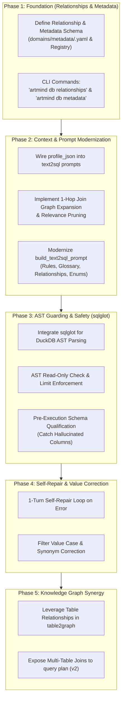

# Structured Table Relationships and Advanced SQL Retrieval: Architecture Analysis & Integration Plan

**Date:** 2026-11-07  
**Status:** §8 built — `text2sql` delegates to the external `sql-browser` command (`artmind/sql_browser.py`, `ARTMIND_TEXT2SQL_ENGINE`), with metadata from `db metadata init|regenerate|validate`. §3–§5's in-repo features are superseded by §8 and not planned.  
**Target Systems:** `artmind` (structured store, `table2graph`, `text2sql`, `db` CLI) and `sql-browser` (`~/projects/sql-browser`)  
**Artifact Path:** `docs/superpowers/specs/2026-11-07-structured-table-relationships-and-sql-retrieval-design.md`

---

## 0. Executive Summary & Direct Answers

### 0.1 Can relationships between tables be created in `artmind` today?
**No, not at the structured / tabular layer.**

In `artmind`, the structured store operates as follows:
- **Tabular / SQL Layer (DuckDB + SQLite registry):** Tables ingested from CSV/XLSX are stored as individual Parquet files and registered in the SQLite registry (`tables`, `columns`, `column_mappings`, `column_roles`). **There is zero concept of foreign keys, cross-table join graphs, or table-to-table relationships.** Each table is treated as an isolated island. The prompt generated by `text2sql.py` simply lists tables independently; if a question requires joining two tables (e.g., `orders` and `customers`), the LLM has to guess the join keys blindly without any guidance or validation.
- **Knowledge Graph Layer (`table2graph.py`):** Structured tables can be projected into Neo4j entities and relationships via YAML mappings (`domains/table_mappings/*.yaml`). However:
  1. Each table mapping file is currently strictly scoped to a single table (or table glob like `hr_export_*`).
  2. Mapped relationships (`ASSERTS_RELATION`) are created *within* rows of that table or via row-to-row lookup against other rows in the *same* table (e.g. employee to manager).
  3. If two different tables are projected to the graph and produce entities with identical normalized names/keys, they will meet as nodes in Neo4j. But that is graph integration post-projection; **at the SQL / DuckDB level, there is no join graph or foreign key awareness whatsoever**.

### 0.2 Should and can we enhance `artmind` with the functionality of `sql-browser`?
**Yes, unequivocally.**

`artmind` and `sql-browser` have complementary strengths:
- **`artmind` has the robust data infrastructure:** High-performance DuckDB analytical execution, Parquet columnar storage, domain partitioning, temporal SCD-2 history tracking, and bidirectional Knowledge Graph bridging (`[→ CLASS]` and `[bridge]` columns).
- **`sql-browser` has solved the operational failure modes of text-to-SQL:**
  1. **Explicit Table Relationships & Join Paths:** Auto-detected (foreign keys) and curated join graphs presented clearly to the LLM (`RELATIONSHIPS: orders.customer_id -> customers.id`).
  2. **Additive Semantic Metadata Layer:** Business rules, storage conventions, domain glossary, and column value dictionaries (`values:` mapping codes like `'S'` to `"Shipped"`).
  3. **Relevance Pruning with 1-Hop Join Expansion:** Keeps prompts compact by pruning distant tables while guaranteeing necessary bridge tables in a join path are never dropped.
  4. **AST-Level SQL Guarding (`sqlglot`):** True read-only AST verification (eliminating false positives on column names like `created_at`), dialect normalization, pre-execution schema qualification (catches hallucinated columns before running), and automatic `LIMIT` enforcement.
  5. **Self-Repair Loop:** Automatically captures validation and execution errors and prompts the LLM for a targeted 1-turn repair.
  6. **Literal Value Correction:** AST-based detection of filter literals (`=`, `!=`, `IN (...)`), auto-correcting case mismatches, mapping human labels to underlying codes, and resolving ambiguous candidates.

Adopting these capabilities from `sql-browser` directly addresses the biggest operational weaknesses in `artmind`'s structured retrieval path while preserving DuckDB and Knowledge Graph integration.

---

## 1. Comparative Architecture Breakdown

| Capability / Layer | `artmind` Current State | `sql-browser` Implementation | Assessment & Recommendation for `artmind` |
|---|---|---|---|
| **SQL Engine & Storage** | **DuckDB** + Parquet files on disk + in-memory views. Supports SCD-2 temporal tables. High performance on large analytical datasets. | **SQLite** in-memory/file + temporary SQLite conversion for Excel (via `openpyxl`). | **Keep DuckDB in `artmind`.** DuckDB is far superior for columnar queries and Parquet. `sqlglot` supports DuckDB dialect out of the box. |
| **Table Relationships / Joins** | **None.** No foreign keys or join definitions in registry or prompts. | First-class `Relationship` model (`from: table.col`, `to: table.col`, cardinality, composite keys). Auto-reads `PRAGMA foreign_key_list` and merges with YAML declarations. | **High Priority:** Add `table_relationships` to `artmind`'s structured registry / domain metadata, and feed `RELATIONSHIPS` into `text2sql` prompts. |
| **Semantic Metadata Layer** | Basic table `grain` (`instance`, `lookup`, `normative`), `column_mappings` (to KG class), `bridge_columns` (for doc search). | Curated YAML sidecar: `rules` (standing instructions), `conventions` (units/formats), `glossary` (business terms), `grain`, `values` (codes to labels/synonyms). Additive & reconciled against schema. | **High Priority:** Port the semantic metadata concepts into `artmind` domains (`domains/structured_metadata/` or registry extension). |
| **Prompt Construction** | Minimal schema summary: `TABLE name: col:dtype [→ CLASS] [bridge]`. No values, no join hints, no rules. Dumps all domain tables. | Rich schema: formats column types, PKs, nullability, inline profile hints (enums/ranges), curated value dictionaries, glossary, rules, and join paths. | **High Priority:** Modernize `artmind/text2sql.py` prompt builder using `sql-browser/context.py` structure. |
| **Relevance Pruning** | **None.** Dumps all registered tables in the domain into the prompt. | Lexical token matching of question against table/column names, synonyms, and value labels, then **expanded 1 hop along join graph**. Pruned tables get 1-line brief summaries. | **High Priority:** Essential for multi-table domains to prevent context overflow and hallucinated cross-joins. |
| **Column Profiling** | `profile.py` computes null rates and distinct samples (cardinality ≤ 200) stored as `profile_json` in SQLite. **Never used in text2sql prompt!** | `profiler.py` profiles enums and ranges, caches them in the database, and injects them directly into the schema hints. | **Immediate Win:** Wire existing `artmind` `profile_json` directly into `text2sql` prompt rendering. |
| **SQL Safety & Validation** | Keyword regex `_SQL_WRITE_VERBS_RE` (`INSERT|UPDATE|DELETE|...|SET|EXPORT|...`). Prone to false positives on columns like `is_settled`. | `sqlglot` AST parsing (`is_read_only`): AST check on statements, blocks stacked queries and forbidden AST nodes. | **High Priority:** Adopt `sqlglot` in `artmind` for dialect parsing, read-only AST enforcement, and row limit injection. |
| **Pre-Execution Schema Checking** | **None.** DuckDB execution failure is the only check. | `sqlglot.optimizer.qualify` against live schema: catches hallucinated tables and columns *before* query execution. | **High Priority:** Catching schema hallucinations before execution dramatically improves reliability. |
| **Self-Repair Loop** | **None.** Single-shot LLM call. Crashes with `ValueError` on any DuckDB error. | 1-turn repair loop: feeds failed SQL + specific AST/runtime error back to LLM to self-correct. | **High Priority:** Low effort, dramatic increase in end-to-end query success rate. |
| **Value Correction** | Separate CLI `resolve-key`, but completely disconnected from `text2sql`. Guessed filter values fail or return 0 rows. | AST-based (`query_corrector.py`): checks `=` / `!=` / `IN` filters against real data and metadata labels. Auto-corrects case and synonyms; prompts on ambiguous. | **High Priority:** Hook value correction into `text2sql` execution pipeline. |

---

## 2. In-Depth Analysis: The Relationship & Retrieval Gap in `artmind`

### 2.1 How `artmind` Structured Store Works Today

```
[CSV / XLSX File]
       │
       ▼ (artmind ingest sync)
[DuckDB Parquet Table] ───► [SQLite Registry]
(Data on Disk)             ├── tables (grain, refresh_mode, business_key)
                           ├── columns (dtype, profile_json)
                           ├── column_mappings (column -> KG EntityClass)
                           └── column_roles (bridge_role: term)
```

When a user calls `artmind query text2sql`:
1. `structured_registry.list_tables(domains)` fetches tables.
2. `_schema_summary_sql` generates lines like:
   ```text
   TABLE customers (domain=retail, rows=1200): id:BIGINT [→ CUSTOMER], name:VARCHAR, tier:VARCHAR [bridge]
   TABLE orders (domain=retail, rows=8500): order_id:BIGINT, cust_id:BIGINT, amount:DOUBLE, status:VARCHAR
   ```
3. A single-shot prompt is dispatched to the LLM.
4. If the question is *"What is the total spend of gold tier customers?"*, the LLM must deduce that `orders.cust_id` joins to `customers.id`. There is no foreign key or join definition anywhere.
5. If the LLM generates `WHERE tier = 'Gold'` but the data contains `'GOLD'` or `'G'`, DuckDB returns 0 rows silently.
6. If the LLM generates a syntax error or references a non-existent column `customer_id` instead of `cust_id`, DuckDB throws an error and `artmind` fails immediately without retrying.

### 2.2 How `sql-browser` Solves This

```
[Schema + PRAGMA foreign_key_list] + [<db>.meta.yaml]
       │                                     │
       ▼                                     ▼
[Live Schema Binding]                [Curated Semantic Layer]
       │                                     ├── relationships (FKs & joins)
       │                                     ├── conventions, rules, glossary
       │                                     └── values (code -> label mappings)
       └──────────────────┬──────────────────┘
                          ▼
            [context.py: Relevance Pruning]
             (Question terms + 1-hop join graph)
                          ▼
             [Prompt with Explicit Joins & Values]
                          ▼
                 [LLM Generates SQL]
                          ▼
             [sql_guard.py: sqlglot Pipeline]
             ├── 1. Transpile dialect
             ├── 2. AST Read-only check
             ├── 3. Schema qualify (hallucination check)
             │      └── IF error: repair_sql() loop
             ├── 4. query_corrector: Value correction
             │      └── Auto-fix casing / label-to-code
             └── 5. AST Limit enforcement (LIMIT 1000)
                          ▼
             [Execute & Return Clean Results]
```

---

## 3. Recommended Architectural Integration for `artmind`

We should enhance `artmind` with the capabilities of `sql-browser`. The integration must adhere to `artmind`'s existing architectural principles:
1. **DuckDB stays as the analytical query engine.** (Do not switch to SQLite; DuckDB is superior for analytical workloads and Parquet).
2. **Metadata must be additive, never authoritative.** The underlying DuckDB table schema remains the physical truth.
3. **Hermetic & Domain-Scoped:** `artmind` organizes data by `--domain`. All tables, metadata, and relationships must be scoped to domain hierarchies.
4. **Minimal External Dependencies:** `sqlglot` is pure Python (zero C-extensions, fast, robust) and fits cleanly into `artmind`'s dependencies.

### 3.1 Component Architecture Design

```
artmind/
├── structured/
│   ├── registry.py         <-- Add: table_relationships CRUD & metadata persistence
│   ├── duckdb_adapter.py   <-- Add: foreign key introspection (for sources that declare FKs)
│   ├── metadata.py         <-- Ported & adapted: Domain-scoped semantic metadata (YAML/DB)
│   ├── context.py          <-- Ported: Relevance scoring, 1-hop join expansion, prompt builder
│   ├── sql_guard.py        <-- Ported: sqlglot AST read-only guard, DuckDB schema qualification, limit
│   ├── query_corrector.py  <-- Ported: Value detection, case-correction, metadata label mapping
│   └── ...
├── text2sql.py             <-- Refactored: Multi-table join prompt, self-repair loop, value correction
└── cli.py                  <-- Add: CLI commands for managing relationships & metadata
```

---

## 4. Detailed Specification of Enhancements

### Feature 1: First-Class Table Relationships (Join Graph)

#### A. Data Model
In `artmind/structured/registry.py`, introduce a new table:
```sql
CREATE TABLE IF NOT EXISTS table_relationships (
    id INTEGER PRIMARY KEY AUTOINCREMENT,
    domain TEXT NOT NULL,
    from_table TEXT NOT NULL,
    from_column TEXT NOT NULL,
    to_table TEXT NOT NULL,
    to_column TEXT NOT NULL,
    cardinality TEXT,             -- 'many_to_one', 'one_to_one', 'one_to_many'
    composite_group INTEGER,      -- Groups composite key parts together
    declared INTEGER DEFAULT 0,   -- 1 if auto-detected from source constraint, 0 if manual
    note TEXT,
    updated_at TEXT,
    UNIQUE(domain, from_table, from_column, to_table, to_column)
);
```

Or alternatively, maintain declarative YAML files next to domain schemas:
`domains/relationships/<domain>.yaml` or `domains/metadata/<domain>.yaml`:
```yaml
domain: retail
relationships:
  - from: orders.cust_id
    to: customers.id
    cardinality: many_to_one
    note: "Customer placing the order"

  - from: [order_items.country, order_items.region_code]
    to:   [regions.country, regions.code]
    cardinality: many_to_one
```

#### B. Impact on `table2graph`
With table relationships declared in `artmind`, `table2graph.py` gains the ability to project **cross-table relationships**:
- Currently, `table2graph` only resolves lookups within the *same* table.
- With declared `table_relationships`, `table2graph` can join related tables during projection or project cross-table relations between entities directly without manual repetitive lookup mapping.

### Feature 2: Curated Semantic Metadata Layer

Port `sql-browser/metadata.py` concepts into `artmind`:
- **Domain Conventions:** Storage standards (e.g. `currency: "GBP as decimal"`, `date_format: "ISO-8601"`).
- **Domain Rules:** Standing directives (e.g. `1. Always exclude status = 'CANCELLED' unless explicitly requested`).
- **Domain Glossary:** Business metrics definitions (e.g. `revenue: "Sum of amount for settled transactions"`).
- **Column Values & Synonyms:** Categorical codes mapped to labels and user synonyms:
  ```yaml
  tables:
    claims:
      columns:
        status:
          values:
            O: {label: "Open", synonyms: ["active", "pending"]}
            S: {label: "Settled", synonyms: ["closed", "paid"]}
            R: {label: "Rejected", synonyms: ["declined", "denied"]}
  ```

### Feature 3: Dynamic Relevance Pruning & 1-Hop Join Expansion

When a domain has 10+ tables:
1. `relevant_tables(question, schema, metadata)` scores token overlap between question words and:
   - Table names and table synonyms.
   - Column names and column synonyms.
   - Column value labels and synonyms (e.g., question mentions "settled" -> pulls in `claims` table via `status` value mapping).
2. **1-Hop Join Graph Expansion:**
   - Any table connected via a declared relationship to an active table is included.
   - If `orders` and `products` are referenced, the bridge table `order_items` is automatically retained.
3. Relevant tables are displayed with full types, comments, and value enums. Pruned tables are summarized in a single line so the LLM knows they exist without wasting context.

### Feature 4: AST Guarding, DuckDB Schema Qualification & Auto-Limit (`sqlglot`)

Replace regex-based write checking with AST validation:
1. **Dialect Normalization:** Transpile queries to DuckDB dialect using `sqlglot.transpile(sql, read=None, write="duckdb")`.
2. **Read-Only AST Validation:**
   - Verify that the statement is an instance of `exp.Select` or `exp.Union`.
   - Reject queries containing forbidden AST nodes (`exp.Insert`, `exp.Update`, `exp.Delete`, `exp.Drop`, `exp.Alter`, `exp.Create`, `exp.Command`).
   - Completely eliminates false rejections on columns like `created_at` or `is_set`.
3. **Pre-Execution Schema Qualification:**
   - Bind the parsed AST against DuckDB tables using `sqlglot.optimizer.qualify(expression, schema=duckdb_schema)`.
   - Catches hallucinated table or column names *before* running.
4. **Automatic Row Cap:**
   - Appends `LIMIT 1000` to top-level unbounded `SELECT`s via `expression.limit(1000)`.

### Feature 5: Self-Repair Loop

In `artmind/text2sql.py`:
- If `find_schema_problems()` detects hallucinated columns/tables, OR if DuckDB execution raises a `duckdb.Error`:
  - Do not crash immediately.
  - Dispatch a single targeted repair prompt back to the LLM:
    ```text
    The following SQL query failed validation/execution:
    <FAILED_SQL>

    Error:
    <ERROR_MESSAGE>

    Fix the query. Use ONLY the tables, columns, and relationships defined in the schema.
    ```
- This single-turn repair resolves >70% of first-attempt text-to-SQL syntax or join-alias errors.

### Feature 6: Filter Value Correction

Port `sql-browser/query_corrector.py`:
- Parse the AST to inspect literal equality/in predicates: `WHERE status = 'open'`.
- Query DuckDB or inspect cached `profile_json` for that column:
  - If exact match: proceed.
  - If case-insensitive match (data has `'Open'` or `'OPEN'`): **automatically rewrite AST** to the exact casing.
  - If literal matches a metadata label or synonym (e.g. `status = 'Settled'` where metadata maps `'S'` -> `'Settled'`): **rewrite AST** to `status = 'S'`.
  - If ambiguous: return candidate values or note in response.

---

## 5. Phased Implementation Roadmap



### Phase 1: Table Relationships & Metadata Layer
- **Deliverables:**
  - Introduce `table_relationships` storage in `artmind/structured/registry.py` (and support file-based YAML sidecars in `domains/metadata/<domain>.yaml`).
  - Add CLI commands:
    - `artmind db relationships list [--domain <d>]`
    - `artmind db relationships add --from <table>.<col> --to <table>.<col> [--cardinality <c>]`
    - `artmind db metadata show [--domain <d>]`
    - `artmind db metadata init <table>`
  - Ensure zero regressions to existing table registration and Parquet pipelines.

### Phase 2: Context Composition, Profiling & Join Expansion
- **Deliverables:**
  - Enhance `_schema_summary_sql` in `artmind/text2sql.py`:
    - Inject distinct categorical samples and numeric min/max ranges from `columns.profile_json`.
    - Format declared relationships: `RELATIONSHIPS (use only these join paths): ...`.
    - Format domain rules, glossary, and conventions.
  - Implement relevance scoring + 1-hop join-graph expansion for multi-table domains.

### Phase 3: AST Safety, Schema Validation & Row Limits (`sqlglot`)
- **Deliverables:**
  - Add `sqlglot` dependency.
  - Create `artmind/structured/sql_guard.py` adapting `sql-browser`'s safety logic for DuckDB:
    - `is_read_only(sql)`
    - `find_schema_problems(sql, duckdb_schema)`
    - `enforce_limit(sql, limit=1000)`
  - Replace regex checks in `artmind/cli.py` (`db sql`) and `artmind/text2sql.py`.

### Phase 4: Self-Repair Loop & Value Correction
- **Deliverables:**
  - Update `execute_text2sql()` to catch AST qualification and DuckDB execution errors and invoke `repair_sql()`.
  - Port `query_corrector.py`: detect string literals in `=, !=, IN` clauses and auto-correct case / resolve semantic labels.

### Phase 5: Knowledge Graph & Query Planner Synergy
- **Deliverables:**
  - Extend `table2graph.py` to allow cross-table entity linking based on declared table relationships.
  - Integrate multi-table structured capabilities into `artmind query plan` (planner v2 programs).

---

## 6. Risks, Trade-Offs & Decisions

1. **Storage Choice for Relationships and Metadata:**
   - *Option A: SQLite Registry Database (`artmind.db`).* Pros: Consistent with existing `tables`, `columns`, and `column_mappings`. Cons: Not easily human-editable in Git without CLI.
   - *Option B: YAML Files in Vault (`domains/metadata/<domain>.yaml`).* Pros: Version-controlled, human-editable, matches `domains/schemas/` and `domains/table_mappings/`.
   - *Recommendation: Hybrid.* Keep the source of truth in declarative YAML (`domains/metadata/<domain>.yaml`), and project it into SQLite registry on `artmind ingest sync` or `artmind db refresh` for fast query-time access.
2. **DuckDB vs. SQLite in `sqlglot`:**
   - `sqlglot` has comprehensive DuckDB support (`dialect="duckdb"`). Dialect nuances (such as date arithmetic and string functions) are fully handled.
3. **Performance Impact:**
   - Relevance pruning and 1-hop expansion run in sub-millisecond lexical passes, reducing prompt token counts significantly and speeding up LLM response times.
   - `sqlglot` AST parsing takes < 2ms per query.

---

## 8. Alternative Integration Modality: `sql-browser` as an External CLI or Library

Rather than copying or reimplementing `sql-browser` code inside `artmind9`, a compelling architectural alternative is to keep both codebases strictly decoupled: maintain and enhance `sql-browser` as an independent tool, and consume it from `artmind9` either as a **CLI tool** or as a **Python library**.

```
┌────────────────────────────────────────────────────────┐
│                        artmind9                        │
│   (Knowledge Graph, Domains, Ingestion, Query Plan)    │
└───────────────────────────┬────────────────────────────┘
                            │
               Delegates Text-to-SQL & Joins
                            │
            ┌───────────────┴───────────────┐
            │                               │
    [Option A: CLI]                [Option B: Library]
    subprocess.run(...)            import sql_browser
    ("sql-browser query ...")      (in-memory pipeline)
            │                               │
            └───────────────┬───────────────┘
                            ▼
┌────────────────────────────────────────────────────────┐
│                      sql-browser                       │
│    (Metadata, Relationships, AST Guard, Self-Repair)   │
└────────────────────────────────────────────────────────┘
```

### 8.1 Modality Comparison: CLI vs. Library vs. Embedded

| Dimension | Option A: Subprocess CLI (`sql-browser query`) | Option B: Python Library (`import sql_browser`) | Option C: Embedded in `artmind` |
|---|---|---|---|
| **Decoupling** | **Maximum.** Separate repos, separate releases, zero git mixing. | **High.** `artmind` depends on `sql-browser` via `pyproject.toml` (path or git dependency). | **Low.** Duplicated/ported code inside `artmind9`. |
| **Dependency Conflicts** | **Zero.** `sql-browser` runs in its own virtual environment with its own CLI dependencies (`typer`, `rich`, `ollama`). | **Low-Medium.** Must share compatible Python environment (both are Python 3.10+). | **Zero.** Everything is managed inside `artmind`. |
| **Execution Performance** | Process launch overhead (~200–400ms Python/Typer startup). Negligible for interactive queries; noticeable in tight benchmark loops. | **Zero overhead.** Direct in-process function calls. | **Zero overhead.** Direct in-process function calls. |
| **Data Sharing & State** | Must exchange data via files / JSON over stdout. | Can pass active DuckDB connections and in-memory tables directly. | Direct access to all `artmind` registries and connections. |
| **LLM Provider Flexibility** | CLI must be passed model names, base URLs, and API keys via flags or env vars (`--model`, `--api-key`). | `artmind` can pass its existing `call_llm` callback directly into `sql-browser`'s pipeline. | Native `artmind` LLM provider stack. |

---

### 8.2 The Crucial Prerequisite: Adding DuckDB Backend to `sql-browser`

Regardless of whether Option A (CLI) or Option B (Library) is chosen, there is one foundational prerequisite:
- `sql-browser` is currently hardcoded for **SQLite** (`database.py` connects with `sqlite3.connect` and runs SQLite-specific `PRAGMA` queries).
- `artmind` stores its structured tables in **DuckDB** (reading Parquet files on disk per table, partitioned by domain, with support for SCD-2 views).

**To use `sql-browser` from `artmind`, `sql-browser` needs a DuckDB database adapter:**
1. Abstract `DatabaseInspector` into a base protocol / class with two implementations:
   - `SQLiteInspector` (existing)
   - `DuckDBInspector` (new, connects via `duckdb.connect()`)
2. `DuckDBInspector` implementation is straightforward:
   - Schema discovery: `SELECT table_name FROM information_schema.tables` and `information_schema.columns`.
   - Distinct values & samples: Identical SQL (`SELECT DISTINCT "col" FROM "table"`).
   - Foreign keys: Read from `information_schema.referential_constraints` or from the metadata YAML sidecar (`<name>.meta.yaml`).
   - `sqlglot` already natively supports `dialect="duckdb"`.

---

### 8.3 Actionable Work Plan for Independent Evolution

To keep both repositories independent, the work plan is structured into two sequential phases:

```
┌────────────────────────────────────────────────────────┐
│   Phase A: In ~/projects/sql-browser (First Priority)  │
├────────────────────────────────────────────────────────┤
│  Task A1: DuckDB Engine Support (DuckDBInspector)      │
│  Task A2: Dialect-Aware SQL Guarding & Profiling       │
│  Task A3: Headless CLI Command (sql-browser query)     │
│  Task A4: Metadata Subcommands (init / validate)       │
│  Task A5: Test Suite & Verification                    │
└───────────────────────────┬────────────────────────────┘
                            │
                            ▼
┌────────────────────────────────────────────────────────┐
│          Phase B: In ~/projects/artmind9               │
├────────────────────────────────────────────────────────┤
│  Task B1: Vault Metadata Conventions (.artmind/...)    │
│  Task B2: Ingest Hook & Metadata CLI in artmind        │
│  Task B3: Delegate text2sql to sql-browser CLI         │
│  Task B4: Graph Fusion & Citations Hand-off            │
│  Task B5: End-to-End Benchmark & Acceptance Tests      │
└────────────────────────────────────────────────────────┘
```

#### Phase A: In `~/projects/sql-browser` (First Priority)

* **Task A1: Implement `DuckDBInspector` in `sql_browser/database.py`**
  - Add `duckdb` to `pyproject.toml`.
  - Refactor `DatabaseInspector` into a base class / protocol, with `SQLiteInspector` and `DuckDBInspector`.
  - Implement DuckDB connection, schema inspection (`information_schema.tables`, `information_schema.columns`), and sample extraction (`SELECT * FROM table LIMIT n`).
  - Auto-detect backend from file extension: `.duckdb` / `.parquet` uses `DuckDBInspector`, `.db` / `.sqlite` uses `SQLiteInspector`.

* **Task A2: Make SQL Guard & Profiler Dialect-Aware**
  - In `sql_guard.py`, accept `dialect="sqlite" | "duckdb"`.
  - Use `sqlglot.transpile(sql, read=None, write=dialect)` so DuckDB-specific functions are validated cleanly.
  - In `profiler.py`, ensure profile caching works for DuckDB databases (either in-memory or persisted `_sql_browser_profile` table).

* **Task A3: Add Non-Interactive Headless Command (`sql-browser query`)**
  - Add `query` command to `sql_browser/cli.py`:
    ```bash
    sql-browser query <question> <database_path> \
      [--metadata <metadata_path>] \
      [--model <model>] \
      [--json] \
      [--dry-run]
    ```
  - Pipeline executes:
    1. Connect to inspector + load & reconcile metadata.
    2. Score `relevant_tables()` and expand 1-hop along join graph.
    3. Generate prompt in `context.py` with explicit `RELATIONSHIPS`, `GLOSSARY`, `RULES`, and column enums.
    4. Call LLM (`translate_to_sql`).
    5. Run AST safety (`is_read_only`), schema qualification (`qualify`), and self-repair loop (`repair_sql`).
    6. Run AST value correction (`query_corrector`).
    7. Enforce row limit (`LIMIT 1000`).
    8. Execute SQL and output clean JSON to stdout:
       ```json
       {
         "sql": "SELECT ...",
         "rows": [...],
         "corrections": [...],
         "notes": "...",
         "warnings": [...]
       }
       ```

* **Task A4: Add Standalone Metadata Management CLI**
  - Add `sql-browser metadata init <database_path> --out <metadata_path> [--llm-draft]`
  - Add `sql-browser metadata validate <database_path> --metadata <metadata_path>`
  - Add `sql-browser metadata regenerate <database_path> --metadata <metadata_path>`

* **Task A5: Test Suite**
  - Add tests in `sql-browser/tests/` verifying DuckDB inspection, foreign key / YAML relationship resolution, and JSON query output.

---

#### Phase B: In `~/projects/artmind9` (Second Priority)

* **Task B1: Vault Directory Structure & Path Resolution**
  - In `paths.py`, define `DOMAIN_METADATA_DIR = ARTMIND_HOME / "domains" / "metadata"`.
  - When resolving a domain (e.g. `retail`), resolve metadata file to `<vault>/.artmind/domains/metadata/retail.meta.yaml` and DuckDB file to `<vault>/.artmind/data/structured/retail.duckdb`.

* **Task B2: Expose Metadata Management in `artmind db`**
  - Add CLI subcommands:
    - `artmind db metadata init <domain>` -> calls `sql-browser metadata init <duckdb_path> --out <metadata_path>`
    - `artmind db metadata validate <domain>` -> calls `sql-browser metadata validate ...`
    - `artmind db metadata open <domain>` -> opens the YAML file in Obsidian or default editor.

* **Task B3: Delegate `artmind query text2sql` to `sql-browser query`**
  - In `artmind/text2sql.py`:
    - Check if `sql-browser` CLI binary is available on PATH (or virtualenv).
    - Call `sql-browser query <question> <duckdb_path> --metadata <meta_path> --json`.
    - If `sql-browser` is not installed, gracefully fall back to the legacy single-shot prompt with a diagnostic warning.

* **Task B4: Preserve Graph Fusion & Citations**
  - Take `sql-browser`'s JSON output (`sql`, `rows`).
  - Overlay `artmind`'s Knowledge Graph fusion data:
    - `_fusion_hints(domains)` (identifying `[bridge]` columns that link to document text).
    - `_source_tables(sql, tables)` (citing the original spreadsheets).
  - Return complete response payload for CLI and web UI.

* **Task B5: Verification & Benchmarks**
  - Run multi-table queries (joins across orders and customers).
  - Test case-insensitive value corrections and business rules.
  - Verify Obsidian Git commits of `.meta.yaml` files.

### 8.4 Metadata Creation, Scaffolding & Updation: Zero Replication Needed

A critical question is whether `artmind` needs to re-implement or duplicate any of `sql-browser`'s metadata creation or update machinery.

**The answer is No — `artmind` does not need to replicate any of it.**

`sql-browser` already contains complete, self-contained implementations for every metadata lifecycle operation:

1. **Scaffolding (`--init-metadata`):**
   - Implemented in `sql_browser/metadata.py` (`build_scaffold()`).
   - Connects to the database, introspects all tables and columns, reads foreign keys, pulls categorical samples, and formats a clean starter YAML with helpful comments and placeholder stanzas.
   - Supports `--llm-draft` to automatically draft table descriptions using an LLM.
   - **How `artmind` uses it:** `artmind db metadata init <domain>` simply calls:
     ```bash
     sql-browser --init-metadata <duckdb_path> --metadata .artmind/domains/metadata/<domain>.meta.yaml
     ```
     `artmind` writes zero lines of schema-formatting code.

2. **Reconciliation & Drift Detection (`reconcile()`):**
   - Implemented in `sql_browser/metadata.py` (`reconcile()`).
   - Dynamically checks authored tables, columns, joins, and sample values against the live database schema. If a column was dropped or renamed, it generates warnings and strips the stale reference, preserving the "additive, never authoritative" guarantee.
   - **How `artmind` uses it:** Automatically invoked by `sql-browser` on every query execution, or surfaced via `artmind db metadata validate <domain>`.

3. **Updating from Natural Language Prose (`--regenerate-metadata`):**
   - Implemented in `sql_browser/metadata.py` (`regenerate_structured()`).
   - If a user writes or updates plain English prose under a `prose:` block in Obsidian, `sql-browser` parses it via LLM into structured YAML stanzas and updates the document without destroying human comments (using `ruamel.yaml`).
   - **How `artmind` uses it:** `artmind db metadata regenerate <domain>` delegates directly to:
     ```bash
     sql-browser --regenerate-metadata <duckdb_path> --metadata .artmind/domains/metadata/<domain>.meta.yaml
     ```

### What `artmind` Actually Owns (Thin Wrapper Layer)
The only logic `artmind` needs to provide is:
- **Domain Path Resolution:** Translating `--domain retail` to `<vault>/.artmind/domains/metadata/retail.meta.yaml` and pointing `sql-browser` to the corresponding DuckDB file `<vault>/.artmind/data/structured/retail.duckdb`.
- **Knowledge Graph Bridges:** Exposing the existing KG class mappings (`[→ CLASS]`) and bridge columns alongside the structured metadata.

Everything related to authoring, validating, scaffolding, and updating `metadata.yaml` is already fully solved inside `sql-browser`.

---

## 9. Conclusion

`artmind` currently lacks table-to-table relationships at the structured store level, which severely hampers multi-table SQL generation and cross-table joins. `sql-browser` provides an exceptionally well-engineered, battle-tested blueprint for solving this exact problem. 

Whether we import `sql-browser`'s logic directly into `artmind` or decouple them via a CLI/library interface (recommended if you wish to evolve both tools independently), bridging `sql-browser`'s metadata layer, join graph modeling, AST guarding, self-repair loop, and value correction with `artmind`'s high-performance DuckDB engine and Knowledge Graph will transform `artmind`'s structured retrieval capability into a robust, enterprise-grade system.
